<p align="center">
  
  
  
  <a href="CHANGELOG.md"></a>
  
  
</p>

<h1 align="center">DockGate</h1>

<p align="center">
  <strong>Self-hosted Docker control panel — for your local daemon and a fleet of remote hosts over SSH.</strong><br>
  Manage containers, build &amp; deploy, provision fresh servers, monitor hosts, and get alerts — from one clean browser UI.
</p>

<p align="center">
  <a href="#quick-start">Quick Start</a> &middot;
  <a href="#screenshots">Screenshots</a> &middot;
  <a href="#features">Features</a> &middot;
  <a href="#notifications--edge-agent">Notifications</a> &middot;
  <a href="#architecture">Architecture</a> &middot;
  <a href="#security">Security</a> &middot;
  <a href="#api-reference">API</a>
  <br>
  <a href="CHANGELOG.md">📋 Changelog</a>
</p>

---

## What is DockGate?

DockGate started as a lightweight, browser-based Docker UI and has grown into a **self-hosted DevOps + server-management panel**. It runs as a single container, connects to your **local** Docker socket *and* to any number of **remote Docker hosts over SSH**, and lets you operate all of them from one place — behind a single admin login.

- **One panel, many hosts** — switch the active server in the sidebar; the whole UI (containers, images, logs, terminal…) follows it.
- **Run & deploy** — launch containers from a guided form, build images, create & edit Compose projects, and deploy from an App-Templates marketplace.
- **Server management** — add SSH hosts, **provision a fresh server** (update, Docker, fail2ban, swap, firewall, SSH-hardening, deploy user) with one click, create a **non-root deploy user** with an SSH key, manage **SSH access** (root login, password login, port), **users & keys** and the **firewall incl. Docker ports**, **monitor the host** (CPU/RAM/disk/net/load + host logs), and manage system **services** from a console.
- **Alerts that survive** — Telegram + email notifications on container die/crash/OOM/restart/unhealthy/start/pause/unpause/disk, plus an optional **outbound-only Edge Notifier agent** that keeps alerting even if DockGate itself is offline.
- **Authenticated & audited** — single admin password (scrypt + signed session cookie), encrypted SSH/registry/channel secrets at rest, and a full audit log of every change.
- **Lightweight** — runs in **≤256 MB RAM / ≤0.5 CPU**; vanilla-JS frontend, no build step, fully air-gappable.

> **Honest scope:** DockGate is **single-admin** today — one password, full control. There is no multi-user / RBAC / per-tenant data isolation (yet). See [Security](#security) and [Limitations](#limitations).

---

## Quick Start

**Prerequisites:** Docker Engine + the Docker Compose plugin.

### Option 1 — Pre-built image (recommended)

```bash
mkdir dockgate && cd dockgate
curl -O https://raw.githubusercontent.com/Ali7Zeynalli/dockgate/main/docker-compose.yml
docker compose up -d
```

### Option 2 — Build from source (development)

```bash
git clone https://github.com/Ali7Zeynalli/dockgate.git
cd dockgate
docker compose -f docker-compose.yml -f docker-compose.dev.yml up -d --build
```

Open **http://localhost:7077**. On first run you'll be asked to **set an admin password** (min 8 chars) — after that, every visit requires login.

### Update

Built-in: **Settings → Software Update → Update Now** (pulls the latest image and recreates the container in place). Or manually:

```bash
docker compose pull && docker compose up -d
```

> Source builds don't auto-update — `git pull` and rebuild.

### ⚠️ Note — container restart-loops on SELinux-confined Docker

On most systems (Ubuntu, Debian, Docker Desktop, **Fedora/RHEL with Docker CE**) DockGate runs with no extra steps. If instead the container **restart-loops on first start** with one of:

```
SqliteError: unable to open database file        (code: SQLITE_CANTOPEN)
[EventMonitor:local] Failed to connect: connect EACCES /var/run/docker.sock
```

…then your **Docker daemon is configured to confine containers with SELinux** (as `container_t`), which blocks the bind-mounted Docker socket and the `data/` directory — even though the container runs as root (this is SELinux MAC, not file permissions). **This is a host Docker setting, not a DockGate bug** — the same Compose file works unchanged on standard Docker CE.

**Confirm it:**

```bash
docker info --format '{{.SecurityOptions}}'   # if it lists "selinux", that's the cause
```

**Recommended fix** — make Docker behave like standard Docker CE (one line, host-wide, fixes *every* container, not just DockGate):

```bash
# Set "selinux-enabled": false in /etc/docker/daemon.json, then restart Docker
sudo sed -i 's/"selinux-enabled": *true/"selinux-enabled": false/' /etc/docker/daemon.json
sudo systemctl restart docker
```

> **openSUSE Leap 16** ships `/etc/docker/daemon.json` with `"selinux-enabled": true` by default, so you hit this out of the box there.

**Alternative** — if you'd rather keep SELinux-confined Docker, leave the daemon alone and add this to the `dockgate` service in `docker-compose.yml` instead (it's a harmless no-op on non-SELinux hosts):

```yaml
    security_opt:
      - label:disable
```

> ⚠️ Never add `:z`/`:Z` to the `/var/run/docker.sock` mount — relabeling the host's Docker socket can break Docker on the host.

---

## Screenshots

| | |
|:--:|:--:|
| **Login** — single admin password gate | **Dashboard** — active host's Docker + metrics |
| 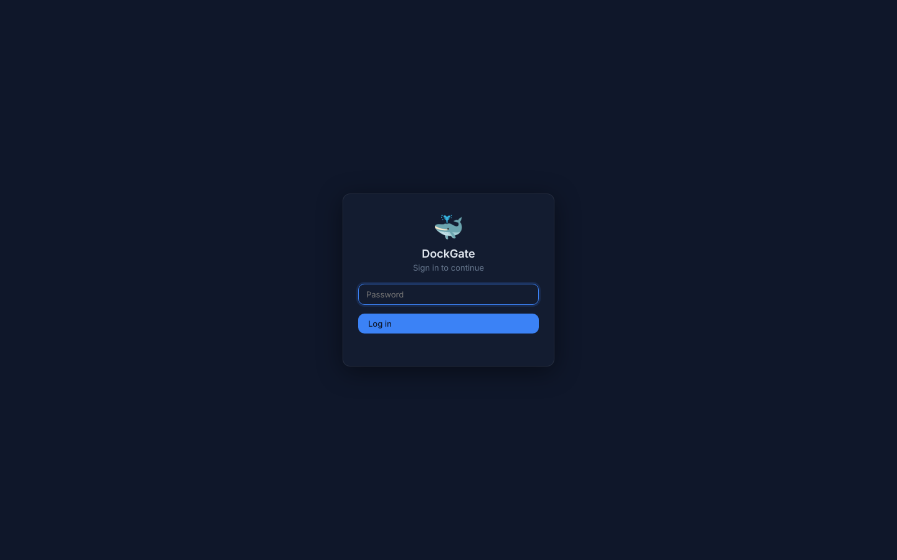 | 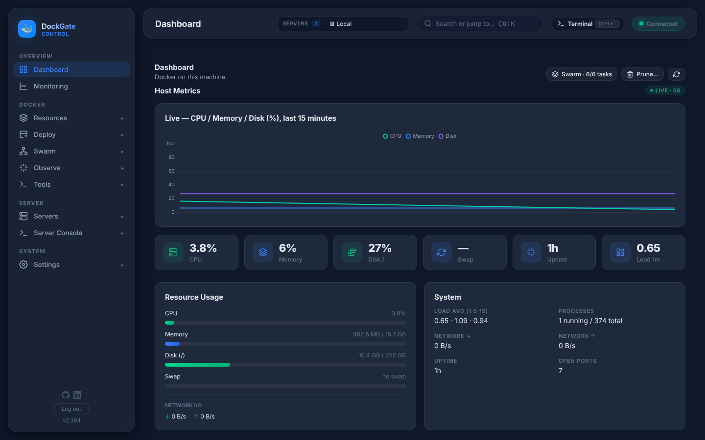 |
| **Containers** — filters, bulk actions, compose grouping | **Images** — pull/push, layers, tags, run |
| 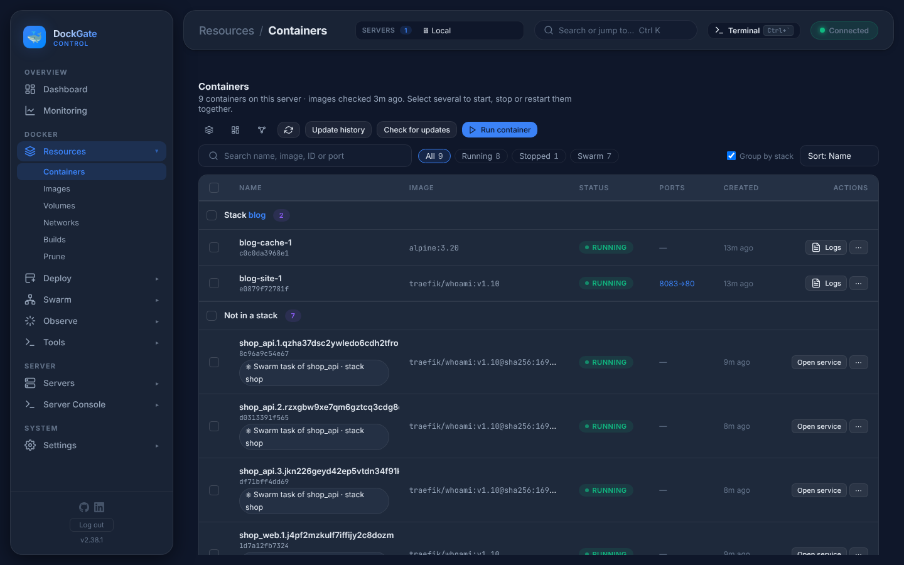 | 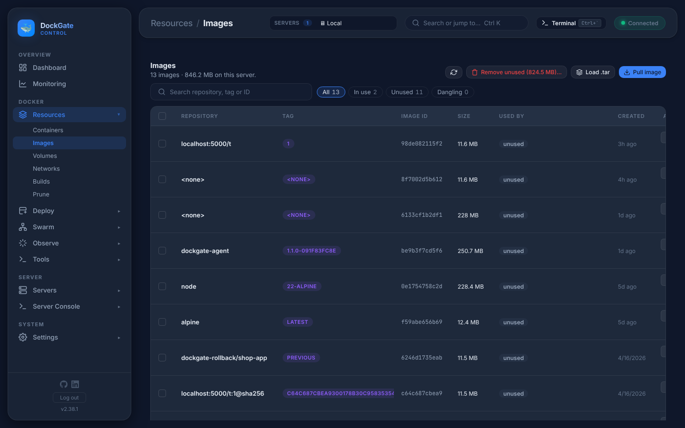 |
| **Containers · Topology** — read-only live graph of the running stack | |
| 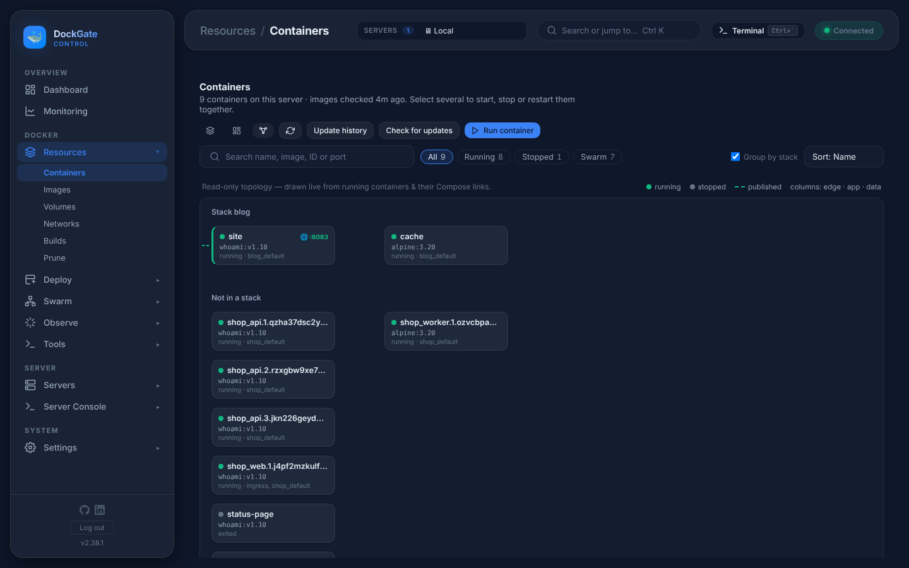 | |
| **Networks** — drivers, subnets, attach/detach | **Compose** — discover, create & edit projects |
| 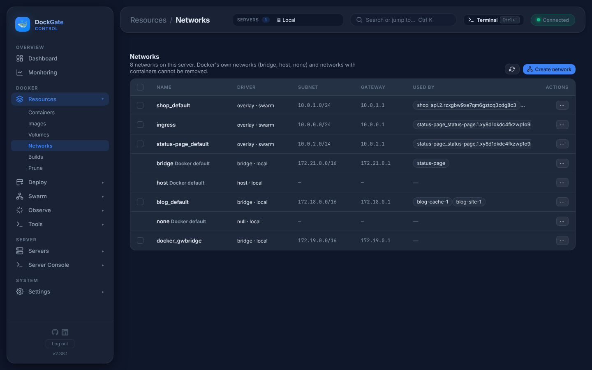 | 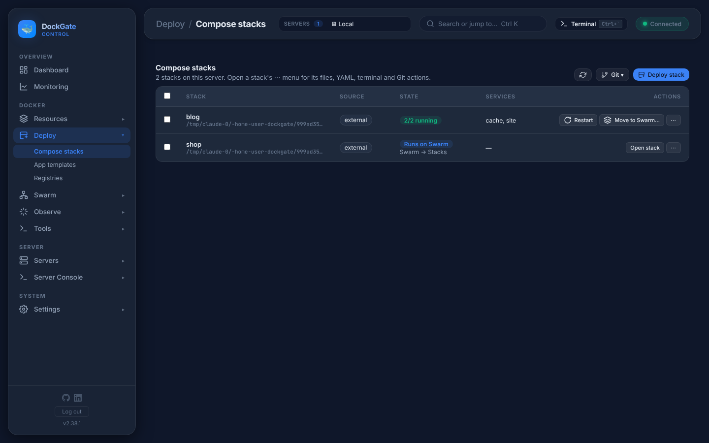 |
| **App Templates** — deploy-ready marketplace | **Terminal** — container exec + host SSH shell |
| 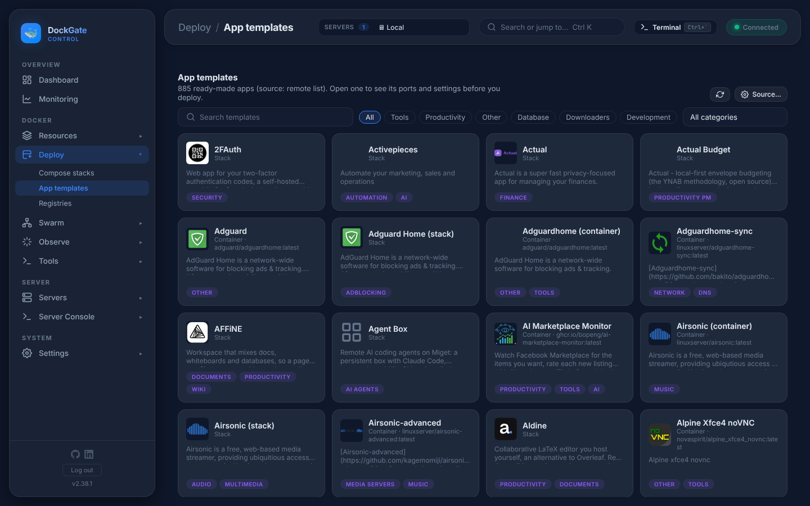 | 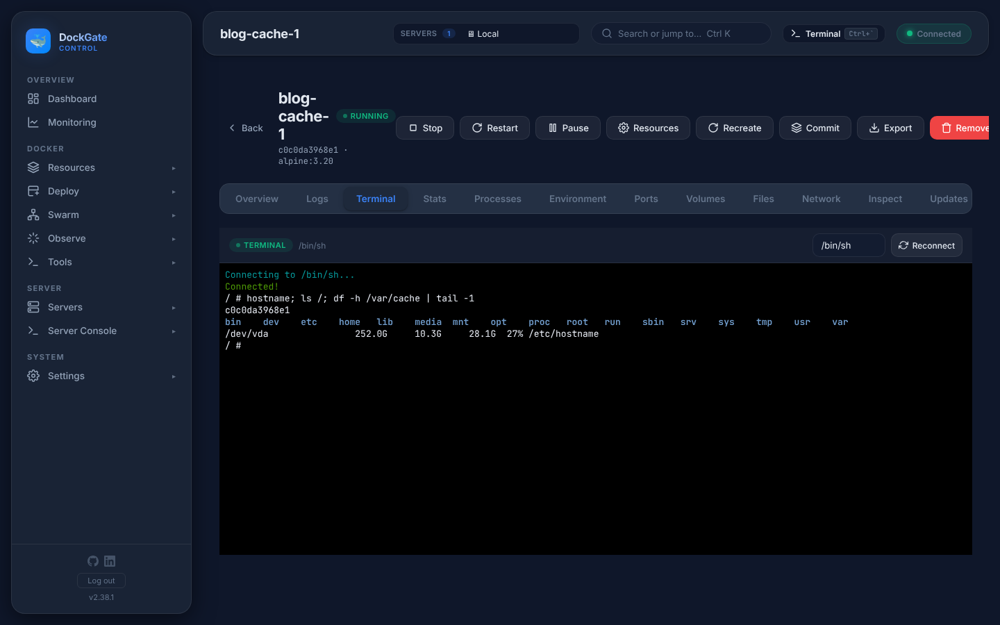 |
| **Audit Log** — every change, host & source IP | **Infrastructure** — SSH servers, registries, provisioning |
| 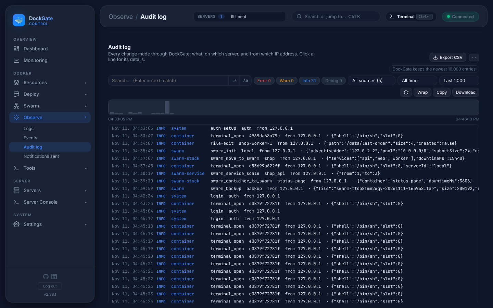 | 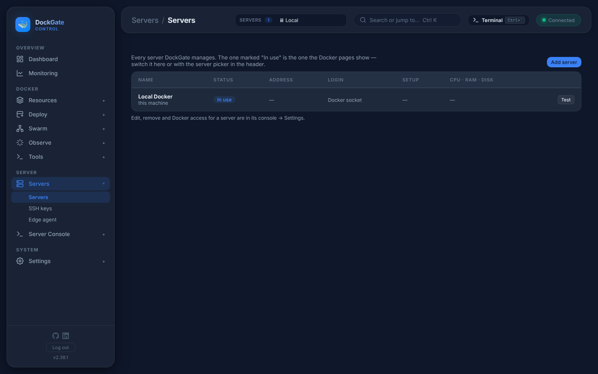 |
| **Server Console** — host services & host logs | **Notifications** — channels, rules, Edge Notifier |
| 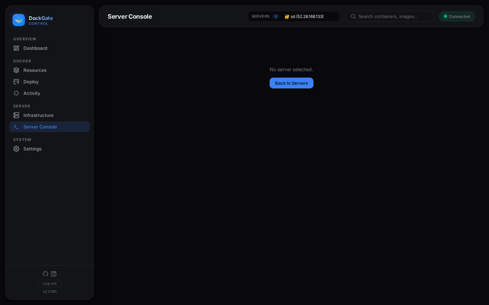 | 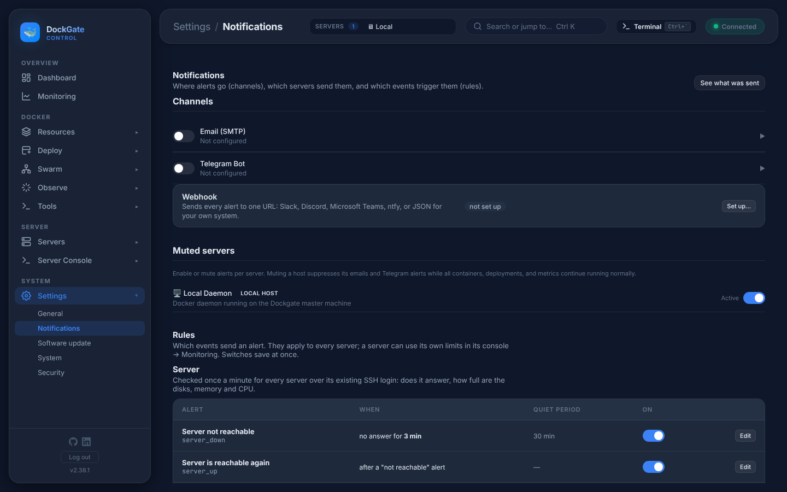 |
| **Security** — change the admin password | **System** — Docker engine & host info |
| 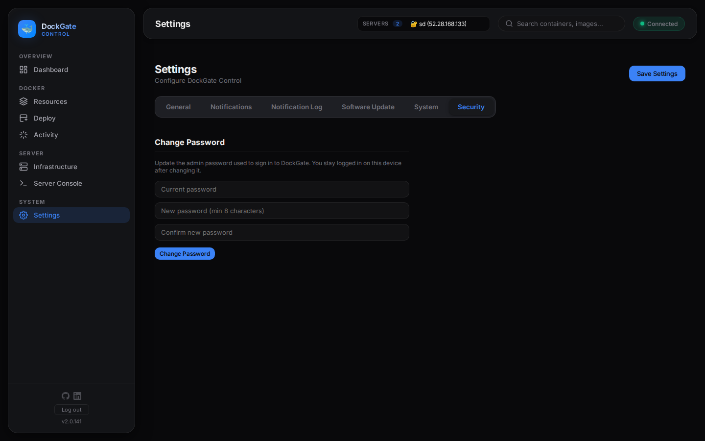 | 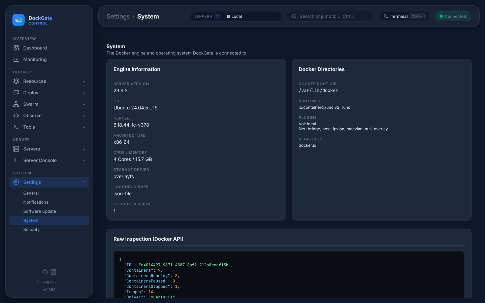 |

---

## Features

The sidebar is grouped into **Overview · Docker · Server · System**.

### 📊 Overview — Dashboard

At-a-glance view of the **active** server: count cards (containers/running/stopped/images/volumes/networks/compose), **Quick Actions** (start-all / stop-all / restart-all), top-5 CPU & memory bars, network I/O, health doughnut, uptime & restart counts, disk-usage breakdown, port map, top images by size, and **Smart Insights** (old stopped containers, unused/dangling images, detached volumes → click through to Prune). For a **remote** server it also embeds a live host-metrics block (CPU/RAM/disk/trend/ports/procs). Auto-refreshes every 30 s.

### 🐳 Docker

<details open>
<summary><strong>Resources</strong> — Containers · Images · Volumes · Networks · Builds · Prune</summary>

- **Containers** — table/card/**topology** views, filters (All/Running/Stopped/Restarting/Paused), search & sort, **group-by-compose**, favorites/notes/tags, per-row **start/stop/restart/logs/terminal/inspect/remove**, multi-select **bulk** actions, and the guided **Run Container** modal (image w/ Hub search, ports, volumes w/ presets, env w/ "paste .env", restart policy, network, CPU/memory). The **Topology** view is a read-only graph drawn live from the running containers — grouped by Compose project, edges from `depends_on` (falling back to shared networks), published ports flagged public; click a node to open its detail. A **newer-image check** (daily and on demand) compares each container's tag with its registry and offers **Update** (pull and recreate; only the service in a stack).
- **Container detail** — lifecycle (start/stop/restart/pause/unpause/remove), **live update** CPU/memory/restart-policy, **Recreate** (new image, keep config), **Commit**, **Export** to tar; tabs: Overview (+health), Logs, Terminal, Stats (live charts), Processes (+one-off exec), Environment, Ports, Volumes, Network (connect/disconnect), Files (browse/download/upload), Inspect (raw JSON), History.
- **Images** — list (in-use/unused/dangling), **pull** (auto-auth via stored registry creds) & **Docker Hub search**, **push**, **layers/history**, **tags** (add/untag), **save** to tar, **build-from** (inline Dockerfile), remove.
- **Builds** — build from Dockerfile / inline / Git with **live streaming log**, build history, build cache (grouped) & prune, buildx builders.
- **Volumes** — create (driver/opts/labels), **backup/restore** (.tar.gz), **clone**, browse files, remove.
- **Networks** — create (bridge/macvlan/ipvlan/overlay, subnet/gateway/internal/attachable/IPv6), inspect, **clone**, connect/disconnect containers, remove.
- **Prune** — one table of unused data (stopped containers, unused images, build cache, unused networks, unused volumes) with what each removes and how much space it frees; pick rows and prune them together, or run a full system prune from the danger zone. Volumes are never pre-selected.
</details>

<details>
<summary><strong>Deploy</strong> — Compose stacks · App templates · Registries</summary>

- **Compose** — auto-discovers projects via the `com.docker.compose.project` label (incl. remote, and DOWN managed projects); **create & edit** in a browser YAML editor + guided "add service"; **up / down / restart / pull**; deploy to a remote host (`DOCKER_HOST=ssh://`); **deploy-from-folder**; a re-openable **Deploys console** with live job logs; a **deploy history** per stack keeps the compose files of each deploy, shows what changed and can **redeploy an earlier version**.
- **App Templates** — a searchable, category-filtered marketplace (Portainer App-Templates format). Deploy a **container** template → prefilled Run modal; a **stack** template → prefilled Compose editor. Bundled catalog offline, or a configurable remote URL (500+); template **detail** view with Docker Hub popularity; logos served through a same-origin proxy.
- **Registries** — store private-registry credentials (encrypted); auto-matched by host so private **pull/push** "just works" from Images, Run and Compose. Includes a pre-save **login test**.
</details>

<details>
<summary><strong>Observe</strong> — Logs · Events · Audit log &nbsp;·&nbsp; <strong>Tools</strong> — Terminal · Files · Schedules</summary>

- **Logs** — live-tail any running container's stdout/stderr (tail 200, follow) or a **time range** (last 15 min … 7 days, or from–to), pause/resume, clear, in-browser search, timestamps.
- **Terminal** — interactive **container exec** (sh/bash/zsh, full xterm.js PTY) **and** a **host shell** (PTY or SSH login shell), plus a **Global Quick Terminal** accessible from any page via header shortcut or `Ctrl+\`` / `Alt+T` with **minimize to floating widget**, **maximize**, and **side-by-side split screen (dual terminals)**.
- **Events** — live Docker daemon event feed with history range (15 m / 1 h / 24 h / live), type filter, keep 100/500/2000, **CSV export**, pause/clear.
- **Schedules** — tasks DockGate runs by itself on a chosen server: **prune** (build cache, unused images, stopped containers, unused networks — never volumes), **volume backup** (tar.gz into a folder on that server, newest N kept) and **Git sync** (redeploy a DockGate-managed Git stack only when its branch has a new commit). Daily, weekly or hourly in the timezone from Settings; Run now; a failed run sends the *Scheduled task failed* alert.
- **Files** — an **SFTP file manager** for the active **remote** server (on **Local**: only folders you share with DockGate under `/host`, e.g. `- /srv:/host/srv` in its compose file; set `FILES_ROOT` to change the root): browse, mkdir, upload/download (streamed), rename, delete, **copy/move**, in-browser **edit**; path-traversal guarded. An opt-in **⇆ Explorer** mode adds a **two-pane, FileZilla-style transfer** between *your computer* and the server, from any **Windows / macOS / Linux** browser: **whole-folder upload** (directory structure preserved), **parallel transfers** (7 concurrent), **pre-upload conflict detection** (**Overwrite / Keep-both / Skip**), a **live transfer panel** — `active · done · failed · cancelled / total` — with **Retry-failed**, and **cancel** of in-flight uploads/downloads. The single-pane manager stays the default; Explorer opens only on demand.
- **Audit** — searchable history of **every mutation** (what / which host / from which IP / when): filter by server/type/action, full-text search, **CSV export**, clear. Single-admin, so it's a "what + from where", not "who".
</details>

### 🖥 Server

<details open>
<summary><strong>Servers</strong> — Servers · SSH keys · Edge agent · Provisioning · Host monitoring</summary>

- **Servers** — add/edit/remove SSH hosts (host/port/user; **key** with optional passphrase, **password**, or SSH-agent — precedence key > password > agent), **test connection**, switch the active server, and **grant the docker group** (passwordless `docker`). SSH passwords/passphrases are **encrypted at rest** (AES-256-GCM).
- **Provisioning** — point DockGate at a **fresh SSH server** and it runs **detect → install → verify** for a chosen preset (**Full / Secure-baseline / Just-Docker / Custom**): system update, **Docker Engine**, **Docker log limits** (`daemon.json`), **fail2ban**, swap (sized to RAM), docker-group, **deploy user**, **safe SSH-hardening** (never disables password/root login — no lockout), and a **firewall** (current SSH port + 80 + 443). A **pre-flight** checks root / passwordless sudo and waits for cloud-init; apt waits for the dpkg lock and keeps modified config files. One run per server at a time, **cancel** between items, and a **reboot-required** notice after kernel updates. Every item's commands come from one central catalog; a per-server **history + state matrix** records what's done / missing / failed. Runs in isolated forked SSH workers.
- **Host monitoring** — beyond Docker: the host's **CPU / load / RAM / swap / disk / disk-IO / net / uptime / top processes**, plus a **host-log viewer** (journald / auth / syslog / kernel / boot, any systemd unit, any `/var/log` file) over SSH. Monitoring has two views: **Live** (refreshes every few seconds, a rolling 15-minute trend, nothing stored) and **Last 48 hours** (DockGate stores one sample a minute per server in its own database and shows 5-minute averages with the peak of each 5 minutes; the same with or without the Edge agent, and it survives reboots).
</details>

<details>
<summary><strong>Server Console</strong> — Setup · security status · deploy user · Access &amp; SSH · Users · Firewall · Fail2ban · Services</summary>

- **Setup** — the components table (presets or your own ticks) shows for each row whether this run installs, retries or skips it; a row opens to show what it installs, which files it writes, the values it sets and where to change them later. Every run is kept with its full log.
- **Security status** (Overview) — deploy user, password login, root login, firewall, Docker ports, host key and fail2ban at a glance, each linking to the place that fixes it. Adding a server that DockGate reaches as root or with a password offers the deploy-user wizard right away.
- **Deploy user** — one wizard creates a non-root user with passwordless sudo + Docker access, generates an ed25519 key (optionally adds your own public key), **proves a new key login works**, and only then switches DockGate's connection to it. Password login stays on until you turn it off yourself.
- **Access &amp; SSH** — root login (allowed / key only / blocked), password login, SSH port and hardening (auth tries, login grace time, dead-connection timeout, real idle-session timeout on OpenSSH 9.2+), all in DockGate's **one** `sshd_config.d` drop-in. A port change also moves fail2ban's sshd jail to the new port. Every change is a **lifeline job**: validate (`sshd -t`) → arm an automatic **120 s rollback** on the server → reload → **open a NEW SSH connection** → keep, or restore immediately. Restricting root/password login is refused until DockGate itself uses a non-root key login.
- **Users** — create / delete / lock users, sudo and docker membership, SSH keys (paste or generate; download a generated private key after re-entering the admin password). DockGate never lets you lock out its own user/key, remove the last sudo user, or remove the last key while password login is off.
- **Firewall** — **Inbound and Outbound rule tables** like cloud firewalls (Description · Sources/Destinations · Protocol · Port/range · Action), each rule edited on its own; sources as Any IPv4 / Any IPv6, **IP lists** (Cloudflare, GitHub webhooks, UptimeRobot, your own) and addresses; outbound rules for the server and its containers; default policies; switch UFW **on/off** (SSH allowed first, new-login test, automatic switch-off on failure); **Docker port isolation** (DOCKER-USER rules) so published container ports no longer bypass UFW. Changes to the SSH port can never cut DockGate off (lifeline job with rollback); fail2ban bans and running containers are checked after each change.
- **Fail2ban** — banned IPs with ban/expiry times (unban, unban + whitelist, manual ban) and ban history, plus one **Configuration** section with two tabs. **Settings** has cards in a fixed order: allowlist, SSH jail, repeat offenders, history & log, and other options DockGate keeps as written. Every setting shows its value, what fail2ban really runs and which file sets it; edit one card or **Edit all**: changes stay pending (amber, with the old value) until **Review & apply all** writes them in one tested reload, or a single card is saved on its own. **Files** lists every fail2ban config file, with an editor for DockGate's files and yours (read-only for the distro's). Settings go to DockGate's own `jail.d`/`fail2ban.d` files, are tested with `fail2ban-client -t` and applied with a **reload** (current bans are kept). DockGate flags settings that cannot work: a recidive jail that can never trigger or that reads the journal instead of `/var/log/fail2ban.log`, a jail watching the wrong SSH port, a short ban memory, its own IP being banned, and running values that differ from its file. Each one names its cause: the file that overrides DockGate's (for example `jail.local`), a missing line, or a missing reload. Checks use the values fail2ban really runs with, and also catch an allowlist that is not in effect. **Move to DockGate** takes the settings over from such a file: it carries your values over, corrects ones that cannot work, adds DockGate's own address to the allowlist, and keeps a backup. It shows every file before → after, tests, reloads and restores everything on failure. recidive can give longer all-port bans to IPs that keep coming back (optional).
- **Services** — sub-pages for **Docker** (log size limits, live-restore, engine details), **Time sync** (choose NTP sources or go back to the distro's, sync state) and **Auto updates** (on/off, automatic reboot and time, pending updates, last run). Each page has the service's state and actions, the raw config file as an advanced, guarded editor (backup → validate → auto-restore), and its recent log. SSH, UFW and fail2ban are managed in their own tabs.
- **Host key pinning** — every SSH connection (panel, workers, Docker CLI) pins the server's host key on first use and refuses a different one; re-trust it here after a rebuild.
</details>

### ⚙️ System — Settings

Tabbed: **General** (theme, default view, **timezone**, shell, log timestamps, auto-start), **Notifications** (channels + rules, below), **Notification Log**, **Software Update** (self-update from GHCR), **System** (Docker engine + host info), **Security** (change the admin password).

---

## Notifications & Edge Agent

**Channels** — **Telegram bot**, **SMTP email** and a **webhook** (Slack, Discord, Microsoft Teams, ntfy or JSON). Configure/test/clear each; secrets are **encrypted at rest**. All fire for every enabled rule.

**Alert rules (8)** — `container_die` (split into **Stopped / Crashed / OOM**), `container_restart`, `container_unhealthy`, `container_start`, `container_pause`, `container_unpause`, `disk_threshold`, `build_failed`. Each has an **enable** toggle and a **cooldown** (minutes) — **`0` = alert on every occurrence**. A `docker restart` is debounced to a **single "Restarted"** alert (not Stopped-then-Restarted), and crash/OOM/unhealthy alerts attach the container's **recent logs** so you see *why*.

**Server health (5 rules)** — `server_down` (no answer for N minutes), `server_up` (answers again, with how long it was down), `host_disk` (any disk above %), `host_mem` and `host_cpu` (above % for N minutes). DockGate checks every server once a minute over its SSH login and stores the samples as Monitoring history. Each server can keep the shared limits, use its own, or turn a rule off (**Server Console → Monitoring → Alerts**). The `disk_threshold` rule is now named **Docker uses a lot of disk space** and its GB limit is editable.

**How it watches** — a central `EventMonitor` runs **per registered host** (local + every SSH server), so alerts arrive from **every** server, not just the active one.

**Edge Notifier agent (optional)** — a tiny **outbound-only** container DockGate deploys onto each server. It watches *that host's* Docker events and sends alerts **directly** to your channel — so it:

- works **behind NAT / firewalls** (no inbound ports — only a loopback healthcheck),
- **keeps alerting even if DockGate is offline**,
- installs with **zero manual steps** — DockGate auto-builds the image and ships it to the host (registry pull, or local `save`→`load` over SSH).

Manage it under **Servers → Edge agent**: **Install on servers…** (multi-select), Start/Stop, Update, Remove, a **per-server channel override** (a different bot/SMTP per host), a re-openable **deploy-log**, and **auto-sync** — saving rules/channels re-pushes them to installed agents. Installing an agent stops DockGate's central monitor for that host (no duplicate alerts).

> The agent runs as root with a **read-only** docker-socket mount, `no-new-privileges`, memory/CPU caps and no published ports. A read-only socket is defense-in-depth, not a security boundary — use a dedicated alert-only bot / send-only SMTP credential, and pin the image by digest.

---

## Architecture

```
Browser (vanilla JS + xterm.js + Chart.js)
   │  cookie-gated session (login required)
   ├── HTTP/REST ─────────► Express API  (/api/*  behind requireAuth + origin check)
   │                          auth · dashboard · servers · containers · images · builds
   │                          volumes · networks · compose · registries · templates
   │                          cleanup · system · agent · meta(settings/notifications/audit)
   │
   └── WebSocket ─────────► Socket.IO  (same session cookie)
                              logs · stats · events · container PTY · host PTY · build
                                          │
                  ┌───────────────────────┼─────────────────────────────┐
                  ▼                       ▼                              ▼
          Local Docker socket     dockerode SSH transport        isolated forked SSH workers
          (/var/run/docker.sock)  (remote daemons)               (host stats / logs / provision /
                  │                       │                        service-ctl — never block the UI)
                  └─── runtime-switchable "active client" (docker Proxy singleton) ───┘

          notifications/EventMonitor  ── one per host ──►  Telegram / SMTP
          agent/deployer ── ships ──►  outbound-only Edge Notifier container (per host)
          better-sqlite3 (WAL)  ── settings, audit, servers, registries, metrics, jobs ──
          auth/secrets  ── AES-256-GCM at rest (SSH/registry/channel passwords) ──
```

**Key ideas**

- **One active Docker client.** A `docker` Proxy forwards every call to the current client — the local Unix socket or an SSH-transport dockerode client — so the whole app re-scopes to the active server instantly.
- **Isolated workers for host ops.** Host metrics, host logs, provisioning and service-control run in **forked one-shot SSH workers** (own process, agent-socket dropped) so a slow SSH host never blocks the event loop or contends with live monitoring.
- **One light sample a minute.** The health monitor reads each server once a minute over SSH (one short command) for its alerts; the same sample is Monitoring's 48-hour history. The Live view reads directly and stores nothing; samples older than 48 hours are deleted.
- **Secrets at rest.** SSH passwords/passphrases, registry passwords and notification-channel tokens are AES-256-GCM encrypted (`DG_MASTER_KEY` or a generated `data/.master.key`).

---

## Security

> **Docker socket access = root-equivalent control of the host.** Treat DockGate as a privileged tool.

- **Authentication.** Single **admin password** — scrypt hash + salt, set on first run (min 8). Login issues an **HMAC-signed, HttpOnly, SameSite=Lax** session cookie (7-day TTL; `Secure` when `COOKIE_SECURE=true`). Login is **rate-limited** (10 / 15 min per IP; the client IP is only taken from `X-Forwarded-For` when `TRUST_PROXY` says the proxy is trusted). Change the password in **Settings → Security** — that signs out every other device; **Sign out everywhere** ends all sessions.
- **First-run setup.** From the same machine or a private network the admin password can be set directly. From the internet a one-time **setup token** is required — DockGate prints it in its log at start (`docker logs dockgate-control-panel`), or set your own with `DG_SETUP_TOKEN`.
- **Every `/api` route and every WebSocket stream requires a valid session** — an unauthenticated client can reach nothing but the login/setup endpoints.
- **CSRF defense.** State-changing requests whose `Origin` host ≠ `Host` are rejected (403); combined with `SameSite=Lax`.
- **Encrypted at rest.** SSH, registry and Telegram/SMTP secrets are AES-256-GCM encrypted in the SQLite DB.
- **Audited.** Every mutating action (and terminal/agent/provision op) is recorded with the target host + source IP.
- **SSH host keys are pinned** (trust on first use) for every connection to a managed server; a changed key is refused instead of silently accepted.
- **No secrets to the browser.** `GET /api/meta/settings` never returns the session secret or the password hash/salt.
- **Still:** don't expose port 7077 to the public internet — put it behind a VPN/SSH tunnel (see [Remote access](#-remote-access)). And because it's single-admin, anyone with the password has full control of every connected host.

---

## Limitations

Honest, current gaps:

- **Single-tenant.** One admin password; **no multi-user, no roles/RBAC, no per-user data isolation.** Everyone with the password sees and controls everything.
- **Local-host-only operations.** Anything needing the host CLI/filesystem — Compose, buildx, build-cache prune, **self-update**, auto-start — only works when **Local** is the active server (remote daemons are managed via the Docker API only). Local host **filesystem browsing** isn't offered (remote SFTP only).
- **Provisioning / host management need SSH + root or passwordless sudo** on the target; validate on your own throwaway VPS first.
- **Docker port isolation needs UFW** (Debian/Ubuntu); it covers IPv4 and, when UFW manages IPv6, IPv6. On firewalld hosts the Firewall tab manages ports, services and rich rules of the default zone, but container ports published by Docker skip firewalld.
- **Edge agent caveats** — channel secrets land in the container env on each host (use a dedicated bot/credential); after a DockGate restart the central monitor isn't yet auto-suppressed for agent-hosts (possible brief duplicate alert).
- **Docker Swarm** support was **removed** (it couldn't work for the common local-manager-behind-NAT topology).

---

## Tech Stack

| Layer | Tech |
|---|---|
| Runtime | Node.js 22 LTS (Alpine) + `docker-cli`, `openssh-client`, `git` |
| Web / real-time | Express 4 · Socket.IO 4 |
| Docker SDK | dockerode 5 (local socket + SSH transport) |
| SSH | dockerode SSH transport · `ssh2` (SFTP, host shell, workers) |
| Database | better-sqlite3 11 (WAL) |
| Email | nodemailer 8 |
| Frontend | Vanilla JS / CSS (no build step) · xterm.js · Chart.js — all **bundled in `public/vendor/`** (air-gap friendly) |
| Agent image | `agent/` — `node:22-alpine`, dockerode + nodemailer, independent semver |

Footprint: **~30–96 MB RAM, <5% CPU** at idle (capped at 256 MB / 0.5 CPU by compose).

---

## API Reference

All under `/api`, JSON, **session-gated** (except `/api/auth/{status,setup,login}`). A selection (see the source for the full surface):

**Auth** — `GET /auth/status` · `POST /auth/setup` · `POST /auth/login` · `POST /auth/logout` · `POST /auth/change-password`
**Containers** — `GET /containers` · `GET /containers/:id` · `POST /containers/:id/:action` (start/stop/restart/kill/pause/unpause/remove/rename) · `POST /containers/run` · `POST /containers/:id/exec` · `GET /containers/:id/export`
**Images** — `GET /images` · `GET /images/search?q=` · `POST /images/pull` · `POST /images/push` · `POST /images/:id/tag` · `GET /images/:id/history`
**Volumes / Networks** — full CRUD + network connect/disconnect
**Compose** — list/detail · up/down/restart/pull · `POST /compose/create` · `GET|PUT /compose/:p/file` *(local host)*
**Builds / Cleanup / System** — build history & cache · prune (containers/images/volumes/networks/cache/system) · system info/version/df
**Servers** — `GET /servers` · `POST /servers` · `PUT /servers/:id` · `POST /servers/test` · `POST /servers/active` · `DELETE /servers/:id` · provisioning (`POST /servers/provision/job/:id/cancel`) + host metrics/logs + service ops
**Server security** — `GET /servers/:id/fail2ban` · `POST /servers/:id/fail2ban/{settings,ban,unban}` · `GET /servers/:id/services/:item/info` · `POST /servers/:id/services/{docker,timesync,unattended-upgrades}/settings` · `POST /servers/:id/firewall/{ufw,reload}` · `GET /servers/:id/security/posture` · `GET|POST /servers/:id/access` · `POST /servers/:id/access/retrust-host-key` · `POST /servers/:id/deploy-user` · `GET /servers/:id/jobs/:jobId` · `GET|POST /servers/:id/users` · `PUT|DELETE /servers/:id/users/:name` · `POST|DELETE /servers/:id/users/:name/keys` · `POST /servers/:id/users/:name/keys/private` · `GET /servers/:id/firewall` · `POST /servers/:id/firewall/{rule,default,docker-isolation}` · `GET|POST /firewall-lists` · `PUT|DELETE /firewall-lists/:id` · `POST /firewall-lists/{parse,:id/check,:id/update}` · `DELETE /servers/:id/firewall/rules/:n` · `POST /servers/:id/reboot`
**Registries** — CRUD + `POST /registries/test`
**Templates** — `GET /templates` · `GET /templates/stackfile?url=` · `GET /templates/logo?url=`
**Agent (Edge Notifier)** — `GET /agent/status` · `POST /agent/{install,update,reconfigure,install-all,remove,power,sync}` · `GET /agent/job/:id` · `GET|POST|DELETE /agent/channel/:serverId`
**Meta** — favorites/notes/tags · `GET|POST /meta/settings` · audit (`/meta/activity`) · SMTP/Telegram · `notifications/rules` · `notifications/log` · self-update

**WebSocket** (Socket.IO, same port): `logs:subscribe` · `stats:subscribe` · `events:subscribe` · `terminal:start` (container PTY) · `hostterm:start` (host shell) · `build:start`.

---

## Configuration

| Env var | Default | Description |
|---|---|---|
| `PORT` | `7077` | HTTP port |
| `NODE_ENV` | `production` | Node env |
| `DG_MASTER_KEY` | *(generated)* | 64-hex AES key for at-rest secret encryption (else `data/.master.key`, mode 0600) |
| `DG_SESSION_SECRET` | *(generated)* | session-cookie signing secret (else persisted in DB) |
| `COOKIE_SECURE` | `false` | set `true` behind HTTPS to mark the session cookie `Secure` |
| `TRUST_PROXY` | *(none)* | reverse proxies allowed to set the client IP (`X-Forwarded-For`): `loopback` (proxy on the same host), `uniquelocal`, IPs/CIDRs, or a hop count. Leave unset when DockGate is reached directly |
| `DG_SETUP_TOKEN` | *(random, printed in the log)* | first-run setup token; when set it is required even from the local network |
| `ALLOWED_ORIGIN` | *(same-origin)* | permit a specific cross-origin panel |

**Data** lives under `data/`: `docker-panel.db` (SQLite), `ssh-keys/` (0600), `compose/` (managed projects), `.master.key`.

---

## Contributing

1. Fork → feature branch → make changes.
2. Test: `docker compose -f docker-compose.yml -f docker-compose.dev.yml up -d --build`.
3. Run locally without Docker: `npm install && npm run dev` (needs Docker socket access) → http://localhost:7077.
4. Open a PR.

---

## 🌐 Remote Access

> Need DockGate from anywhere without static IP or port-forwarding? Use **[NovusGate](https://github.com/Ali7Zeynalli/NovusGate)** — a self-hosted WireGuard® VPN — and reach DockGate securely over the tunnel.

---

## License

[MIT](LICENSE) — free to use, modify, and distribute with attribution.

**Original Author: Ali Zeynalli** — this attribution must be preserved in all copies and derivative works.

---

<p align="center">
  <strong>DockGate</strong> — Docker &amp; servers, managed from one place.
</p>
