<p align="center"></p>

<h1 align="center">DockGate</h1>

<p align="center">
  <strong>Self-hosted control panel for Docker, Compose, Docker Swarm and your servers.</strong><br>
  One container, one admin login, every host — local and over SSH.
</p>

<p align="center">
  
  
  
  <a href="CHANGELOG.md"></a>
  
</p>

<p align="center">
  <a href="#quick-start">Quick Start</a> ·
  <a href="#screenshots">Screenshots</a> ·
  <a href="#features">Features</a> ·
  <a href="#docker-swarm">Swarm</a> ·
  <a href="#notifications">Notifications</a> ·
  <a href="#security">Security</a> ·
  <a href="guide/README.md">Docs</a> ·
  <a href="CHANGELOG.md">Changelog</a> ·
  <a href="CONTRIBUTING.md">Contributing</a>
</p>

<p align="center">
  
</p>

---

## What is DockGate?

- **Docker** — containers, images, volumes, networks and builds, with logs, a terminal and file editing inside containers.
- **Compose** — create, edit and deploy projects locally or on a remote server, with deploy history and image updates. Replicas, auto-heal, Auto Scaling and updates without downtime — **without Swarm**, your compose files untouched.
- **Docker Swarm** — set up a cluster and move Compose projects and containers to it and back, as well protected as before. Each service gets its own page; published ports are firewalled on every server at once.
- **Servers** — provision, secure (SSH, users, firewall, fail2ban) and monitor any number of hosts over SSH.
- **Alerts** — Telegram, email and webhook, plus an optional Edge agent that keeps alerting — and keeps replicas, healing and Auto Scaling running — when DockGate is offline.
- **Light** — at most 256 MB RAM and 0.5 CPU; plain JavaScript, no build step, works offline.

> DockGate is **single-admin**: one password, full control, no user roles.

---

## Quick Start

```bash
mkdir dockgate && cd dockgate
curl -O https://raw.githubusercontent.com/Ali7Zeynalli/dockgate/main/docker-compose.yml
docker compose up -d
```

Open **http://localhost:7077** and set the admin password. From the internet, the first setup also asks for the token printed by `docker logs dockgate-control-panel`.

| | |
|---|---|
| **Update** | Settings → Software update → **Update now**, or `docker compose pull && docker compose up -d` |
| **Back up** | the `data/` folder (database, SSH keys, `.master.key`, compose projects); volumes from Resources → Volumes or Tools → Schedules |

**From source:**

```bash
git clone https://github.com/Ali7Zeynalli/dockgate.git && cd dockgate
docker compose -f docker-compose.yml -f docker-compose.dev.yml up -d --build
```

<details>
<summary><strong>Container restart-loops on SELinux-confined Docker (openSUSE Leap 16 and similar)</strong></summary>

If the container keeps restarting with `SQLITE_CANTOPEN` or `connect EACCES /var/run/docker.sock`, the Docker daemon confines containers with SELinux. Check with `docker info --format '{{.SecurityOptions}}'`.

Either set `"selinux-enabled": false` in `/etc/docker/daemon.json` and restart Docker:

```bash
sudo sed -i 's/"selinux-enabled": *true/"selinux-enabled": false/' /etc/docker/daemon.json
sudo systemctl restart docker
```

or add this to the `dockgate` service in `docker-compose.yml`:

```yaml
    security_opt:
      - label:disable
```

Never add `:z` / `:Z` to the `/var/run/docker.sock` mount.
</details>

---

## Screenshots

**Docker**

<table>
<tr>
<td width="50%"><br><sub><b>Dashboard</b></sub></td>
<td width="50%"><br><sub><b>Containers</b> — stacks, filters, Swarm tasks</sub></td>
</tr>
<tr>
<td width="50%"><br><sub><b>Topology</b> — live graph of the stacks</sub></td>
<td width="50%"><br><sub><b>Container terminal</b></sub></td>
</tr>
<tr>
<td width="50%">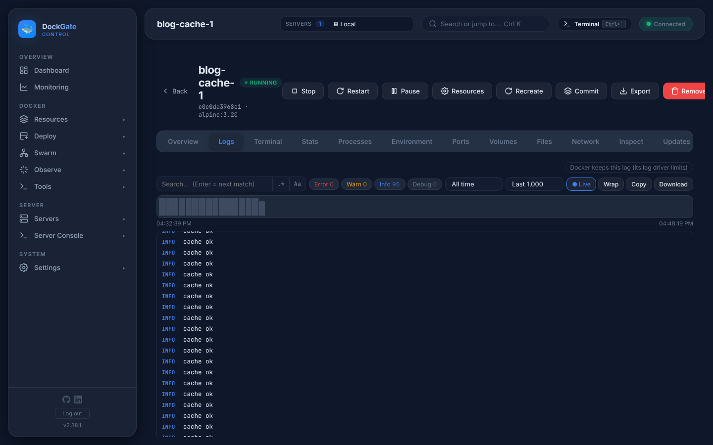<br><sub><b>Logs</b> — one viewer everywhere</sub></td>
<td width="50%"><br><sub><b>Compose stacks</b> — history, Move to Swarm</sub></td>
</tr>
</table>

**Docker Swarm**

<table>
<tr>
<td width="50%">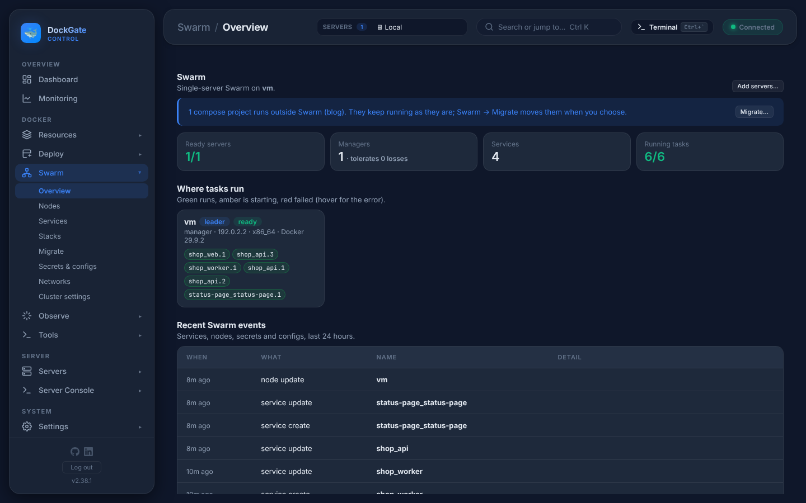<br><sub><b>Overview</b> — servers, tasks, events</sub></td>
<td width="50%">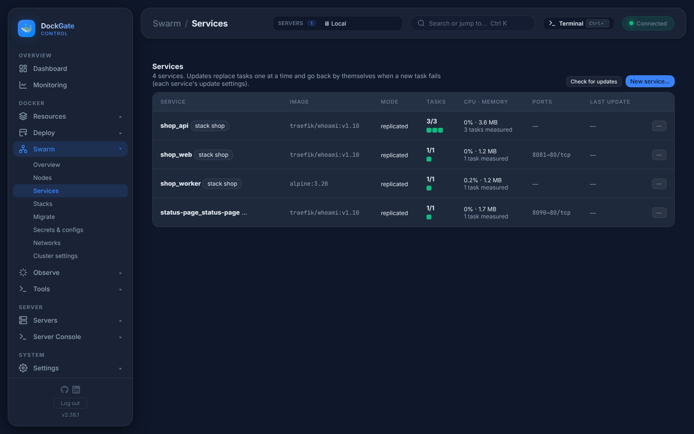<br><sub><b>Services</b> — replicas, CPU, memory, ports</sub></td>
</tr>
<tr>
<td width="50%">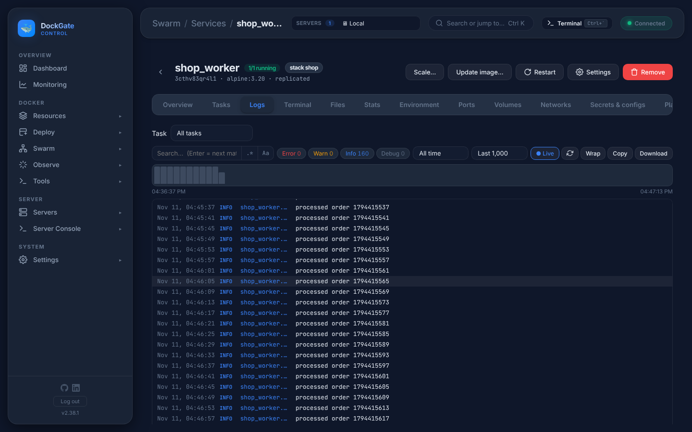<br><sub><b>Service page</b> — tasks, logs, terminal, files</sub></td>
<td width="50%">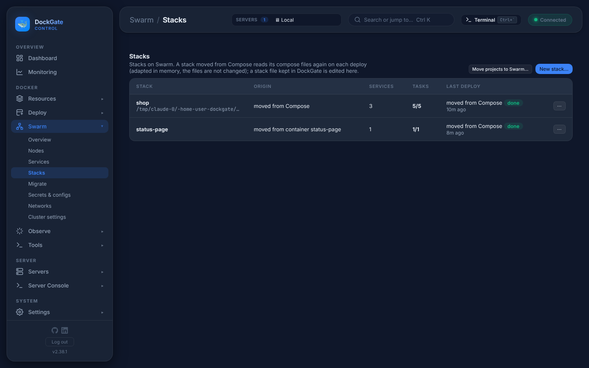<br><sub><b>Stacks</b> — from Compose, a file or a container</sub></td>
</tr>
<tr>
<td width="50%">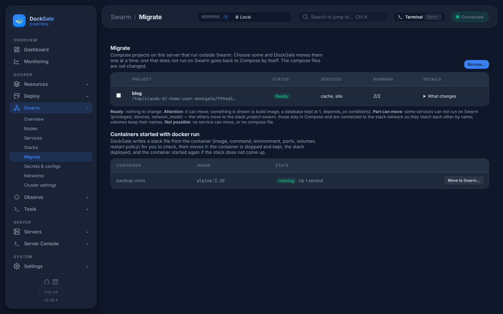<br><sub><b>Migrate</b> — Compose projects and containers</sub></td>
<td width="50%">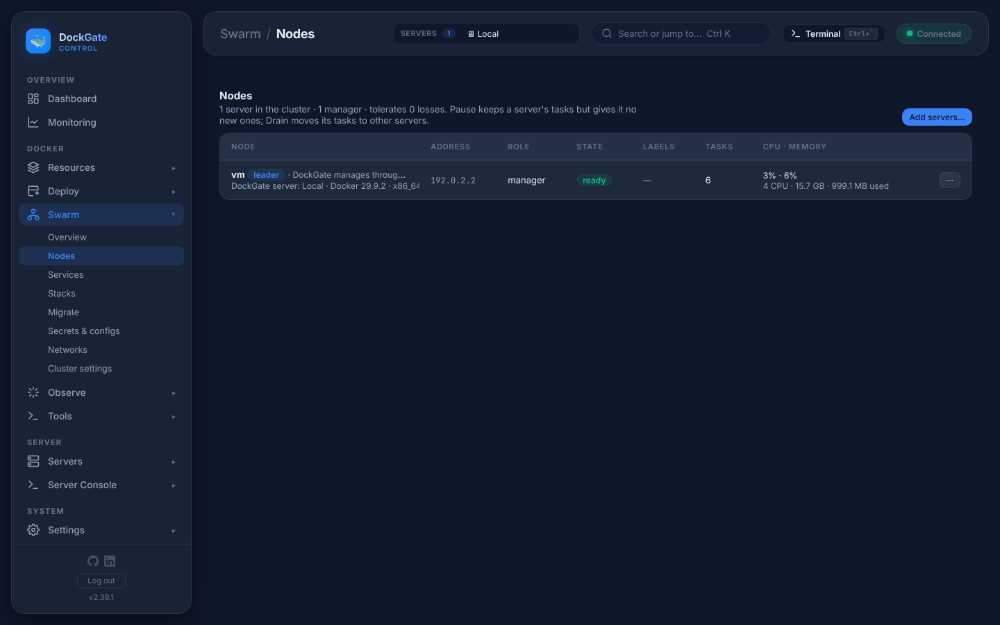<br><sub><b>Nodes</b> — role, state, CPU, memory</sub></td>
</tr>
<tr>
<td width="50%">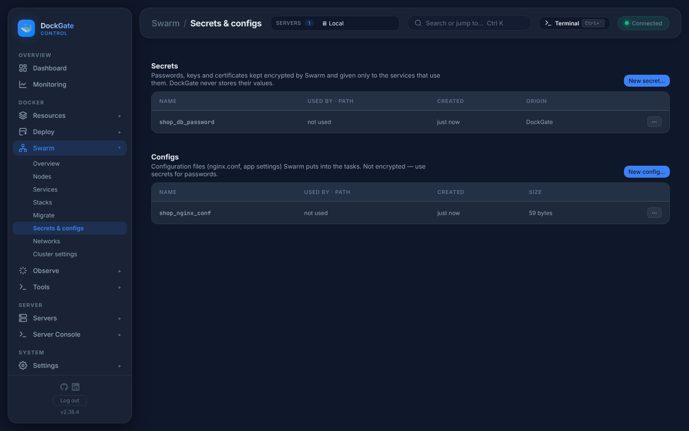<br><sub><b>Secrets & configs</b></sub></td>
<td width="50%">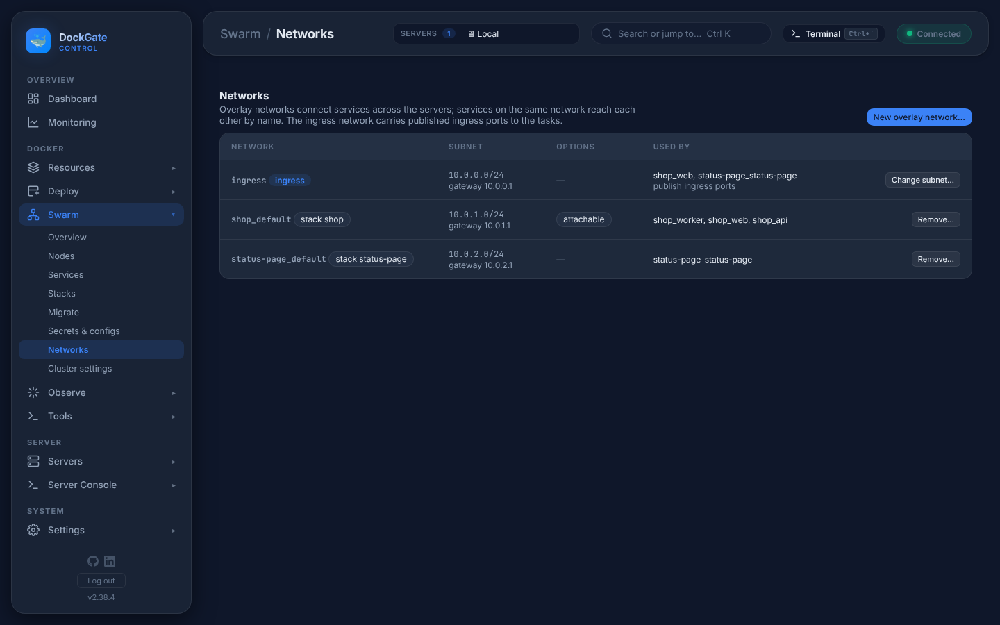<br><sub><b>Overlay networks</b></sub></td>
</tr>
<tr>
<td width="50%">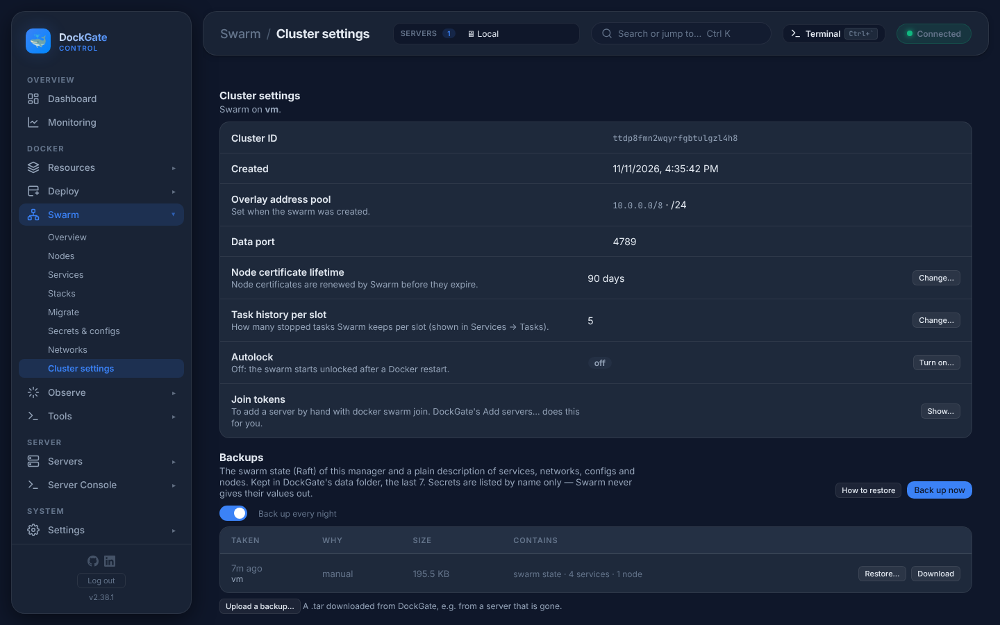<br><sub><b>Cluster settings</b> — tokens, autolock, backups</sub></td>
<td width="50%"></td>
</tr>
</table>

**More**

<table>
<tr>
<td width="50%">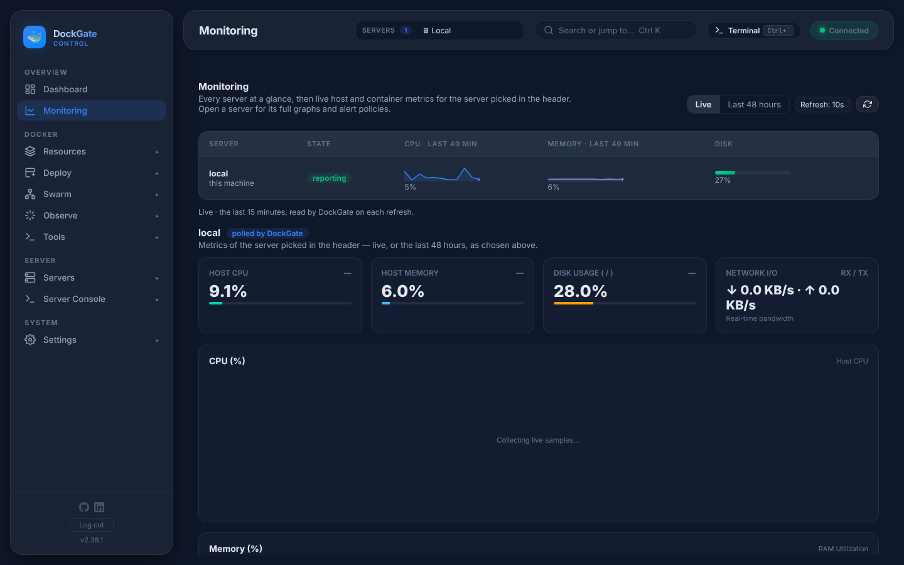<br><sub><b>Monitoring</b> — every server, live and 48 h</sub></td>
<td width="50%"><br><sub><b>App templates</b> — 500+ apps</sub></td>
</tr>
<tr>
<td width="50%">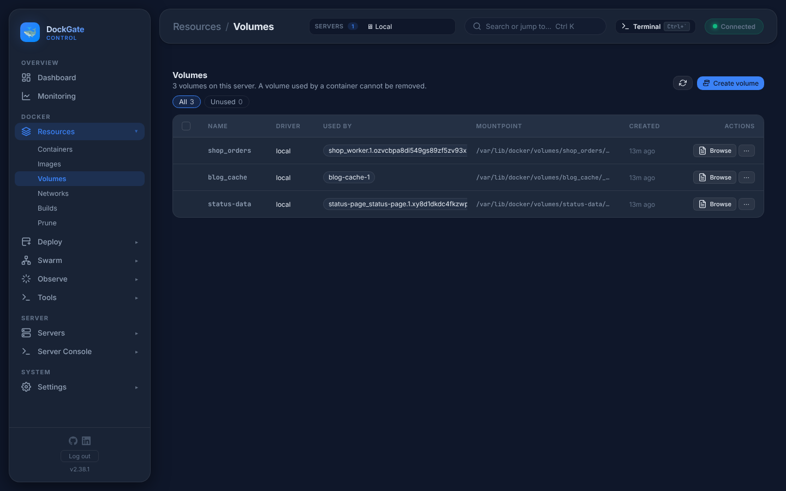<br><sub><b>Volumes</b> — backup, restore, files</sub></td>
<td width="50%"><br><sub><b>Audit log</b></sub></td>
</tr>
<tr>
<td width="50%"><br><sub><b>Notifications</b> — channels and rules</sub></td>
<td width="50%"><br><sub><b>Login</b></sub></td>
</tr>
</table>

---

## Features

| Area | What you can do |
|---|---|
| **Dashboard · Monitoring** | The server at a glance with Smart Insights and host metrics; every server's CPU, memory, disk and load, live and for 48 hours. `Ctrl/Cmd+K` jumps anywhere. |
| **Containers** | Table, cards or topology; run, start, stop, recreate, commit, export. Each container has a page with logs, terminal, stats, environment, ports, volumes, network, **files (edit, upload, download)**, updates and history. |
| **Images · Volumes · Networks · Builds** | Pull, push, tag, Docker Hub search; volume backup, restore, clone and file editing; networks of every driver; builds from a Dockerfile or Git with live logs; one Prune table. |
| **Image updates** | A daily check of every tag against its registry; safe update with a health check, automatic roll back, version names and history. |
| **Compose** | Discover, create and edit projects; deploy a folder, adopt a project already on a server, or deploy from Git. On a remote server Compose runs on that server over SSH. Deploy history with changes and redeploy. |
| **[Scaling & health](guide/compose-scaling.md)** (Compose, without Swarm) | **Replicas** with one click — DockGate writes its own override file, your compose files stay as they are; host ports and `container_name` fixed only after you see the fix; proxies reloaded. **Auto-heal** restarts a replica that stays unhealthy. **Auto Scaling** — Off / Suggest / Auto (24 h simulation first), measured against your own limits, adds a replica only when the server has room, values suggested from the last 48 hours. **Roll out** — updates replica by replica without downtime, also for *newer image* updates. |
| **App templates · Registries** | 500+ apps as a container, a Compose project or a Swarm stack; private registry logins used everywhere. |
| **Observe · Tools** | Logs, Docker events, audit log, notifications sent; container and host terminal (`` Ctrl+` ``); SFTP file manager with two-pane transfers; scheduled prune, volume backup and Git sync. |
| **Servers** | Hosts over SSH (password, key, key with passphrase); provisioning presets; deploy user; SSH access; users and keys; firewall (UFW / firewalld, IP lists, Docker port isolation); fail2ban; time sync; auto updates; host logs; pinned host keys. |

---

## Docker Swarm

- **Set up** on one server or several at once: checks, firewall ports, undo on failure. Add servers later.
- **Nodes** — pause, drain, promote, demote, labels, remove, rebalance. Each node has a **page** with its tasks, CPU and memory (live and 48 h), labels, events and history.
- **Services** — full form, scale, update image, **Update to newest**, roll back, restart, resume a paused update. Each service has a **page** with tasks, logs, terminal and files on any node, stats, settings, updates and events.
- **[Auto Scaling](guide/swarm-auto-scaling.md)** — Swarm does not scale by itself: DockGate adds or removes replicas when CPU or memory per replica stays high or low (min / max, thresholds, average or every replica, separate waits). It suggests each replica's limits and reservations from the last 48 hours of use, shows the free capacity and how many more replicas fit, and spreads them over the servers.
- **Stacks** — move Compose projects (whole or in part, one at a time even when they share a network) and `docker run` containers to Swarm and back, with limits, start order, names and local-only ports kept; new stacks from a file or a template; take over stacks made elsewhere. Volumes keep their names, so data stays; a move that fails puts the project back.
- **[Protected as before](guide/swarm-stacks-and-migrate.md#protected-as-before)** — the plan compares each service's protection in Compose and on Swarm (user, read-only, no-new-privileges, seccomp, AppArmor, capabilities, mounts, where ports are reachable); `no-new-privileges` and seccomp are kept on the Swarm service; a weaker service stays in Compose unless you choose otherwise; every task is checked after the move and the project is put back if it is weaker than planned.
- **[Build & push](guide/swarm-stacks-and-migrate.md#build--push-services-built-from-source)** — services with `build:` are built with Compose, pushed to your registry and deployed from there, again on every Redeploy. **Secrets and configs from files** are versioned by content, so Redeploy never fails on a changed file (also for remote projects). **privileged** images of known families run with only the `cap_add` they need, when you accept it. **macvlan / ipvlan** networks are made on every server.
- **[Firewall](guide/swarm-firewall.md)** — the published ports of every service on every server in one table: open (to whom), closed, or open to everyone; open or close a port on all servers at once, for anyone, an IP list or addresses. Servers that join later get the same rules.
- **Secrets, configs, overlay networks** — create, rotate, remove; encrypted overlays.
- **Cluster** — certificates and CA rotation, autolock and unlock-key rotation, heartbeat and Raft tuning, join tokens, nightly backups, restore of missing services, Recover cluster.

---

## Notifications

Channels: **Telegram**, **SMTP email** and **webhook** (Slack, Discord, Teams, ntfy, JSON). There are 24 rules, each with an on / off switch and a cooldown:

| Group | Rules |
|---|---|
| Containers | stopped / crashed / OOM, restarted, unhealthy, started, paused, unpaused |
| Docker | disk usage, build failed, newer image, image update failed, scheduled task failed |
| Servers | down, back, disk, memory, CPU — shared or per-server limits |
| Compose | auto-heal restarted a container (or gave up), Auto Scaling changed a service or the server was full |
| Swarm | service short of replicas, node down / back, update rolled back, quorum lost, autoscale changed a service |

The optional **Edge agent** runs on each server, makes only outbound connections and sends alerts directly — behind NAT, and when DockGate is offline. It also keeps the [Scaling & health](guide/compose-scaling.md) rules there (replicas, auto-heal, Auto Scaling) while DockGate is away; it takes them only [signed by the DockGate that installed it](guide/agent-security.md).

---

## Security

- One admin password (scrypt), an HMAC-signed HttpOnly session cookie, a login rate limit, and a setup token for the first setup from the internet.
- Every API route and WebSocket needs a session; cross-origin changes are refused.
- SSH, registry and channel secrets, the Swarm unlock key and stack variables are encrypted at rest (AES-256-GCM).
- Every change is in the audit log with the server and source IP; SSH host keys are pinned.
- The Edge agent has **no network port**: DockGate signs every rule and command with an Ed25519 key only it holds (one per install), the agent checks signature, server, order and age, and does only a short list of actions within their limits — [details](guide/agent-security.md).
- **The Docker socket is root on the host:** keep port 7077 off the internet and use a VPN such as [NovusGate](https://github.com/Ali7Zeynalli/NovusGate) or an SSH tunnel.

**Limitations:** single admin; self-update only for DockGate's own host; provisioning needs root or passwordless sudo; Docker port isolation needs UFW; Swarm volumes stay on their server, and files changed inside a Swarm task are lost when the task is replaced.

---

## Configuration

| Env var | Default | |
|---|---|---|
| `PORT` · `BIND_HOST` | `7077` · `0.0.0.0` | where DockGate listens |
| `DATA_DIR` | `./data` | database, keys, Swarm backups |
| `DG_MASTER_KEY` | generated | AES key for secrets at rest |
| `DG_SESSION_SECRET` | generated | session cookie key |
| `COOKIE_SECURE` | `false` | `true` behind HTTPS |
| `TRUST_PROXY` | — | proxies allowed to set the client IP |
| `DG_SETUP_TOKEN` | printed in the log | first-run setup token |
| `ALLOWED_ORIGIN` | same origin | allow another panel origin |
| `FILES_ROOT` | `/host` | root of Tools → Files on Local |

<details>
<summary><strong>Architecture and tech stack</strong></summary>

```
Browser (vanilla JS · xterm.js · Chart.js)
  ├─ REST  → Express API  (/api/*, session + origin check)
  └─ WS    → Socket.IO    (logs · stats · events · terminals · builds)
                 │
   Docker client of the server in use: local socket or dockerode over SSH
   SSH sessions (ssh2): remote Compose, docker stack, SFTP, forked host workers
   Monitors: events per server · health 1/min · Swarm 30 s → Telegram / SMTP / webhook
   better-sqlite3 (WAL) · AES-256-GCM secrets at rest
```

Node.js 22 (Alpine) with `docker-cli`, `docker-cli-compose`, `openssh-client`, `git` · Express 4 · Socket.IO 4 · dockerode 5 · ssh2 · better-sqlite3 11 · nodemailer 10. Frontend libraries are bundled in `public/vendor/`.
</details>

<details>
<summary><strong>API</strong></summary>

Everything is under `/api`, in JSON, behind the session (except `/api/auth/{status,setup,login}`). Main groups: `auth`, `containers`, `images`, `volumes`, `networks`, `builds`, `compose`, `swarm`, `servers`, `schedules`, `monitoring`, `registries`, `templates`, `agent`, `meta`. The routes are in `server/routes/`. WebSocket events: `logs:subscribe`, `stats:subscribe`, `events:subscribe`, `terminal:start`, `hostterm:start`, `build:start`.
</details>

---

## Contributing

Bug reports, fixes and ideas are welcome — see [CONTRIBUTING.md](CONTRIBUTING.md) for how to run DockGate locally, test and open a pull request. Report security problems privately as described in [SECURITY.md](SECURITY.md). Please follow the [Code of conduct](CODE_OF_CONDUCT.md).

## License

[MIT](LICENSE) — free to use, modify, and distribute with attribution.

**Original Author: Ali Zeynalli** — this attribution must be preserved in all copies and derivative works.

<p align="center"><strong>DockGate</strong> — Docker &amp; servers, managed from one place.</p>
