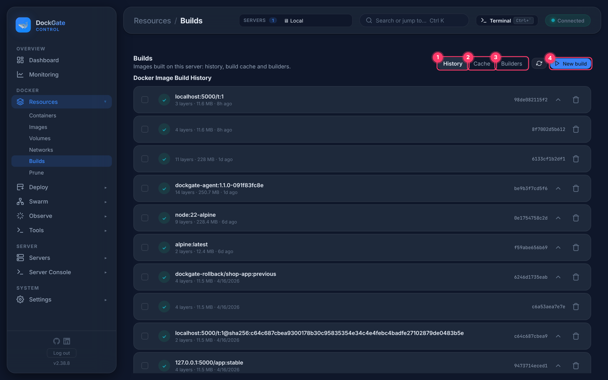
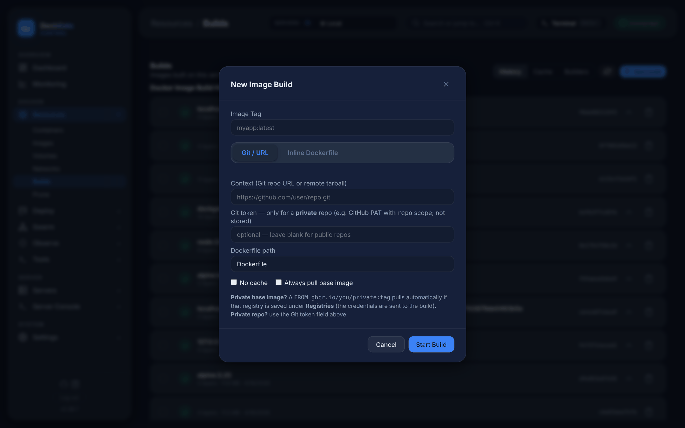

# Resources → Builds

> **Where:** sidebar **Resources → Builds**
>
> **Works on:** the server picked in the top bar (**SERVERS ▾**).

Build images from a Git repository or a Dockerfile you type, watch the build live, and look back at earlier builds.

1. **History** — images on the server with their layers, and the builds started from DockGate.
2. **Cache** — the build cache, grouped by image, with its size. **Prune Cache** frees it (the next build is slower).
3. **Builders** — the BuildKit builders Docker has.
4. **New build** — see below.

## New build

| Field | Notes |
|---|---|
| **Image Tag** | e.g. `myapp:latest` |
| **Git / URL** | **Context:** a Git URL (`https://github.com/user/repo.git`) or a remote tarball. **Git token:** only for a private repo (e.g. a GitHub token with `repo` scope); it is **not stored**. **Dockerfile path:** relative to the repo |
| **Inline Dockerfile** | Type the Dockerfile; no context folder is sent |
| **No cache** | Build every step again |
| **Always pull base image** | Pull a newer `FROM` image even if one is on the server |

A `FROM` on a private registry (e.g. `ghcr.io/you/private:tag`) pulls automatically when that registry is saved under **Deploy → Registries**.

**Start Build** opens the live log. A build started from DockGate has:
- **Info** — tag, source, time, result;
- **Logs** — the full log in the log viewer (search, levels; each step is a source);
- **Steps** — the log split by Dockerfile step, each with its time;
- **History** — other builds of the same tag.

**Images → ⋯ → Build from this (FROM)…** opens a new build whose Dockerfile starts from that image.

## Good to know

- Builds run on the server picked in the top bar.
- The **Builders** tab lists builders only for Local; on a remote server it shows the default builder.
- For Compose projects with `build:`, use **Deploy → Compose stacks → Build** instead.

## Errors and fixes

| You see | Why | What to do |
|---|---|---|
| `failed to read dockerfile: open Dockerfile: no such file or directory` | Wrong **Dockerfile path** | Give the path inside the repo, e.g. `docker/Dockerfile` |
| `authentication required` / `Repository not found` during clone | Private repo without a token, or the token lacks access | Fill **Git token** with a token that can read the repo |
| `pull access denied for <base image>` | Private `FROM` image without a login | Add the registry under **Deploy → Registries** |
| A step fails (`RUN … returned a non-zero code`) | The command in the Dockerfile failed | Open **Steps** to see that step's output |
| `Build not found` | The build was removed from history | — |
