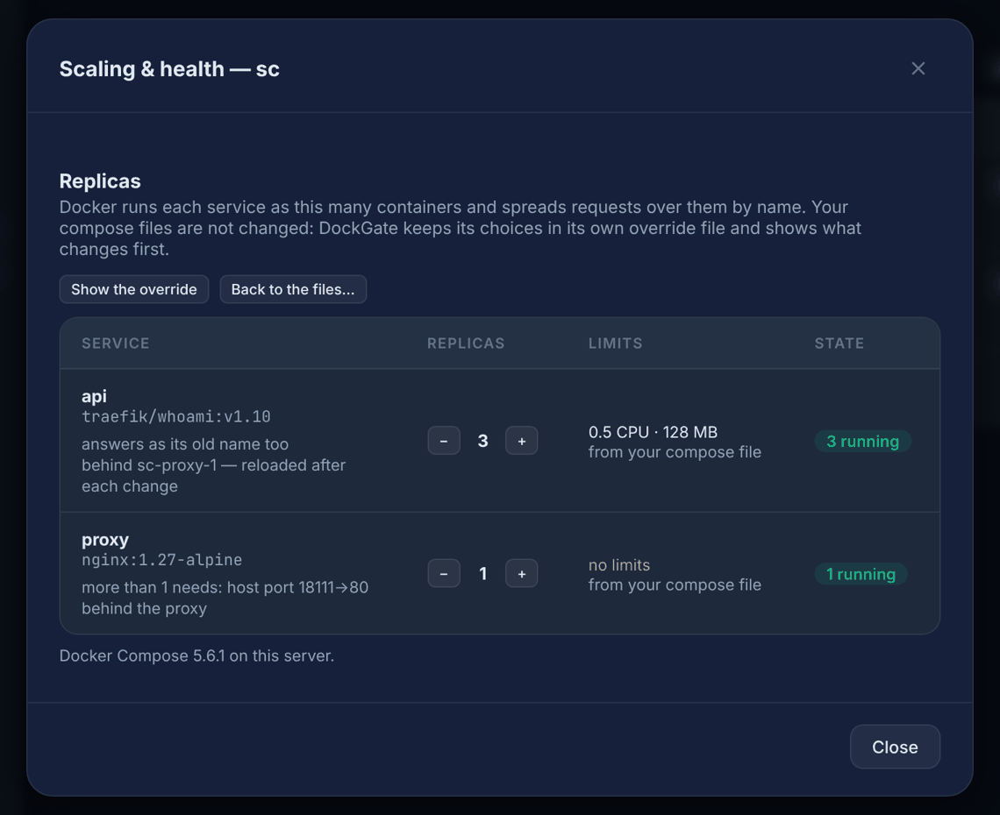
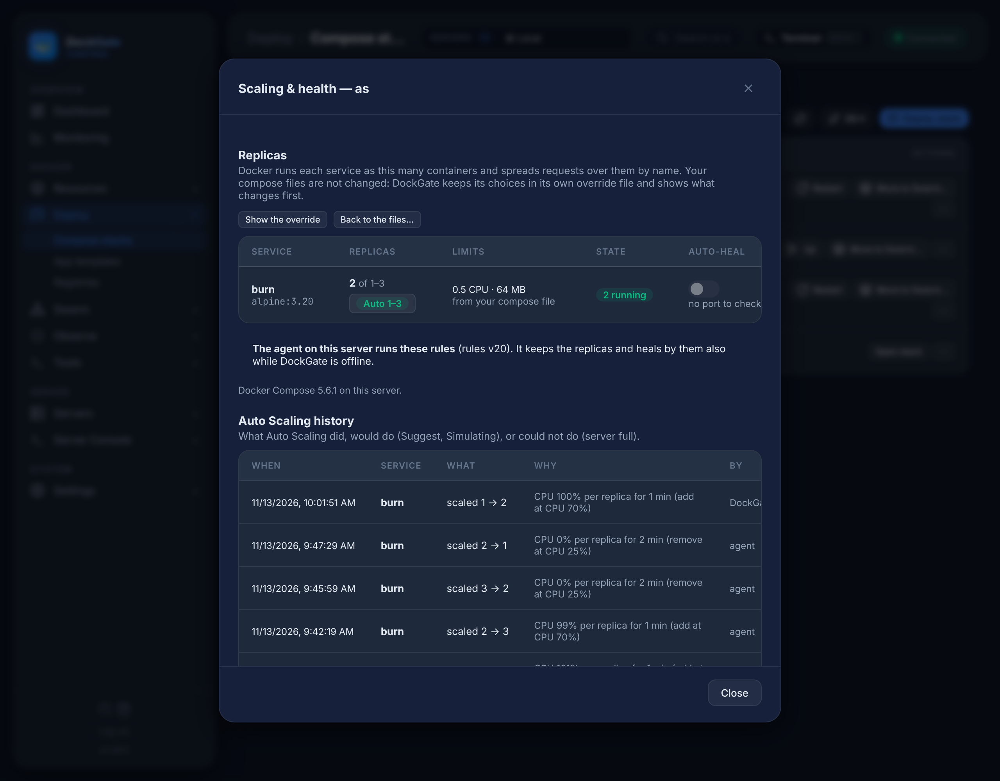
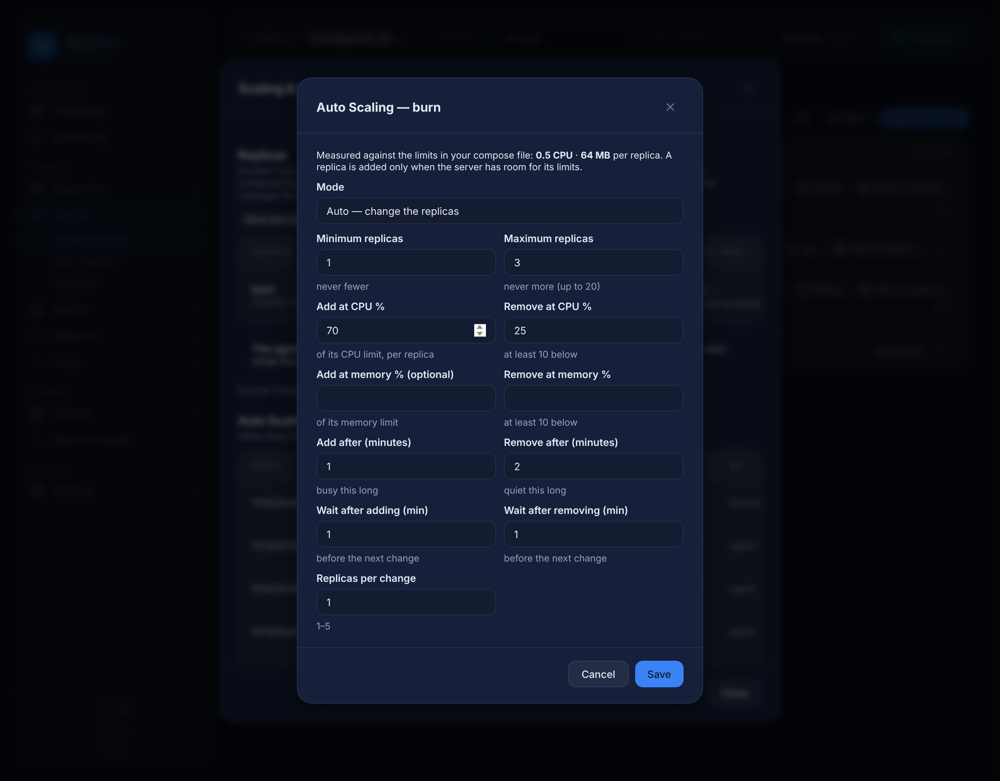

# Deploy → Compose stacks → Scaling & health

> **Where:** **Deploy → Compose stacks →** a stack's **⋯ → Scaling & health…**
>
> **Works on:** the server picked in the top bar (**SERVERS ▾**). No Swarm needed.

Run a Compose service as several containers (replicas) with one click. Docker spreads the requests over them by the service's name, so a proxy in front (nginx, Caddy) or another service reaches all of them as `http://api:8080`.



| Column | What it shows |
|---|---|
| **Service** | Name and image, and notes: what it needs to run as several replicas, the old name it still answers to, the proxy in front of it |
| **Replicas** | `−` and `+`. `+` is disabled with the reason when the service can not have more than one |
| **Limits** | The CPU and memory limits **from your compose file** (`cpus`, `mem_limit`, `deploy.resources.limits`). DockGate does not change them |
| **State** | Replicas running, or **drift** when they differ from what was set |
| **Auto-heal** | On: a replica that stays unhealthy is restarted. Uses the service's own health check; without one, the Edge agent checks its port |

## Your files are not changed

DockGate keeps its choices in its own **override file**, `docker-compose.dockgate.yml`, and adds it to every compose command it runs (Up, Rebuild, image updates, Move to Swarm). It is not in the project folder or a Git checkout:

- on DockGate's own server: `DATA_DIR/compose-overrides/local/<project>/`;
- on a remote server: `~/.dockgate/overrides/<project>/`.

Only its owner can read it. **Show the override** shows what is in it; **Back to the files…** removes it, and `docker compose up -d` runs the services as your files say again.

## What can have more than one replica

| Service | Can it? |
|---|---|
| A database (postgres, mysql, mongo, redis…) | **No** — more replicas would be separate databases, not copies |
| A service that writes to a volume or folder | **No** — two replicas would write the same data. A **read-only** mount is fine |
| `network_mode: host` | **No** — two replicas would take the same ports |
| A service with a **host port** (`80:80`) | After a fix: two containers can not take one port, so the port is removed and requests come through the proxy |
| A service with **`container_name`** | After a fix: two containers can not share a name, so the name is dropped — it stays a name other services reach it by |
| Anything else (an API, a frontend, a worker) | **Yes** |

A fix is shown before it is applied, written to the override only, and the service is recreated once. The fixes need Docker Compose 2.24.4 or newer on the server (the panel shows its version).

## What happens when you click

1. DockGate checks the service (above) and writes the override.
2. `docker compose up -d --no-deps --no-recreate --scale <service>=N <service>` — the other services and the replicas already running are not touched.
3. **Fewer replicas:** the ones that go are stopped gracefully first (they finish what they are doing; the proxy sends new requests to the others).
4. **Proxies on the same networks are reloaded** — nginx after `nginx -t` passes (a config that fails its check is left alone), Caddy with `caddy reload`. A plain `proxy_pass http://api:8080;` only looks the name up when nginx starts; the reload makes it see the new replicas.
5. **If compose fails** (an image that can not be pulled, a port taken), the previous override comes back and the service runs as before.
6. Each change is in **Deploy history…** (*replicas*) and in **Observe → Audit log** (`compose_scale`).

## Auto-heal, and who keeps the rules

Turn **Auto-heal** on for a service and a replica that stays unhealthy is restarted: after 3 failed checks in a row, not in its first 60 seconds, at most 3 times an hour — then it stops trying and tells you (Settings → Notifications → *Auto-heal restarted a Compose container*).

The note under the table says who keeps these rules:

- **The Edge agent on that server**, when it runs the current version: it also brings back replicas that are gone (a `docker rm`, a crash with no restart), and keeps doing both while DockGate is offline. How it is commanded without a port: [Edge agent → How DockGate commands it, safely](agent-security.md).
- **DockGate**, otherwise: it heals services that have their own health check while it is online.

## Auto Scaling

The chip under the replicas (**Auto scaling: off**) opens the rule of a service. Auto Scaling measures each replica against **the limits in your compose file** — CPU as a % of its `cpus`, memory as a % of its `mem_limit` — and adds or removes replicas within your minimum and maximum.



| Mode | What it does |
|---|---|
| **Off** | Nothing. You set the replicas with `−` / `+` |
| **Suggest** | Writes what it would do in the history (*suggests 2 → 3* and why); **Apply** does it |
| **Auto** | Changes the replicas itself. The first 24 hours it only **simulates** — writes *would scale 2 → 3* — so you see what it would have done before it acts. Tick *skip the 24 h simulation*, or later *start acting now*, to begin at once |



**Suggest from the last 48 h** (in the rule) fills in the minimum, maximum and thresholds from what the service really did: DockGate reads its replicas every 2 minutes (once a service is in Scaling & health; asking for a suggestion starts it) and keeps 48 hours. It needs about an hour of readings. Each value says why; it only suggests replicas — **your limits are never changed**, but when a replica uses far less than its limit the suggestion says so (a lower limit would let more replicas fit). The maximum is cut to what fits on the server.

The rule has the same fields as Swarm Auto Scaling: add at CPU % (and/or memory %), remove at a % at least 10 lower, for how many minutes, the wait after each change, and how many replicas per change.

**It is safe by design:**

- **Your limits are never changed.** A service with no CPU or memory limit can not have a rule — there is nothing to measure against.
- **A replica is added only when the server has room for its limits** — the free memory minus 10 % for the server itself, and the CPU load below 80 % of the cores. Without room it adds none, writes *server full* in red, and tells you once (Settings → Notifications → *Auto Scaling changed a Compose service, or the server was full*).
- **Never during a deploy:** nothing changes while a deploy, rebuild or image update of the project runs, or a container of it was made in the last 2 minutes.
- **One change at a time per project**, then the wait you set.
- **Fewer replicas stop gracefully** (the highest numbers go), and nginx / Caddy are reloaded after each change.
- **The number Auto Scaling chose is written to DockGate's override**, so a later deploy through DockGate keeps it. Under Auto, the panel shows *2 of 1–3* instead of `−` / `+`, and drift means only *outside min–max*.

**Who runs it:** the Edge agent on that server, every 30 seconds — also while DockGate is offline; DockGate reads what it did into the history. On a server without an up-to-date agent, DockGate runs the same loop every minute while it is online. The **By** column of the history says which.

## Updates without downtime (Roll out)

A service that can run as several replicas is updated **one replica at a time**, so requests keep being served:

1. Compose starts **one new replica** with the compose file and image as they are now (`up --no-recreate --scale <service>=N+1` — the running ones are not touched).
2. DockGate waits until it is **ready**: healthy by its own health check, or running for 10 seconds without restarting (up to 3 minutes).
3. The proxies are reloaded, **one old replica stops gracefully**, the proxies are reloaded again, and the old container is removed.
4. Repeat until every replica is new.

**If the first new replica is not ready** (it exits, keeps restarting, or is unhealthy), it is removed and **nothing old was touched**. If a later one fails, the new ones that passed stay and the rest still run the previous version; the message says how many were updated.

Where it is used:

- **Roll out…** next to a service in Scaling & health — after you changed the image tag or anything else in the compose file. *Pull the image first* is on by default.
- **Newer image → Update** (Containers, Updates) of a Compose service that can run as several replicas: it rolls out instead of recreating the whole service. If the update fails at the first new replica, the image tag is pointed back and the old replicas never stopped; if it fails later, every replica is put back on the previous image.

A service that can not run as several replicas (a database, a writable volume, a host port or `container_name` that was not fixed) is updated the usual way, with a short stop.

**nginx and the switch:** a plain `proxy_pass http://api:80;` keeps the addresses it found at its last reload. In the moment between an old replica stopping and the reload, a request can be sent to the address that just went away; that address does not refuse, so nginx waits `proxy_connect_timeout` — **60 s by default** — before it tries another replica. DockGate keeps that moment as short as it can (it checks `nginx -t` once before, then reloads at once), and the panel warns when an nginx in front still has the long default. Add this to the `location`:

```nginx
proxy_connect_timeout 2s;
proxy_next_upstream error timeout;
```

In tests with a request every 100 ms through nginx, 3 replicas were rolled out with no failed request (with the 2 s setting none took longer than a few milliseconds).

## nginx in front

For replicas to share the traffic, nginx must reach the service by its name. Two ways, both work with DockGate:

```nginx
# static: DockGate reloads nginx after each change
location / { proxy_pass http://api:8080; }

# dynamic: nginx looks the name up by itself every 10 s
resolver 127.0.0.11 valid=10s;
set $api http://api:8080;
location / { proxy_pass $api; }
```

The panel says which one each nginx uses.

## Drift

If someone runs `docker compose up` on the server without DockGate's override, the replicas go back to what the files say. The panel shows **drift** and a **Fix** button; DockGate does not fight it on its own.

## Good to know

- Replicas share the service's limits each: 3 replicas of `cpus: 0.5` can use 1.5 CPU together. Keep an eye on the server's total.
- An app that keeps sessions in memory loses them between replicas — keep sessions in Redis or a database, or in a cookie.
- Deleting the stack removes DockGate's override and choices too.
- A project on Swarm is scaled in **Swarm → Services** and **Swarm → Auto Scaling** instead.

## Errors and fixes

| You see | Why | What to do |
|---|---|---|
| `database: more replicas would be separate databases, not copies — it stays at 1` | Database image | Keep one; use the database's own replication |
| `writes to /data: two replicas would write the same data — it stays at 1` | A writable volume or folder | Make the mount read-only if it is, or keep one |
| `<service> needs its host port moved behind the proxy …` | A published port | Accept the fix; reach it through the proxy |
| `… needs Docker Compose 2.24.4 or newer on the server` | Old Compose | Update Docker Compose on the server |
| `A deploy of this project is running — try again when it ends` | A deploy or rebuild is running | Wait for it |
| `<service> could not run N replicas: … — the previous setting is back` | Compose failed (image, port…) | Read the message; nothing changed |
| `Replicas: a whole number from 0–20` | Out of range | 0 to 20 |
| `This service has no CPU or memory limit in its compose file — Auto Scaling needs one…` | No `cpus` / `mem_limit` | Add a limit to the compose file and redeploy |
| `… needs its host port moved behind the proxy before it can have more than one replica — press + once…` | A rule with a maximum above 1 on a service that needs a fix | Press `+` once and accept the fix, then set the rule |
| `Remove at a CPU % at least 10 below the add %…` | The two thresholds are too close | Keep 10 or more between them |
| `… can not be updated without downtime: it takes a host port …` | Roll out on a service with an unfixed host port or `container_name` | Press `+` once in Scaling & health and accept the fix |
| `… the new container stopped (exit code N) — nothing was changed, the previous replicas keep running` | The new image or config does not start | Read the container's logs; fix and roll out again |
| `… after 1 of 3 replicas were updated — the others still run the previous version` | A later new replica was not ready | Fix and roll out again |
| nginx warning: *waits 60 s for a replica that just stopped* | `proxy_connect_timeout` not set | Add `proxy_connect_timeout 2s;` (above) |
| History: *server full* | No room for one more replica's limits | Free memory / CPU, lower the limit, or accept fewer replicas |
| nginx: `host not found in upstream "api"` when nginx restarts | A static `proxy_pass` needs the service up when nginx starts | Add `depends_on: [api]` to nginx, or use the resolver form above |
