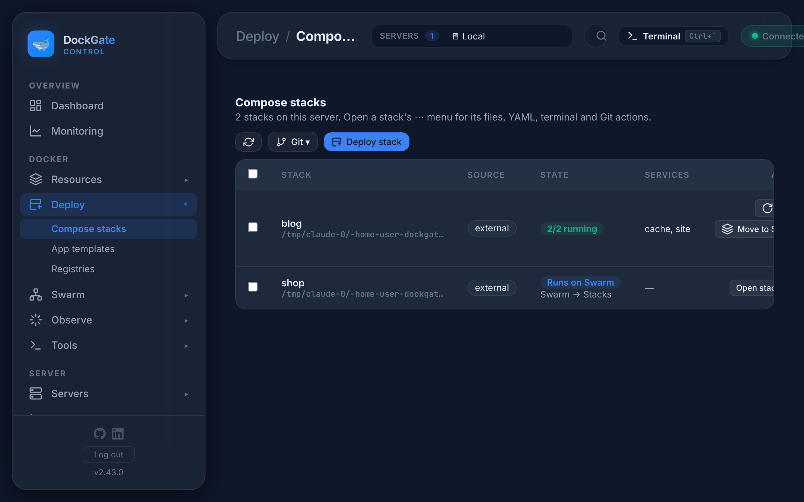

# Deploy → Compose stacks

> **Where:** sidebar **Deploy → Compose stacks**
>
> **Works on:** the server picked in the top bar (**SERVERS ▾**).

A Compose **stack** (project) is a group of containers started from one `docker-compose.yml`. This page lists every stack on the server, including stacks started outside DockGate with `docker compose up`, and lets you deploy new ones.

| Column | What it shows |
|---|---|
| **Stack** | The project name and its folder on the server |
| **Source** | *git · branch* (from a repository), *adopted* (a folder taken over on the server), *folder* (deployed by DockGate from the editor, an upload or a template) or *external* (started outside DockGate) |
| **State** | `2/2 running`, `not deployed`, or **Runs on Swarm** for a project moved to Swarm |
| **Services** | The services in the compose file |

The buttons above the list: **↻** reloads it, **Git ▾** (shown when there are Git stacks) pulls or deploys all of them, and **Deploy stack** adds a new one.

## Deploy a stack

**Deploy stack** asks where the compose file comes from:

| Source | What happens |
|---|---|
| **Write a compose file** | Paste or write `docker-compose.yml` in the editor, give the stack a name, deploy |
| **Git repository** | DockGate clones the repo (HTTPS with an optional access token, or SSH with a key from **Servers → SSH keys**), then lets you pick which compose files and services to deploy. **Clone only (Stage)** registers it without starting anything |
| **Upload a folder** | Upload a folder with a compose file and its build context (up to 1 GB). For a remote server the files are copied there over SSH |
| **Existing on the server** | *Adopt* a compose folder already on a remote server: pick a folder, DockGate scans it for compose files, then deploys them in place. DockGate never moves or deletes an adopted folder |
| **App template** | Opens **Deploy → App templates** |

Every deploy runs as a **job** with a live log. You can close the window: the job keeps running and shows on the list.

### Build options

When a deploy or **Rebuild…** builds images, you can tick:

| Option | Meaning |
|---|---|
| **build** | Rebuild the image from the Dockerfile before starting. Tick it when the code changed |
| **no-cache** | Build without Docker's cache: a full clean rebuild (slower, rarely needed) |
| **pull** | Pull the newest base images (`FROM …`) before building |
| **no-deps** | Touch only the chosen services, not their dependencies (a database, for example) |

## Actions (⋯)

| Action | What it does |
|---|---|
| **Up** / **Restart** / **Down** | `docker compose up -d`, restart all services, or stop and remove the containers (volumes stay) |
| **Services and details** | The services, their state, the folder and the compose files used |
| **Deploy history…** | Every deploy of this stack with the compose files it used and what changed. **Redeploy this** puts those files back and runs `docker compose up -d`. Volumes and data stay |
| **Edit YAML** | Edit the compose file and redeploy |
| **Files (Dockerfile, .env…)** | Browse, edit, upload and delete the files of the project folder |
| **Terminal in this folder** | A shell in the project folder on the server |
| **Rebuild…** | Pick services and build options, then rebuild them |
| **Update from folder…** | Upload a new version of a folder-deployed stack |
| **Git pull (files only)** | Fetch the newest commit without touching the containers |
| **Git sync and deploy** | Pull, then `docker compose up -d --build` |
| **Force pull (discard server changes)…** | Reset the checkout on the server to the remote branch, then rebuild |
| **Move to Swarm…** / **Move back to Compose…** | See [Swarm → Stacks and Migrate](swarm-stacks-and-migrate.md) |
| **Delete stack…** | Stops and removes the containers and untracks the project. Optionally also removes the project files. For an adopted project the folder is never deleted |

A Git stack with new commits on the remote shows a blue badge: click it to sync and deploy.

**Auto-deploy webhook**: a Git stack's details show a webhook URL. Add it to the repository (GitHub, GitLab, Gitea) so a push deploys the stack. It only works when DockGate has a public address the Git host can reach.

## Good to know

- Deploy and update jobs keep running when you close the window or the browser.
- **Down** keeps the volumes, so the data stays. Only **Delete stack…** with *Remove the project files* deletes files.
- A stack started outside DockGate (*external*) shows here too: you can stop, start, restart and move it, but DockGate has no copy of its compose file.
- To update the images of a running stack, use **Resources → Containers → Update** on its containers, or **Rebuild…** with *pull*.
- Deploy history keeps the files of each deploy, so a bad change can be undone with **Redeploy this**.

## Errors and fixes

| You see | Why | What to do |
|---|---|---|
| `Invalid project name (only a-z, 0-9, _, -)` | Uppercase letters, spaces or dots in the name | e.g. `my-app` |
| `A different project named "<name>" already exists — rename this one.` | The name is taken on this server | Choose another name |
| `Invalid compose file: …` | The YAML does not parse, or Compose refuses it | Fix the line shown in the message |
| `No docker-compose.yml (or compose.yaml) found in the folder` | Upload a folder without a compose file | Add one at the top of the folder |
| `Folder exceeds the 1GB upload limit — use pre-built images or git-based deploy for large projects` | Too large to upload | Push images to a registry, or deploy from Git |
| `Upload session expired — start over` | The upload was left too long | Upload again |
| `A git URL is required (https://… or git@host:owner/repo.git for an SSH key)` | Empty or wrong repository URL | Paste the clone URL |
| `With an SSH key, use the SSH clone URL (git@host:owner/repo.git)` | An HTTPS URL with an SSH key | Use the `git@…` URL |
| `Not a fast-forward — your server checkout has diverged from the remote. …` | Files were changed on the server | **Force pull…**, or fix it on the server |
| `Adopt-from-server needs a remote SSH server active (the compose files live on the server).` | Adopt on *Local* | Pick a remote server in **SERVERS ▾** |
| `Remote deploy needs a remote SSH server active in the header.` | The server was switched meanwhile | Pick the server again |
| `Switch to the server this project was deployed to, then update.` | Update from folder on another server | Pick that server |
| `This project was adopted in place — DockGate never re-uploads or cleans an adopted folder. …` | Update from folder on an adopted project | Edit the files on the server, then **Up** |
| `Deploy job not found (it may have finished and expired)` | An old job log | Look at **Deploy history…** |
