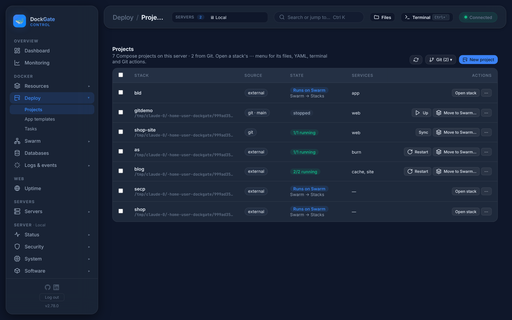
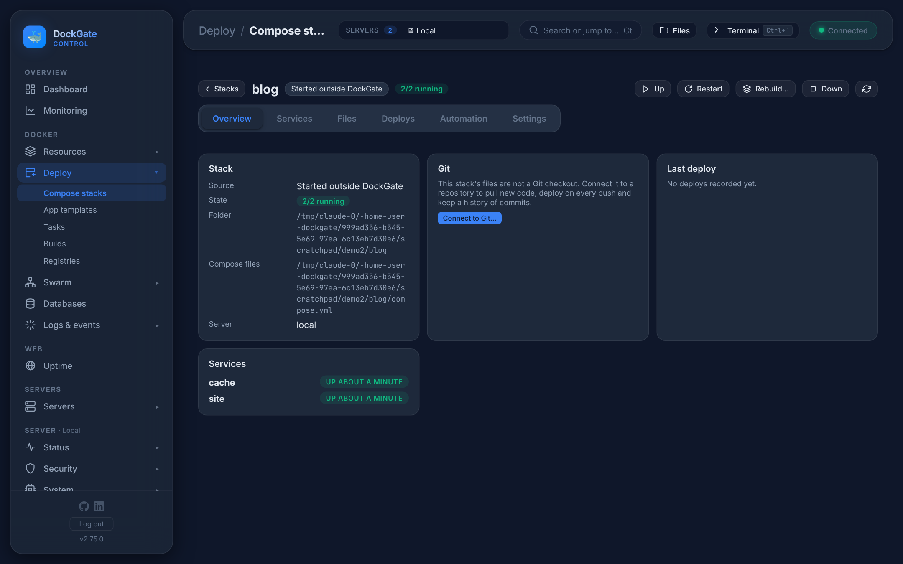
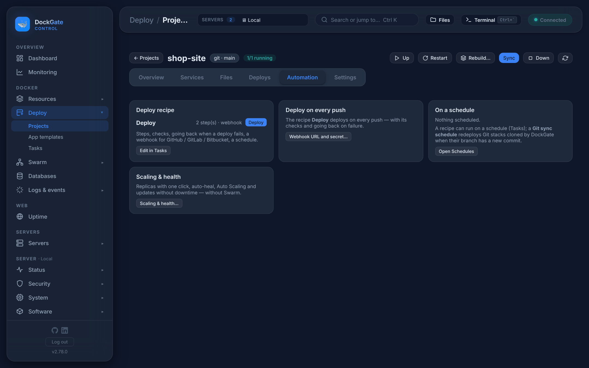

# Deploy → Projects

> **Where:** sidebar **Deploy → Projects**
>
> **Works on:** the server picked in the top bar (**SERVERS ▾**).

A Compose **stack** (project) is a group of containers started from one `docker-compose.yml`. This page lists every stack on the server, including stacks started outside DockGate with `docker compose up`, and lets you deploy new ones.

| Column | What it shows |
|---|---|
| **Stack** | The project name and its folder on the server |
| **Source** | *git · branch* (from a repository), *adopted* (a folder taken over on the server), *folder* (deployed by DockGate from the editor, an upload or a template) or *external* (started outside DockGate) |
| **State** | `2/2 running`, `not deployed`, or **Runs on Swarm** for a project moved to Swarm |
| **Services** | The services in the compose file |

The buttons above the list: **↻** reloads it, **Git ▾** (shown when there are Git stacks) pulls or deploys **every** Git stack of the server at once (to pull one stack, use **Pull** on its page), and **New project** adds a new one.

Click a stack's **name** (or **⋯ → Open the stack**) to open its page. The row's **⋯** keeps only the everyday actions: Up, Restart, Rebuild, Git sync, Down, Delete.

## A stack's page

The top bar of the page: **Up**, **Restart**, **Rebuild…**, **Sync** (Git stacks), **Down** and **↻**. **← Stacks** goes back to the list.

| Tab | What is there |
|---|---|
| **Overview** | Where the stack comes from (Git cloned by DockGate, a Git checkout on the server, an uploaded folder, adopted, written in the editor, or started outside DockGate), its state, folder, compose files and server; the **Git** card (repository, branch, commit, **Pull**, **Sync and deploy**, **Access…**) or **Connect to Git…**; the last deploy; the services |
| **Services** | Each service: container, image, state, published ports, and **Logs**, **Terminal**, **Open** for its container |
| **Files** | The project's files (Dockerfile, .env, configs) to open, edit, add and delete, plus **Edit YAML**, **Open folder in Files** and **Terminal in this folder** |
| **Deploys** | The Compose deploy history (what changed, **Redeploy this…**) — a deploy recipe that ran `docker compose up` here is in it too, as *deploy recipe* with its name, how it started and its run — and, below it, the **recipe and task runs** of the stack's folder with their logs |
| **Automation** | **Deploy recipe:** the recipe of the stack's folder, with **Deploy**; when there is none, **Set up auto-deploy** makes one in a click (Git pull → `docker compose up --build` → if it fails, back to the commit before) and turns on its webhook. **Deploy on every push:** the recipe's webhook URL and secret for GitHub / GitLab / Bitbucket / CI (or the older simple webhook of a stack cloned by DockGate). **On a schedule:** recipe schedules and Git sync schedules. **Scaling & health**. Works on the local server and on SSH servers |
| **Settings** | Edit YAML, Update from folder (uploaded stacks), Git (Connect to Git… or Force pull…), Scaling & health, Move to Swarm, Terminal, Delete the stack |

## New project

**New project** asks where the project comes from; each choice says when to pick it:

| Choice | Pick it when | What happens |
|---|---|---|
| **From a Git repository** | The code is on GitHub, GitLab, Bitbucket or your own Git server | DockGate clones the repo (HTTPS with an optional access token, or SSH with a key from **Servers → SSH keys**), then lets you pick which compose files and services to deploy. **Clone only (Stage)** places the files without starting them |
| **Upload a folder** | The project is on your computer | Upload a folder with a compose file and its build context (up to 1 GB). For a remote server the files are copied there over SSH. You can connect it to Git later |
| **Already on the server** | The compose folder is on an SSH server already (copied, cloned by hand, running) | *Adopt*: pick a folder, DockGate scans it for compose files, then deploys them in place. DockGate never moves or deletes an adopted folder. On the local server, stacks started with `docker compose` show in the list by themselves |
| **Write a compose file** | A small stack: an image or two, ports, volumes | Paste or write `docker-compose.yml` in the editor, give it a name, deploy |
| **App template** | A ready-made app (databases, CMS, monitoring, tools) | Opens **Deploy → App templates** |
| **Connect a stack to Git** | A stack you uploaded as files should now come from a repository | Pick the stack, then [Connect to Git](git-connect.md) |

When a deploy finishes, **Open the project** in its log window opens the project's page.

Every deploy runs as a **job** with a live log. You can close the window: the job keeps running and shows on the list.

### Build options

When a deploy or **Rebuild…** builds images, you can tick:

| Option | Meaning |
|---|---|
| **build** | Rebuild the image from the Dockerfile before starting. Tick it when the code changed |
| **no-cache** | Build without Docker's cache: a full clean rebuild (slower, rarely needed) |
| **pull** | Pull the newest base images (`FROM …`) before building |
| **no-deps** | Touch only the chosen services, not their dependencies (a database, for example) |

## Actions

On the stack's page (and Up / Restart / Rebuild / Git sync / Down / Delete also in the row's ⋯):

| Action | What it does |
|---|---|
| **Up** / **Restart** / **Down** | `docker compose up -d`, restart all services, or stop and remove the containers (volumes stay) |
| **Overview / Services tabs** | The services, their state, the folder and the compose files used |
| **Scaling & health…** | Replicas with one click, auto-heal, Auto Scaling and updates without downtime (Roll out), without Swarm — see [Scaling & health](compose-scaling.md) |
| **Deploy history…** | Every deploy of this stack with the compose files it used and what changed. **Redeploy this** puts those files back and runs `docker compose up -d`. Volumes and data stay |
| **Edit YAML** | Edit the compose file and redeploy |
| **Files (Dockerfile, .env…)** | Browse, edit, upload and delete the files of the project folder |
| **Terminal in this folder** | A shell in the project folder on the server |
| **Rebuild…** | Pick services and build options, then rebuild them |
| **Update from folder…** | Upload a new version of a folder-deployed stack |
| **Connect to Git…** | A stack uploaded as files becomes a Git checkout in the same folder, with a compare first and a backup — see [Connect to Git](git-connect.md) |
| **Git pull (files only)** | Fetch the newest commit without touching the containers |
| **Git sync and deploy** | Pull, then `docker compose up -d --build` |
| **Git access…** | How DockGate reaches the repository of a stack it did not clone (adopted, or found by its containers): **the server's own git setup** (the SSH user's key or credential helper — the default), an **access token** (HTTPS; stored encrypted, never written into the repository) or an **SSH key** from Servers → SSH keys (add its public key to the repository's Deploy keys). **Test** asks the repository for its branches. Pull, Sync and Pull every stack use it; an SSH remote is reached over HTTPS for a token, an HTTPS one over SSH for a key |
| **Force pull (discard server changes)…** | Reset the checkout on the server to the remote branch, then rebuild |
| **Move to Swarm…** / **Move back to Compose…** | See [Swarm → Stacks and Migrate](swarm-stacks-and-migrate.md) |
| **Delete stack…** | Stops and removes the containers and untracks the project. Optionally also removes the project files. For an adopted project the folder is never deleted |

A Git stack with new commits on the remote shows a blue badge: click it to sync and deploy.

**Auto-deploy webhook**: the page of a Git stack cloned by DockGate shows a webhook URL under **Automation**. When the stack's folder has a **deploy recipe**, this webhook and the **Git sync schedules** run the recipe (with its checks and going back on failure) instead of the simple redeploy. Add it to the repository (GitHub, GitLab, Gitea) so a push deploys the stack. It only works when DockGate has a public address the Git host can reach.

## Good to know

- Deploy and update jobs keep running when you close the window or the browser.
- **Down** keeps the volumes, so the data stays. Only **Delete stack…** with *Remove the project files* deletes files.
- A stack started outside DockGate (*external*) shows here too: you can stop, start, restart and move it, but DockGate has no copy of its compose file.
- To update the images of a running stack, use **Resources → Containers → Update** on its containers, or **Rebuild…** with *pull*.
- Deploy history keeps the files of each deploy, so a bad change can be undone with **Redeploy this**.

## Errors and fixes

| You see | Why | What to do |
|---|---|---|
| `Invalid project name (only a-z, 0-9, _, -)` | Uppercase letters, spaces or dots in the name | e.g. `my-app` |
| Pull / Sync: `could not read Username for 'https://github.com'` | A private repository over HTTPS, and git has no access token | **Git → Access…** on the stack's page: paste an access token (or choose an SSH key) and **Test** |
| Pull / Sync: `Permission denied (publickey)` | The server's SSH key is not accepted for the repository | **Git → Access…**: choose an SSH key and add its public key to the repository's Deploy keys — or use an access token |
| Pull / Sync: `The repository refused the access token` | The token is wrong, expired, or can not read this repository | Paste a new token in **Git → Access…** |
| `A different project named "<name>" already exists — rename this one.` | The name is taken on this server | Choose another name |
| `Invalid compose file: …` | The YAML does not parse, or Compose refuses it | Fix the line shown in the message |
| `No docker-compose.yml (or compose.yaml) found in the folder` | Upload a folder without a compose file | Add one at the top of the folder |
| `Folder exceeds the 1GB upload limit — use pre-built images or git-based deploy for large projects` | Too large to upload | Push images to a registry, or deploy from Git |
| `Upload session expired — start over` | The upload was left too long | Upload again |
| `A git URL is required (https://… or git@host:owner/repo.git for an SSH key)` | Empty or wrong repository URL | Paste the clone URL |
| `With an SSH key, use the SSH clone URL (git@host:owner/repo.git)` | An HTTPS URL with an SSH key | Use the `git@…` URL |
| `Not a fast-forward — your server checkout has diverged from the remote. …` | Files were changed on the server | **Force pull…**, or fix it on the server |
| `Adopt-from-server needs a remote SSH server active (the compose files live on the server).` | Adopt on *Local* | Pick a remote server in **SERVERS ▾** |
| `Remote deploy needs a remote SSH server active in the header.` | The server was switched meanwhile | Pick the server again |
| `Switch to the server this project was deployed to, then update.` | Update from folder on another server | Pick that server |
| `This project was adopted in place — DockGate never re-uploads or cleans an adopted folder. …` | Update from folder on an adopted project | Edit the files on the server, then **Up** |
| `Deploy job not found (it may have finished and expired)` | An old job log | Look at **Deploy history…** |
