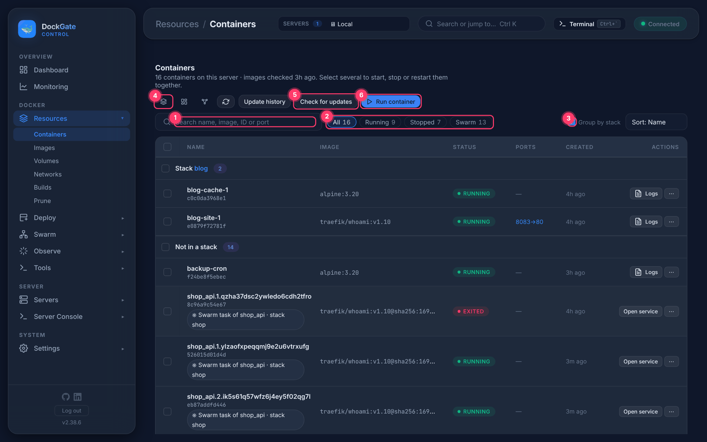
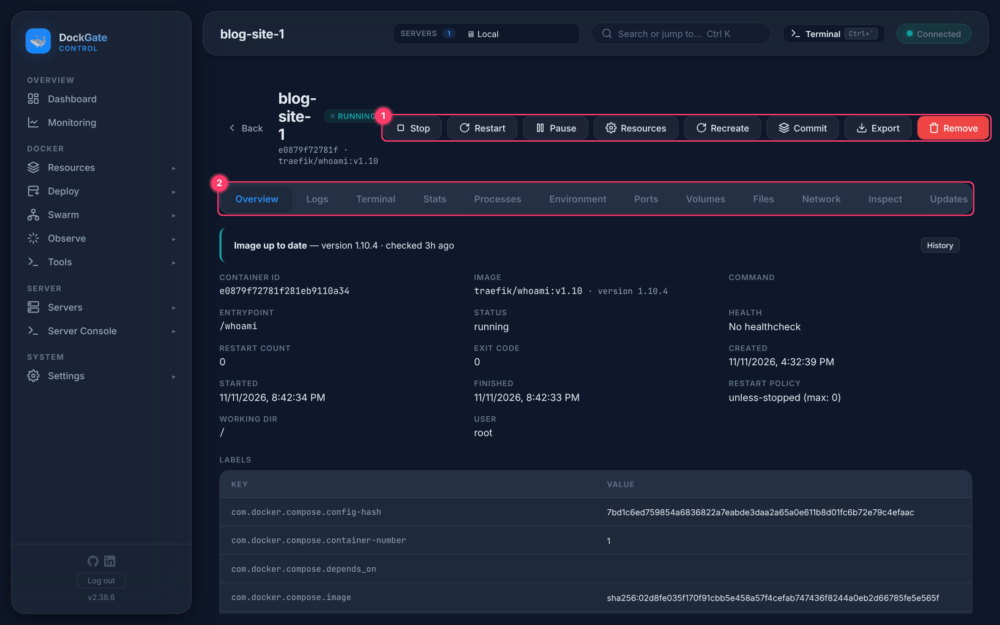
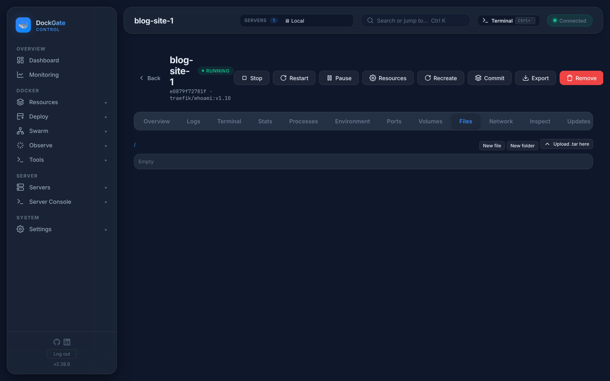

# Resources → Containers

> **Where:** sidebar **Resources → Containers**
>
> **Works on:** the server picked in the top bar (**SERVERS ▾**). Pick another server there to see its containers.

The list of every container on the server, and a page for each one with its logs, terminal, files, stats and settings.

---

## The list

1. **Search** by name, image, ID or port.
2. **Filters:** All, Running, Stopped, Unhealthy, Restarting, Paused, Swarm. A filter only appears when some container is in that state.
3. **Group by stack** shows the containers of each Compose project together. The rest are under *Not in a stack*.
4. **Views:** table, cards, or **topology** (a read-only graph of the stacks and their networks).
5. **Check for updates** asks each registry whether a newer image exists for each container's tag. **Update history** lists the image updates and roll backs started from DockGate on this server.
6. **Run container** opens a guided form (see below).

**Several at once:** tick the boxes on the left to **Start**, **Stop**, **Restart** or **Remove…** the selected containers together.

**Row actions:** **Logs** (or **Start** when stopped), and **⋯** with Open details, Terminal, Restart, Stop and Remove….

### Swarm tasks in the list

A container that Swarm runs shows **⎈ Swarm task of *service* · stack *name***. Its row offers **Open service** instead of Stop and Restart: Swarm would start a stopped task again at once, so change it in **Swarm → Services**.
A container moved to Swarm shows **⎈ moved to Swarm**. It is kept but stopped. Do not start it, or the app runs twice; move it back from **Swarm → Stacks**.

### Run container

| Field | Notes |
|---|---|
| **Image** \* | e.g. `nginx:1.27`. Pulled first if it is not on the server. |
| **Container name** | optional |
| **Restart policy** | unless-stopped (default), no, always, on-failure |
| **Network** | the networks on this server |
| **CPUs** / **Memory** | optional limits, e.g. `0.5` and `512m` |
| **Command override** | optional |
| **Ports**, **Volumes**, **Environment** | add as many rows as needed |

The same form opens from **Images → Run** and from **App templates**.

---

## The container page

Click a container's name, or **⋯ → Open details**.

**① Actions**

| Button | What it does |
|---|---|
| **Stop / Restart / Pause** (or **Start / Unpause**) | as named |
| **Update…** | Shown only when a newer image of the same tag exists. Pulls it and recreates the container, then checks the new one. If it keeps restarting, stops, or is unhealthy, **the previous image is put back by itself**. |
| **Resources** | CPUs, memory and restart policy, changed without recreating |
| **Recreate** | Same settings (environment, ports, volumes, networks), optionally a new image. Volume data stays; the old container is removed and the page opens the new one. |
| **Commit** | Saves the container's filesystem as an image (repository and tag) |
| **Export** | Downloads the filesystem as a `.tar` |
| **Remove** | Removes the container (asks first) |

**② Tabs**

| Tab | What you get |
|---|---|
| **Overview** | ID, image and version, status, health, restart count, exit code, times, restart policy, labels; and whether the image is up to date |
| **Logs** | The shared log viewer: search, levels, time range, live follow, wrap, copy, download |
| **Terminal** | A shell inside the container: choose `/bin/sh`, `/bin/bash` or `/bin/zsh`, then **Reconnect** |
| **Stats** | Live CPU, memory, network and block I/O (only while running) |
| **Processes** | Running processes inside the container |
| **Environment** | Environment variables |
| **Ports** | Published ports |
| **Volumes** | Mounts and where they come from |
| **Files** | Browse, edit text files, new file or folder, rename, delete, download, **Upload .tar here** (extracted into the current folder) |
| **Network** | Networks, IP addresses, aliases |
| **Inspect** | The raw `docker inspect` JSON |
| **Updates** | Whether a newer image exists, and every image update of this container with its result. **Roll back** puts the previous image back after an update |
| **History** | Actions on this container from the audit log, also from before it was recreated (newest 200) |

---

## Good to know

- **Files need a running container with a shell.** Browsing and editing run `sh` inside the container. Images built `FROM scratch` (for example `traefik/whoami`) have no shell, and the tab says so. Use **Export** to get the files out.
- Text files over **1 MB** and binary files can not be edited here; download them instead.
- Top-level system folders (`/bin`, `/etc`, `/usr`, `/var`, `/proc`, `/sys`, `/dev` and similar) are not deleted from the Files tab.
- **Update…** is for the same tag (e.g. a new build of `nginx:1.27`). To change the tag, use **Recreate** with the new image.
- For a **Compose service that can run as several replicas**, Update… replaces the replicas one at a time, without downtime; if the first new one is not ready, nothing old is stopped. See [Scaling & health → Updates without downtime](compose-scaling.md#updates-without-downtime-roll-out).
- Every action is written to **Observe → Audit log** with the server and your IP.

---

## Errors and fixes

| You see | Why | What to do |
|---|---|---|
| `Pull failed: …` | The registry refused the pull, or the image name is wrong | Check the name and tag. For a private registry add a login in **Deploy → Registries** |
| `not authorized — add a login in Deploy → Registries` | The image is private | Add the registry login |
| `Image is required` | Run container without an image | Fill in **Image** |
| `The container must be running` | Files tab or edit on a stopped container | Start it first |
| `The container has no shell (sh) — files can only be downloaded and uploaded` | The image has no `sh` | Use Export, or Upload .tar |
| `This is a binary file — download it instead` | Edit opened on a binary file | Download it |
| `More than 1 MB — upload the file instead` | File too big for the editor | Download, change, upload |
| `The folder <path> does not exist — make it first` | Saving into a folder that is not there | Create the folder with **New folder** |
| `The folder <path> does not exist` | The folder was removed, or the path is wrong | Go back to `/` and open it again |
| `The folder <path> can not be opened (permission denied)` | The container's user may not open that folder | Open it from a folder you have access to, or use **Export** |
| `That place is read-only` | The mount or filesystem is read-only | Change it in a writable volume |
| `the new container keeps restarting (exit code N)` | Update… started the new image and it crashed | The old image was put back. Check the new version's release notes and logs |
| `the new container is unhealthy` / `the new container did not become healthy in time` | The image's healthcheck failed after Update… | The old image was put back |
| `The server in use was switched during the update — switch back to finish it` | You picked another server in the top bar while an update ran | Pick the first server again |
| `Job not found (DockGate restarted?) — see the update history` | DockGate restarted during an update | Open **Update history** for the result |
