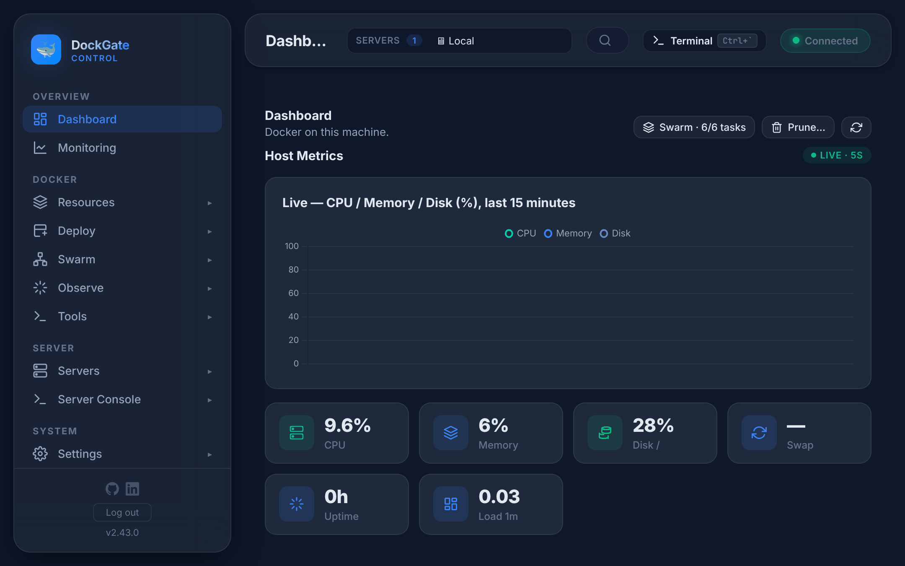
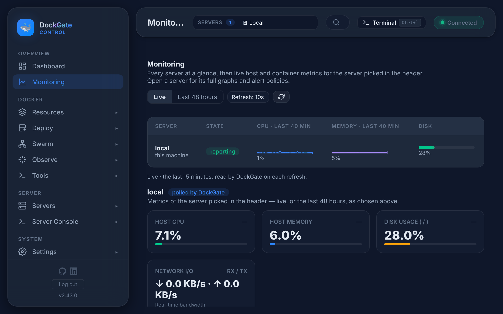

# Dashboard and Monitoring

> **Where:** sidebar **Overview → Dashboard** and **Overview → Monitoring**
>
> **Works on:** the server picked in the top bar (**SERVERS ▾**). Monitoring also lists every server.

---

## Dashboard

The first page after login: the state of the server picked in the top bar.

| Part | What it shows |
|---|---|
| **Top bar** | With Swarm on, *Swarm · 6/6 tasks* (or *no leader*); **Prune…**; refresh. With several servers, a strip of every server with its state and *Open the console* |
| **Host Metrics** | The host's CPU, memory, disk and swap over the last 15 minutes, live; uptime and load; network I/O; processes, open ports, disks and top processes |
| **Counters** | Total containers, running, stopped, restarting; images, volumes, networks, Compose projects |
| **Container Resources** | CPU, memory and network I/O of the containers |
| **Health Status** | Containers by healthcheck: healthy, starting, unhealthy, no check |
| **Port Map** | Which host port goes to which container |
| **Disk Usage** | Space used by images, containers, volumes and build cache |
| **Top Images by Size** | The largest images |
| **Uptime & Restarts** | How long containers run, and which restart often |
| **Smart Insights** | Space you can free: containers stopped for 7+ days, unused and dangling images, volumes no container uses. Click one to open **Resources → Prune** |
| **Recent Activity** | The latest entries of the audit log |
| **System Info** | Docker version, storage driver, CPUs, memory, architecture; registries connected |
| **Quick Actions** | **Start All Stopped**, **Stop All Running**, **Restart All** (each asks first) |

Click a container, image or count to open its page.

---

## Monitoring

**The server list** shows every server: its state, CPU and memory over the last 40 minutes, and disk use. Click a server for its full graphs and alert policies (**Server Console → Monitoring**).

**Under it**, the server picked in the top bar:

| Graph | What it shows |
|---|---|
| **Host CPU · Host memory · Disk usage (/)** | The whole server |
| **Network I/O** | Traffic in and out of the server (RX / TX) |
| **Containers** | CPU and memory per container |

| Control | Meaning |
|---|---|
| **Live** | Read every few seconds: through the Edge agent when it is installed, else over SSH (or the Docker socket on *Local*) |
| **Last 48 hours** | From DockGate's own store: one sample a minute, kept 48 hours, shown as 5-minute averages. Container graphs are live only |
| **Refresh** | How often the live view updates |

### Alerts

Alerts for high CPU, memory and disk, and for a server that goes down, are set in **Settings → Notifications → Rules** (for all servers) and per server in **Server Console → Monitoring**. They are sent through the channels in **Settings → Notifications**.

## Good to know

- Without the [Edge agent](servers.md#edge-agent) DockGate reads remote servers over SSH. That works, but the agent is lighter and keeps working through short network drops.
- *No stored samples yet* means DockGate has not stored a minute of data for that server yet. It keeps 48 hours.
- **Stop All Running** also stops DockGate itself if it runs as a container on that server, so use it with care on *Local*.
