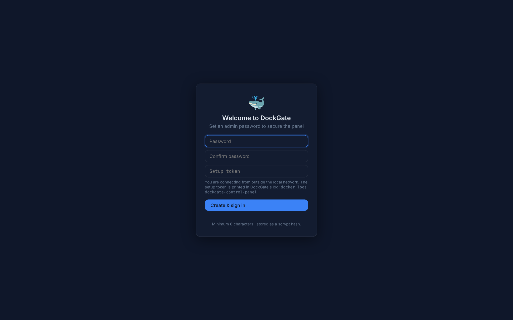
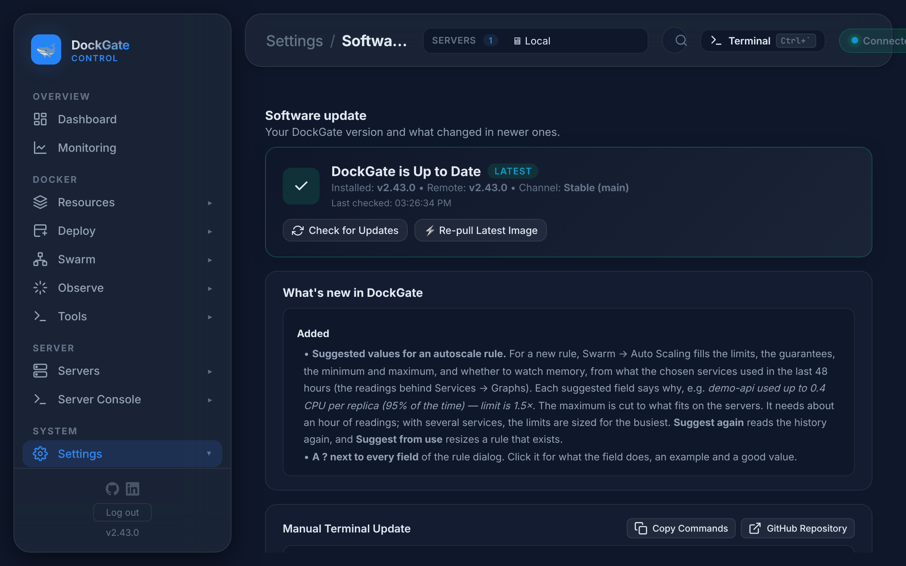

# Getting started

Install DockGate, create the admin password, keep it up to date and back it up.

---

## 1. Requirements

- A Linux server with **Docker** and the **Compose plugin** (`docker compose version` works).
- About **256 MB RAM** and half a CPU for DockGate itself (these are the limits in `docker-compose.yml`).
- Port **7077** free, or another port of your choice.

DockGate runs as one container. It talks to Docker through `/var/run/docker.sock` and keeps its data in `./data`.

> **The Docker socket gives root access to the host.** Do not open port 7077 to the internet. Reach DockGate through a VPN or an SSH tunnel.

## 2. Install

```bash
mkdir dockgate && cd dockgate
curl -O https://raw.githubusercontent.com/Ali7Zeynalli/dockgate/main/docker-compose.yml
docker compose up -d
```

Open **http://SERVER-IP:7077**.

What the downloaded `docker-compose.yml` sets:

| Line | Why |
|---|---|
| `image: ghcr.io/ali7zeynalli/dockgate:latest` | the published image |
| `/var/run/docker.sock:/var/run/docker.sock` | manage Docker on this host — required |
| `./data:/app/data` | database, keys, compose projects — required |
| `# - /:/host:ro` | optional: uncomment so **Tools → Files** and Compose can read folders on the host |
| `# - TRUST_PROXY=loopback` | optional: only behind a reverse proxy on the same host |
| `# - DG_SETUP_TOKEN=change-me` | optional: always ask for this token at first setup |

## 3. Create the admin password

The first visit opens **Welcome to DockGate**.



1. Type a password (at least **8 characters**) twice.
2. **Setup token** — this field appears only when you connect from **outside your local network**, or when `DG_SETUP_TOKEN` is set. It stops a stranger from claiming a fresh install before you do. The token is in DockGate's log:

   ```bash
   docker logs dockgate-control-panel
   ```

   ```
   ┌────────────────────────────────────────────────────────────┐
   │  DockGate first-run setup                                  │
   │  Setup token: Xk3p…                                        │
   └────────────────────────────────────────────────────────────┘
   ```

3. **Create & sign in.**

From the same machine or a private network (192.168.x.x, 10.x.x.x and similar) no token is asked.

DockGate has **one admin**. There are no other users or roles.

## 4. First steps

- **Top bar → SERVERS ▾** — the server every page works on. *Local* is the host DockGate runs on. Add more in **Servers → Servers**; they are reached over SSH.
- **Ctrl/Cmd + K** — search pages, containers, images, volumes, networks, stacks, servers and actions.
- **Ctrl + `** — open a terminal.
- **Settings → Notifications** — connect Telegram, email or a webhook so you hear about crashes and full disks.

## 5. Update

**From DockGate:** **Settings → Software update**.



| Button | What it does |
|---|---|
| **Check for Updates** | compares your version with the newest release and shows what changed |
| **Update to vX.Y.Z Now** | shown when a newer version exists: pulls the image, then a small helper container replaces DockGate with the same ports, volumes, environment and networks. The page reloads after a few seconds |
| **Re-pull Latest Image** | shown when you are up to date: pulls `latest` again and restarts |
| **Copy Commands** | the manual commands below |

**From the terminal:**

```bash
docker compose pull && docker compose up -d
```

Self-update works for the DockGate container on its own host. Your data in `./data` is kept.

## 6. Back up

Everything DockGate knows is in the **`data/`** folder next to `docker-compose.yml`:

| In `data/` | What it is |
|---|---|
| `docker-panel.db` (+ `-wal`, `-shm`) | settings, servers, history, audit log, encrypted secrets |
| `.master.key` | the key that decrypts saved passwords and tokens. **Without it the saved secrets can not be read.** Not needed if you set `DG_MASTER_KEY` |
| `ssh-keys/` | SSH keys DockGate made or imported |
| `compose/` | Compose projects created in DockGate |
| `swarm-backups/` | nightly Swarm cluster backups |

Copy the whole folder. To be sure the database is consistent, stop DockGate first:

```bash
docker compose stop
tar czf dockgate-backup-$(date +%F).tar.gz data/
docker compose start
```

**Volume data** (your apps' data) is not in `data/`. Back it up from **Resources → Volumes → Backup**, or on a schedule in **Tools → Schedules**.

**Restore:** put the `data/` folder back next to `docker-compose.yml` and run `docker compose up -d`.

---

## Errors and fixes

| You see | Why | What to do |
|---|---|---|
| `Setup token is missing or wrong — find it in the DockGate logs (docker logs <container>).` | You set up from outside the local network, or `DG_SETUP_TOKEN` is set | Run `docker logs dockgate-control-panel` and copy the token |
| `Password must be at least 8 characters` | Too short | Use 8 or more characters |
| `Too many attempts — try again later` | More than 10 sign-in or setup tries from your IP in 15 minutes | Wait 15 minutes. Behind a reverse proxy, set `TRUST_PROXY` so DockGate sees each client's own IP |
| `Incorrect password` | Wrong password | Try again (counts toward the limit above) |
| `Already configured` | Setup was done before | Sign in instead |
| The container keeps restarting with `SQLITE_CANTOPEN` or `connect EACCES /var/run/docker.sock` | SELinux confines containers (openSUSE Leap 16 and similar) | See *SELinux* below |
| The page does not open | Port 7077 is closed or used | Check `docker ps`, the firewall, and change `"7077:7077"` if needed |

### SELinux

Check with `docker info --format '{{.SecurityOptions}}'`. If it lists `selinux`, either turn it off for Docker:

```bash
sudo sed -i 's/"selinux-enabled": *true/"selinux-enabled": false/' /etc/docker/daemon.json
sudo systemctl restart docker
```

or add this under the `dockgate` service in `docker-compose.yml`:

```yaml
    security_opt:
      - label:disable
```

Never add `:z` or `:Z` to the `/var/run/docker.sock` mount.

### Forgot the admin password

There is no reset button. Remove the stored password, restart, and set a new one on the setup screen. Containers, servers, history and saved secrets are kept.

```bash
docker exec dockgate-control-panel node -e "new (require('better-sqlite3'))('/app/data/docker-panel.db').prepare(\"DELETE FROM settings WHERE key IN ('admin_setup_done','auth_password_hash','auth_salt')\").run()"
docker restart dockgate-control-panel
```

Until you set the new password, whoever opens the page first can set it — do this from your local network, or set `DG_SETUP_TOKEN` first.
