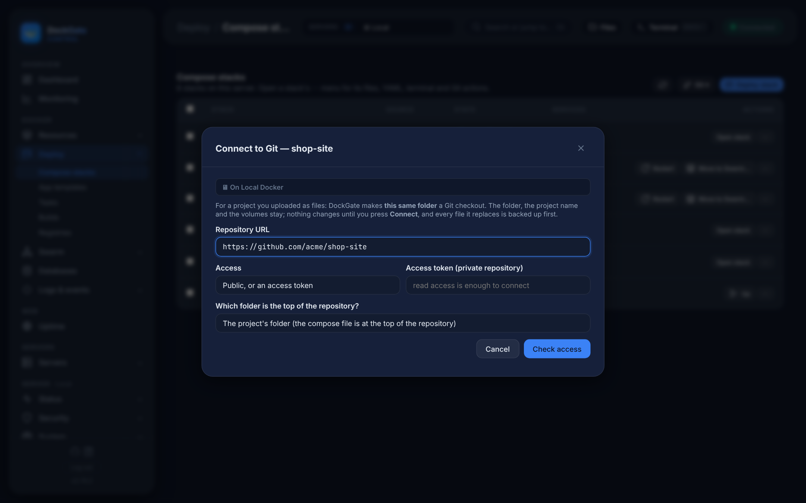
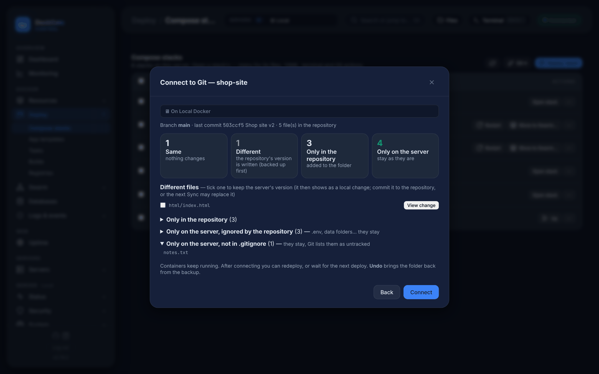

# Connect to Git

> **Where:** Deploy → Projects → a project's **⋯ → Connect to Git…**, or Deploy → Tasks → a folder's **⋯ → Connect to Git…**
>
> **Works on:** the local server and SSH servers. The server needs `git` installed.

Use this when you first uploaded a project as files (**Deploy from folder**, SFTP, `scp`…) and now want its code to come from a Git repository. DockGate turns **the same folder** into a Git checkout. The folder, the Compose project name, the volumes and the running containers stay as they are.

Why not just deploy it again from Git? A new clone goes to a new folder. The Compose project name comes from the folder, so the containers would start as a new project. Named volumes such as `shop_db-data` would be created again under a new name, and the old data would no longer be used. `.env` and data folders (`./data`, `./uploads`) would stay behind in the old folder.

## 1. Repository and access

| Field | |
|---|---|
| **Repository URL** | `https://github.com/owner/repo`, or `git@github.com:owner/repo.git` for a deploy key |
| **Access** | public, an **access token** (read access is enough to connect), or a **deploy key** from Servers → SSH keys |
| **Top folder** (Compose) | the project's folder, or one or two folders up when the compose file is in a subfolder of the repository |

**Check access** reads the branches of the repository (nothing is downloaded into the folder yet). It also shows the folder, the server and the number of files.

- When the folder is a Git checkout already, it says so. Use **Git pull** / **Git sync** on it.
- When the repository is **empty**, you can make the [first push](#first-push-the-repository-is-empty).

## 2. Compare

Pick the branch and press **Compare with the folder**. DockGate reads the repository into a temporary place and compares it with the folder. **The folder does not change.**

| List | What happens on Connect |
|---|---|
| **Same** | nothing |
| **Different** | the repository's version is written; the server's version is **backed up first**. **View change** shows the difference (− the server now, + after connecting). Tick a file to **keep the server's version**: it then shows as a local change. Commit it to the repository, or the next **Git sync** may replace it |
| **Only in the repository** | added to the folder (for example `.github/`, `README.md`) |
| **Only on the server, ignored by the repository** | stays. These are the files the repository's `.gitignore` leaves out: `.env`, data folders |
| **Only on the server, not in .gitignore** | stays; Git lists it as *untracked* |

Warnings:
- The compose file the project uses is missing from the repository at that place. Pick another **top folder**.
- Files that look like secrets (`.env`, `*.pem`, `*.key`…) are only on the server and not in the repository's `.gitignore`. They stay on the server. Add them to `.gitignore` so nobody commits them by mistake.

## 3. Connect

1. Every file in **Different** is packed into a backup (on that server, under `~/.dockgate/git-connect-backups`; for the local server, in DockGate's data folder).
2. `git init`, `origin` is set to the repository, the branch is fetched and checked out. The branch follows `origin/<branch>`, so `git pull` works from DockGate and from a terminal.
3. Files that are ignored or only on the server are not touched. DockGate's own records in the folder (`.dockgate-*`) are kept out of Git.

Containers keep running. Press **Redeploy now** to rebuild from the new files (Git sync), or wait for the next deploy.

From then on:
- the project's **Git pull** and **Git sync and deploy**;
- the **Git pull** step and **Back to the commit before** in [Deploy → Tasks](tasks.md) recipes;
- deploys on every push from **GitHub, GitLab or Bitbucket**, through a recipe's **Webhook / CI…**. On the stack's page: **Automation → Set up auto-deploy**.

The access token is kept in the folder's `.git/config` (in the `origin` URL), as with any clone made with a token, so pulls keep working. A deploy key is saved as `core.sshCommand`.

## Undo

**Undo…** (on the result, or under *Earlier connects of this folder* when you open the dialog again) removes `.git`, puts back every file the connect replaced, and deletes the files it added. Undo works once for each connect.

## First push (the repository is empty)

When the repository has no branches, DockGate can make the first commit from the folder and push it:

1. **.gitignore.** When the folder has one, it is used as it is. When it has none, DockGate suggests one: `.env`, `.env.*`, keys, `node_modules/`, logs, and the data folders it finds (`data/`, `uploads/`, `storage/`…). You can edit it.
2. **Check the file list** shows exactly what will be pushed.
3. Give the branch, your name and e-mail for the commit, and a message.
4. **Commit and push**. The token or key needs **write** access.

The push stops when:
- a file looks like a secret and is not in `.gitignore` (you can tick *Push them anyway*);
- a file is over 50 MB (GitHub refuses files over 100 MB);
- the repository has that branch already. Use Connect instead.

If the push fails, `.git` and the new `.gitignore` are removed again.

## Errors and fixes

| Message | Why | What to do |
|---|---|---|
| *git is not installed on this server* | — | `apt-get install -y git` / `dnf install -y git`, or Server → Software → Setup |
| *Reading the repository failed … check the URL and that the token / deploy key can read this repository* | Wrong URL, private repository without a token, or the deploy key is not added to the repository | Check the URL; give a token with read access; add the key's public part to the repository's deploy keys |
| *Fetching branch … failed* | The branch does not exist | Pick one from the list |
| *The comparison is too old* | More than 30 minutes since Compare | Compare again |
| *This folder is a Git checkout already* | `.git` exists | Use Git pull / Git sync |
| *The push failed … needs write access* | Read-only token or key | Use a token with write access, or allow write on the deploy key |
| *These look like secrets and would be pushed* | A `.env` or key file is not in `.gitignore` | Add it to `.gitignore` and check the list again |
