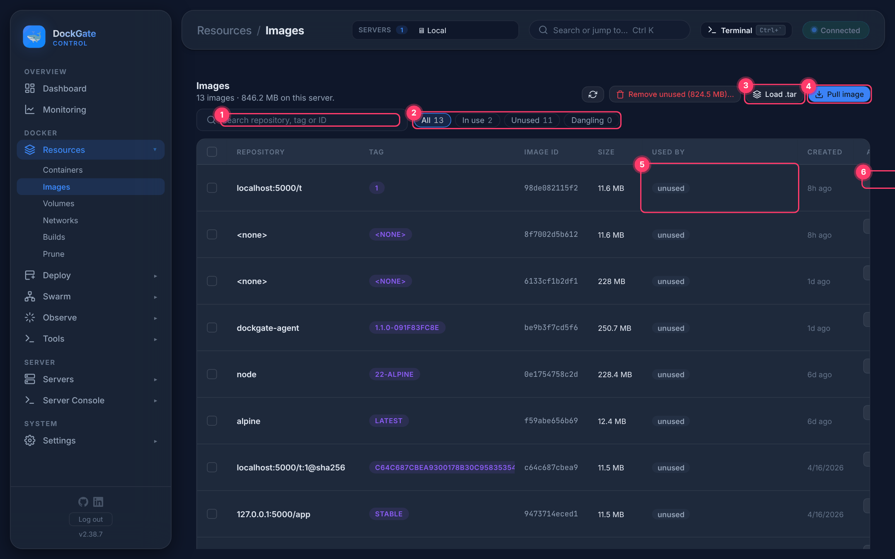
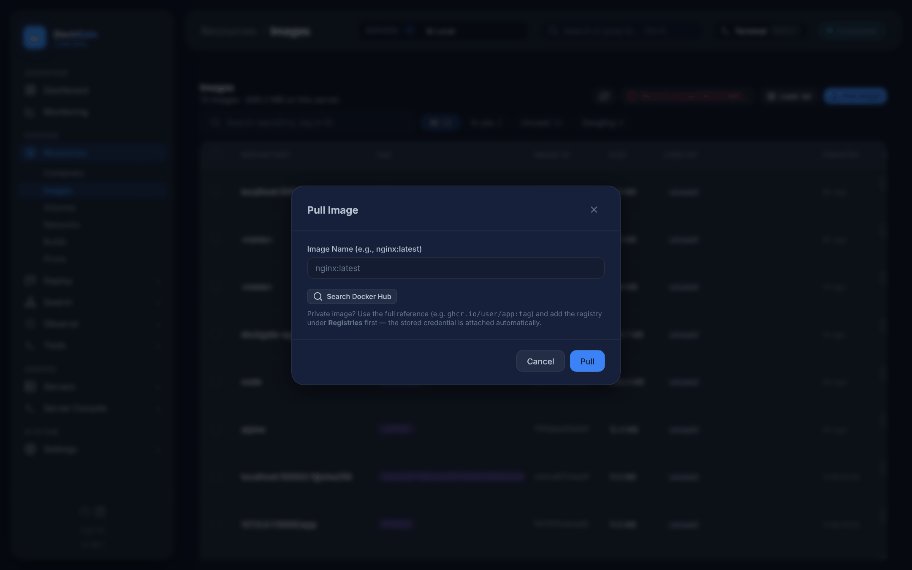

# Resources → Images

> **Where:** sidebar **Resources → Images**
>
> **Works on:** the server picked in the top bar (**SERVERS ▾**).

Every image on the server: pull, load, tag, push, save, inspect, and run a container from one.

1. **Search** by repository, tag or ID.
2. **Filters:** All, In use, Unused, Dangling (`<none>` images left by rebuilds).
3. **Load .tar** — load an image from a file made by `docker save` or **Save as .tar**.
4. **Pull image** — see below.
5. **Used by** — the containers that use this image. *unused* means none.
6. **Run** — opens the [Run container](containers.md#run-container) form with this image filled in.

When some images are unused, **Remove unused (size)…** appears at the top. It removes every image no container uses (the same as Prune → Unused images). You type `delete` to confirm.

**Several at once:** tick images, then **Remove…** or **Force remove…** (force also removes images that stopped containers still reference, or that have several tags).

## Pull an image

Type a reference such as `nginx:1.27`, or click **Search Docker Hub** to find one (official images are marked). For a private registry use the full reference, for example `ghcr.io/you/app:tag`, and add a login under **Deploy → Registries** first — it is used automatically.

## Actions (⋯)

| Action | What it does |
|---|---|
| **Inspect** | The raw `docker image inspect` JSON |
| **Layers and history** | Each layer with its size and the Dockerfile command that made it |
| **Tags…** | Add a tag (`repo:tag`) or **Untag** one |
| **Push to registry…** | Push to a target reference such as `ghcr.io/owner/app:tag`, with a live log. The login is picked by the registry host from **Deploy → Registries** |
| **Build from this (FROM)…** | Opens **Builds** with an inline Dockerfile starting `FROM` this image |
| **Save as .tar** | Downloads the image as a `.tar` (load it elsewhere with **Load .tar** or `docker load`) |
| **Remove…** | Removes the image. You type its name to confirm |

## Good to know

- An image used by a **running** container can not be removed at all. One used only by stopped containers needs **Force remove…**.
- Newer-image checks for running containers are on **Resources → Containers → Check for updates**.

## Errors and fixes

| You see | Why | What to do |
|---|---|---|
| `pull access denied for <name>, repository does not exist or may require 'docker login'` | Wrong name, or a private image without a login | Check the name; add the registry under **Deploy → Registries** |
| `not authorized — add a login in Deploy → Registries` | Push or pull to a private registry without a login | Add the login |
| `Docker Hub HTTP 429` | Docker Hub rate limit for searches | Wait a minute, or type the name yourself |
| `conflict: unable to delete <id> (cannot be forced) - image is being used by running container <id>` | A **running** container uses the image; not even Force remove can delete it | Stop and remove that container first |
| `conflict: unable to delete <id> (must be forced) - image is being used by stopped container <id>` | A stopped container uses it | Remove the container, or use **Force remove…** |
| `image has dependent child images` | Other images are built on it | Remove those first |
