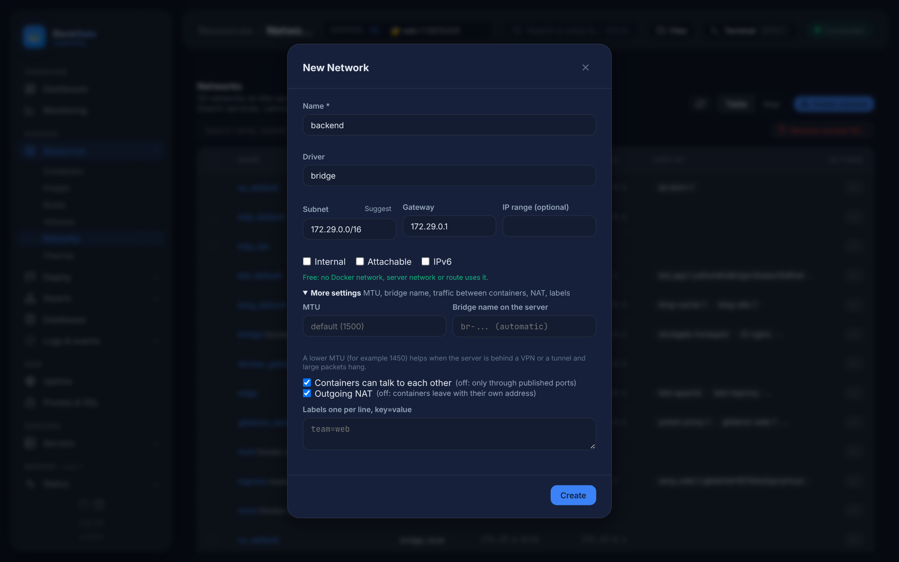

# Resources > Networks

> **Where:** sidebar **Resources > Networks**
>
> **Works on:** the server picked in the top bar (**SERVERS ▾**).

Docker networks connect containers to each other. Containers on the same network reach each other by name.

1. **Used by** - the containers on the network, and the Swarm services attached to it.
2. **Create network** - see below.
3. **Table / Map** - the Map shows each network as a card with its running containers, grouped by compose project (Swarm tasks by service, stopped containers counted). A container marked `+name` is on other networks too: that is where traffic can cross between networks and projects. A card with more than one project says so. Swarm's `ingress` is left out.

Click a network's name (or **Open** in its menu) for its own page.

Labels next to the name:
- **Docker default** - `bridge`, `host`, `none`. Docker makes them; they can not be removed.
- **made by Swarm** - `ingress` (routes published ports to every server) and `docker_gwbridge`. Never removed here.
- **internal** - containers on it have no route to the outside.

Only networks you created **and nothing uses** can be ticked and removed.

## Create a network

| Field | Notes |
|---|---|
| **Name** \* | |
| **Driver** | `bridge` (one server), `overlay` (spans Swarm servers), `macvlan` / `ipvlan` (containers get addresses on the host's LAN) |
| **Subnet** | Filled with a free private range. **Suggest** picks the next free one |
| **Gateway**, **IP range** | Filled to match the subnet; IP range is optional |
| **Internal** | No outside access |
| **Attachable** | For `overlay`: lets plain containers join, not only Swarm services (on by default for overlay) |
| **IPv6** | Enable IPv6 on the network |

## Actions (⋯)

| Action | What it does |
|---|---|
| **Open** | The network's page (below) |
| **Quick view** | Settings and the connected containers in a dialog. **Connect** a container to the network, or **Disconnect** one, from here |
| **Clone...** | Opens the create form filled from this network. Pick another subnet so they do not overlap |
| **Remove...** | Only for networks nothing uses |

## A network's page

| Part | What it shows |
|---|---|
| **Made by** | The compose project (and its name for the network in the file), Docker, or by hand (`docker network create`) |
| Settings | Driver, subnet, gateway, internal, IPv6, attachable, created |
| **Compared with the compose files** | Every compose project on the network (or the one that made it): its file read with `docker compose config`, against what is live. Opens with the page, again with **Compare with compose** |
| **Containers on this network** | Each container with its state, compose project and service, address (marked fixed when the file sets it), aliases (the names the others reach it by here) and ports on the server. Stopped containers keep their place and are listed too. **Disconnect...**, and **Connect** a container |
| **Options and labels** | Driver options and labels as Docker holds them |

What the comparison finds, and the fix next to each:

| Finding | Meaning | Fix |
|---|---|---|
| **should be on this network, but is not** (High) | A running container of a service the file puts on this network is not on it: it can not reach the others here | **Compose up...** (`docker compose up -d`) |
| **does not list it** | A compose container is on this network but its service in the file does not say so: connected by hand, or the file changed | **Disconnect...** |
| **should answer to ... but does not** | An alias from the file is missing on the live container. `compose up` leaves a running container alone in this case | **Make <service> again...** (`docker compose up -d --force-recreate --no-deps <service>`) |
| **has ... here, the file fixes it to ...** | The address differs from `ipv4_address` in the file | **Make <service> again...** |
| **is no longer in the compose file** | The container's service was taken out of the file | **Compose up, remove old...** (`docker compose up -d --remove-orphans`) |
| **differs from the live one** | The network's driver, internal, IPv6 or subnet changed in the file. Compose can not change a network in place | Compose down and up for that project (its containers stop for that time) |
| **made this network, but its compose file no longer has it** | The project's file dropped the network | Remove it when nothing uses it |
| **started without a compose file** (Info) | A container from `docker run` or by hand | - |
| **its compose file could not be read** (Info) | DockGate can not find or read the project's file (for example a missing `.env`) | Open the project in Deploy > Projects |

Every fix asks first, then runs with its log on screen and reads the network again. Connecting a container on this page is not written to any file, so the comparison shows it as connected by hand.

## Errors and fixes

| You see | Why | What to do |
|---|---|---|
| `Pool overlaps with other one on this address space` | The subnet is used by another network | Click **Suggest** for a free one |
| `network with name <name> already exists` | Name taken | Choose another name |
| `error while removing network: network <name> has active endpoints` | Something still uses it | Disconnect the containers or stop the services first |
| `No free subnet found` | Every suggested range is used | Type a subnet yourself |
| `... is a pre-defined network and cannot be removed` | `bridge`, `host`, `none` | They always stay |
