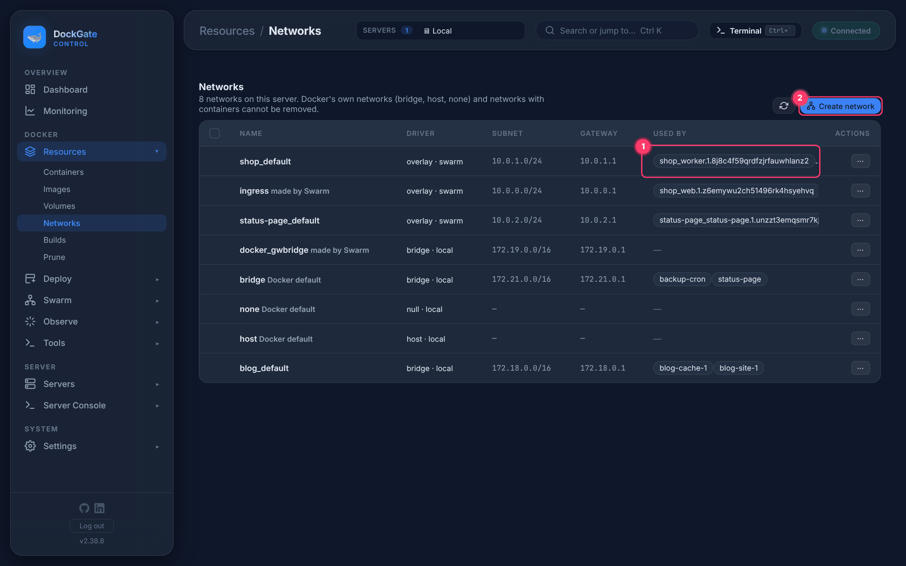
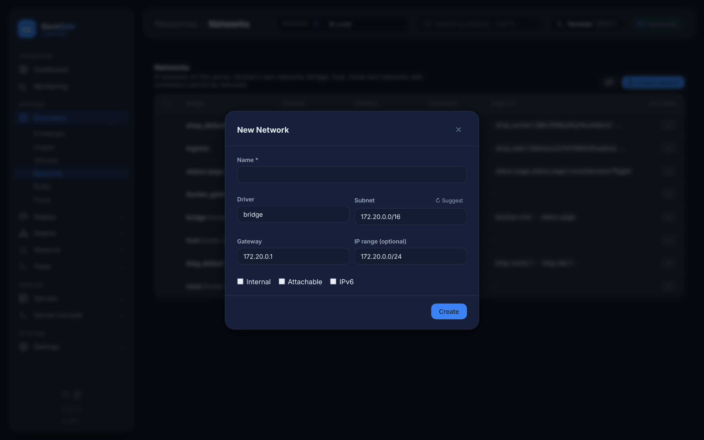

# Resources → Networks

> **Where:** sidebar **Resources → Networks**
>
> **Works on:** the server picked in the top bar (**SERVERS ▾**).

Docker networks connect containers to each other. Containers on the same network reach each other by name.

1. **Used by** — the containers on the network, and the Swarm services attached to it.
2. **Create network** — see below.

Labels next to the name:
- **Docker default** — `bridge`, `host`, `none`. Docker makes them; they can not be removed.
- **made by Swarm** — `ingress` (routes published ports to every server) and `docker_gwbridge`. Never removed here.
- **internal** — containers on it have no route to the outside.

Only networks you created **and nothing uses** can be ticked and removed.

## Create a network

| Field | Notes |
|---|---|
| **Name** \* | |
| **Driver** | `bridge` (one server), `overlay` (spans Swarm servers), `macvlan` / `ipvlan` (containers get addresses on the host's LAN) |
| **Subnet** | Filled with a free private range. **Suggest** picks the next free one |
| **Gateway**, **IP range** | Filled to match the subnet; IP range is optional |
| **Internal** | No outside access |
| **Attachable** | For `overlay`: lets plain containers join, not only Swarm services (on by default for overlay) |
| **IPv6** | Enable IPv6 on the network |

## Actions (⋯)

| Action | What it does |
|---|---|
| **Inspect** | Settings and the connected containers. **Connect** a container to the network, or **Disconnect** one, from here |
| **Clone…** | Opens the create form filled from this network. Pick another subnet so they do not overlap |
| **Remove…** | Only for networks nothing uses |

## Errors and fixes

| You see | Why | What to do |
|---|---|---|
| `Pool overlaps with other one on this address space` | The subnet is used by another network | Click **Suggest** for a free one |
| `network with name <name> already exists` | Name taken | Choose another name |
| `error while removing network: network <name> has active endpoints` | Something still uses it | Disconnect the containers or stop the services first |
| `No free subnet found` | Every suggested range is used | Type a subnet yourself |
| `… is a pre-defined network and cannot be removed` | `bridge`, `host`, `none` | They always stay |
