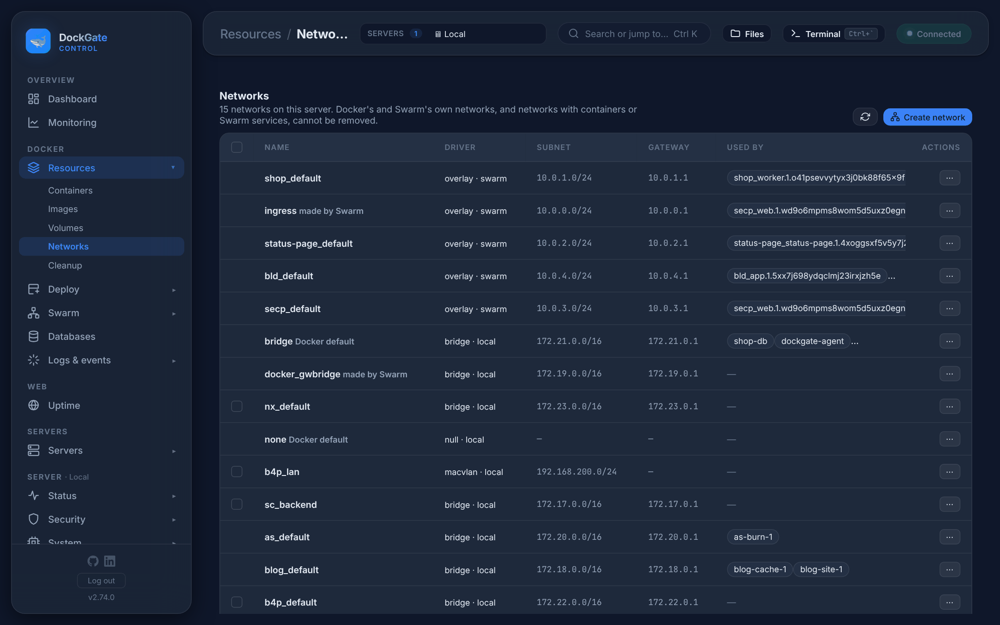
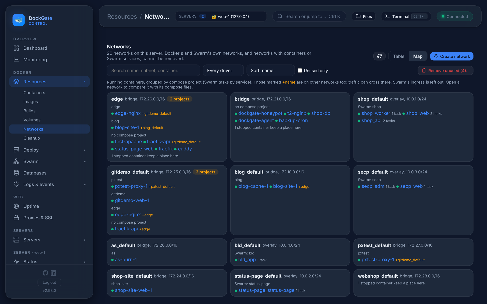
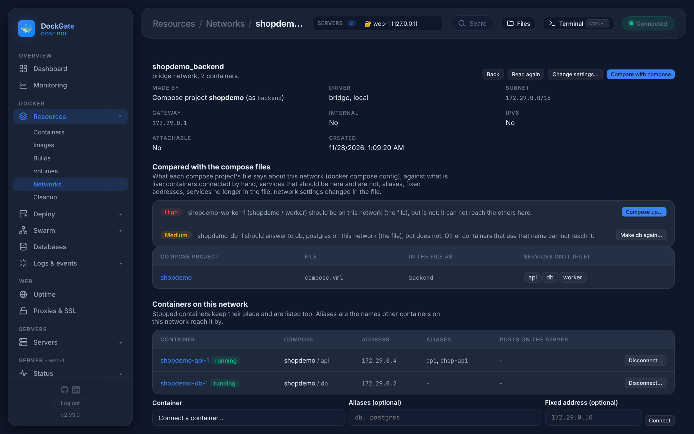

# Resources > Networks

> **Where:** sidebar **Resources > Networks**
>
> **Works on:** the server picked in the top bar (**SERVERS ▾**).

Docker networks connect containers to each other. Containers on the same network reach each other by name.

1. **Used by** - the containers on the network, and the Swarm services attached to it.
2. **Create network** - see below.
3. **Search, filter, sort** - search by name, subnet, gateway or a container on it; one driver; **Unused only**; sort by name, most used or driver. The choices are kept when you come back.
4. **Remove unused (N)...** - removes every network nothing uses (no container, running or stopped, and no Swarm service), after showing which.
5. **Table / Map** - the Map shows each network as a card with its running containers, grouped by compose project (Swarm tasks by service, stopped containers counted). A container marked `+name` is on other networks too: that is where traffic can cross between networks and projects. A card with more than one project says so. Swarm's `ingress` is left out.

The list reads Docker again every 15 seconds and only redraws when something changed, so an open menu or a half typed search stays.

Click a network's name (or **Open** in its menu) for its own page.

Labels next to the name:
- **Docker default** - `bridge`, `host`, `none`. Docker makes them; they can not be removed.
- **made by Swarm** - `ingress` (routes published ports to every server) and `docker_gwbridge`. Never removed here.
- **internal** - containers on it have no route to the outside.

Only networks you created **and nothing uses** can be ticked and removed.

## Create a network

| Field | Notes |
|---|---|
| **Name** \* | |
| **Driver** | `bridge` (one server), `overlay` (spans Swarm servers), `macvlan` / `ipvlan` (containers get addresses on the host's LAN) |
| **Parent interface** \* | For `macvlan` / `ipvlan`: the server's interface whose network the containers join (eth0...). The list is read from the server. **Mode** (`l2` / `l3`) for ipvlan |
| **Subnet** | Filled with a free private range: not used by another Docker network, nor by the server's own networks and routes (LAN, VPN). **Suggest** picks the next free one. For macvlan, use the LAN's subnet |
| **Gateway**, **IP range** | Optional. For macvlan, the gateway is the router and the range should be outside what its DHCP hands out |
| **Internal** | No outside access |
| **Attachable** | For `overlay`: lets plain containers join, not only Swarm services (on by default for overlay) |
| **IPv6** | Turns IPv6 on and shows **IPv6 subnet** (a random private `fd..::/64` is filled in) and gateway |
| **More settings** | **MTU** (lower it, for example to 1450, behind a VPN or tunnel), **Bridge name on the server**, **Containers can talk to each other** (off: only through published ports), **Outgoing NAT**, **Labels** (`key=value` per line) |

As you type a subnet, it is checked:
- **Overlaps a Docker network**: Docker will refuse it. Change it.
- **Overlaps a network or route of the server** (an office LAN, a VPN, the provider's private network): Docker allows it, but the server and its containers could no longer reach that network. Change it, or tick **Create it anyway**.

**Clone...** copies every setting, both subnets (IPv4 and IPv6), options and labels; a new free subnet is filled in so the two do not overlap.

## Actions (⋯)

| Action | What it does |
|---|---|
| **Open** | The network's page (below) |
| **Quick view** | Settings, every subnet and the connected containers in a dialog. **Connect** a container, or **Disconnect** one (asks before forcing it when Docker refuses) |
| **Clone...** | Opens the create form filled from this network. Pick another subnet so they do not overlap |
| **Remove...** | Only for networks nothing uses |

## A network's page

| Part | What it shows |
|---|---|
| **Made by** | The compose project (and its name for the network in the file), Docker, or by hand (`docker network create`) |
| Settings | Driver, subnet, gateway, internal, IPv6, attachable, created |
| **Compared with the compose files** | Every compose project on the network (or the one that made it): its file read with `docker compose config`, against what is live. Opens with the page, again with **Compare with compose** |
| **Containers on this network** | Each container with its state, compose project and service, address (marked fixed when the file sets it), aliases (the names the others reach it by here) and ports on the server. Stopped containers keep their place and are listed too. **Disconnect...** (a normal disconnect first; when Docker refuses, it asks before forcing). **Connect** a container, with optional **Aliases** and a **Fixed address** |
| **Change settings...** | Subnet, gateway, IP range, internal, attachable, IPv6, MTU, traffic between containers, NAT. See below |
| **Can a container reach another?** | From a running container, a name, alias or address and an optional port. A small helper container joins the first one's network for a few seconds and answers: is the name found by Docker's DNS, which address and which network it gives (and whether the first container is on that network), and does the port answer (open, refused: nothing listens there, or no answer in 3 seconds: dropped on the way) |
| **History** | What DockGate did to this network: created, connected (with aliases and address), disconnected, settings changed, with the time and where from. Changes made outside DockGate are not there |
| **Options and labels** | Driver options and labels as Docker holds them |

### Change settings

Docker can not change a network in place, so DockGate makes it again under the same name, as a job with its steps on screen:

1. Reads the network and every container on it, running or stopped, with its aliases and fixed address.
2. Disconnects them, 3. removes the network, 4. creates it with the new settings.
5. Connects every container back with its aliases. A fixed address is kept when it fits the new subnet, otherwise the container gets a new one (the log says which).
6. Checks every container is back.

Running containers can not reach each other over this network for those few seconds. A subnet Docker would refuse (it overlaps another Docker network) is caught before anything is disconnected. If a step fails after the removal, the old network is made again with its old settings and the containers go back to it.

Not changed here: Docker's own networks; Swarm networks (change them in Swarm > Networks); networks a compose project made (the next compose up would undo it: the dialog offers to open the project, change its compose file, then compose down and up).

What the comparison finds, and the fix next to each:

| Finding | Meaning | Fix |
|---|---|---|
| **should be on this network, but is not** (High) | A running container of a service the file puts on this network is not on it: it can not reach the others here | **Compose up...** (`docker compose up -d`) |
| **does not list it** | A compose container is on this network but its service in the file does not say so: connected by hand, or the file changed | **Disconnect...** |
| **should answer to ... but does not** | An alias from the file is missing on the live container. `compose up` leaves a running container alone in this case | **Make <service> again...** (`docker compose up -d --force-recreate --no-deps <service>`) |
| **has ... here, the file fixes it to ...** | The address differs from `ipv4_address` in the file | **Make <service> again...** |
| **is no longer in the compose file** | The container's service was taken out of the file | **Compose up, remove old...** (`docker compose up -d --remove-orphans`) |
| **differs from the live one** | The network's driver, internal, IPv6 or subnet changed in the file. Compose can not change a network in place | Compose down and up for that project (its containers stop for that time) |
| **made this network, but its compose file no longer has it** | The project's file dropped the network | Remove it when nothing uses it |
| **started without a compose file** (Info) | A container from `docker run` or by hand | - |
| **its compose file could not be read** (Info) | DockGate can not find or read the project's file (for example a missing `.env`) | Open the project in Deploy > Projects |

Every fix asks first, then runs with its log on screen and reads the network again. Connecting a container on this page is not written to any file, so the comparison shows it as connected by hand.

## Errors and fixes

| You see | Why | What to do |
|---|---|---|
| `Pool overlaps with other one on this address space` | The subnet is used by another network | Click **Suggest** for a free one |
| `network with name <name> already exists` | Name taken | Choose another name |
| `error while removing network: network <name> has active endpoints` | Something still uses it | Disconnect the containers or stop the services first |
| `No free subnet found` | Every suggested range is used | Type a subnet yourself |
| `... is a pre-defined network and cannot be removed` | `bridge`, `host`, `none` | They always stay |
