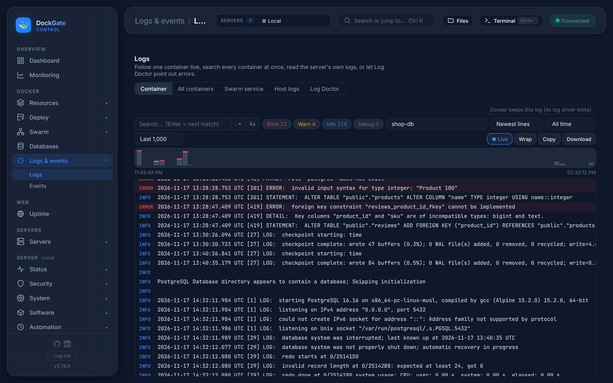
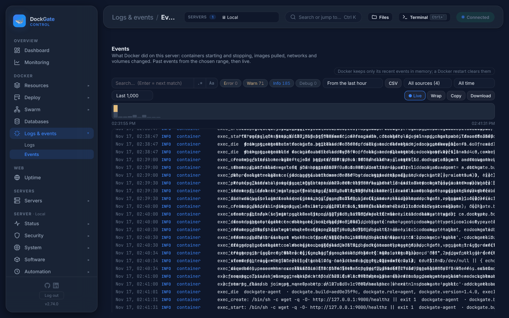
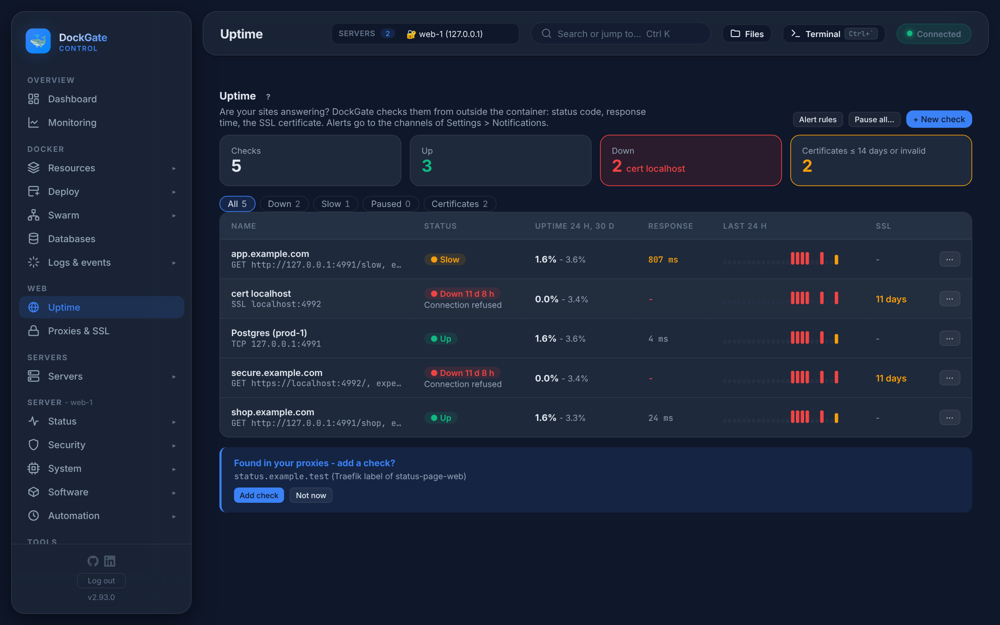
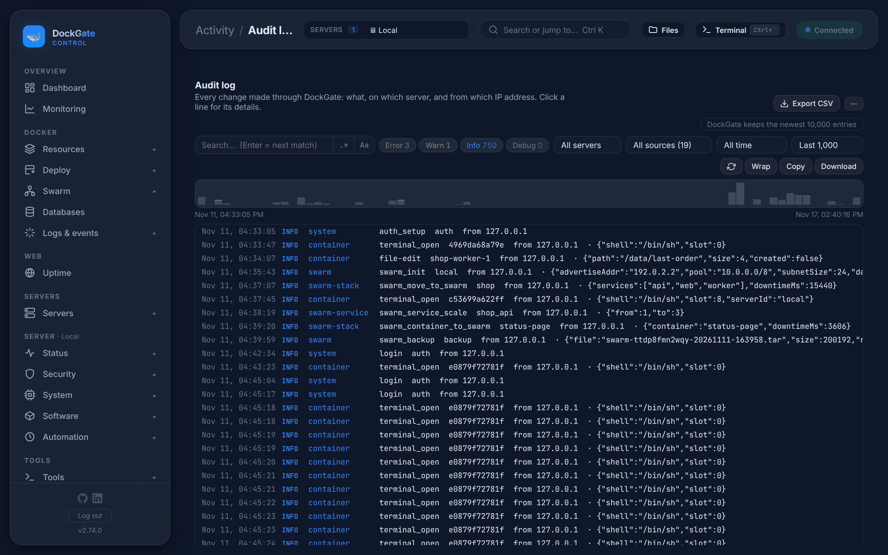

# Observe > Logs, Events, Uptime, Audit log, Notifications sent

> **Where:** sidebar **Logs & events** (Logs, Events), **Web > Uptime**, **System > Activity** (Audit log, Notifications sent)
>
> **Works on:** the server picked in the top bar (**SERVERS ▾**). Uptime, the audit log and the notification log cover all servers.

---

## The log viewer

Every log in DockGate (these pages, the container page, Swarm services, Server > Status > Logs) uses the same viewer:

| Control | What it does |
|---|---|
| **Search** | Highlights matches; **Enter** jumps to the next one. **.\*** turns on regular expressions, **Aa** makes it case-sensitive |
| **Error, Warn, Info, Debug** | Show or hide lines by level, with the count of each |
| **Time range** | All time, or the last 15 min, hour, 24 h... |
| **Last 1,000** | How many of the newest lines to load (1,000 to 10,000), remembered per place |
| **Live** / **Paused** | Follow new lines, or stop to read |
| **Wrap** | Wrap long lines |
| **Copy** / **Download** | The lines shown, as text or a `.txt` file |
| Timeline | A bar per minute above the lines, red for errors. Click a bar to zoom to that minute. Click a line for its details |

Timestamps can be turned on in **Settings > General > Log timestamps**.

---

## Logs

| Tab | What it shows |
|---|---|
| **Container** | One container, live. Pick it, and how far back: *Newest lines*, *Last 15 min*, *Last hour*, *Last 24 h* |
| **All containers** | Search every container of the server at once. With the Edge agent the newest 10,000 lines per server are kept, so stopped containers can be searched too; without it, DockGate reads from Docker |
| **Swarm service** | All tasks of one service, wherever they run |
| **Host logs** | The server's own logs: the system journal and log files. Most sources need passwordless `sudo` |
| **Log Doctor** | Scans recent logs for known problems: out-of-memory kills, proxy 502/504 errors, port conflicts and security warnings |

Docker keeps container logs by its log driver (`json-file` by default, often without a size limit). To keep them small, set `max-size` in the Docker daemon or the compose file.

---

## Events

What Docker did on the server: containers created, started, stopped, killed and removed, images pulled, networks and volumes changed. It shows past events from the chosen range (*From the last 15 min* ... *From the last 7 days*), then new ones live. Red lines are errors, such as a container that exited with a non-zero code or went unhealthy.

**CSV** downloads the loaded events. Docker keeps only recent events in memory: a Docker restart clears them.

---

## Uptime

Are your sites answering? A container can be *running* while the site behind it is down. Uptime checks the address itself, from DockGate, every 30 seconds to 1 hour.

| Type | What it checks |
|---|---|
| **HTTP(S)** | The status code (`200`, `200-399`, `2xx`, `200,301`), the response time, optionally a text the page must or must not contain (`OK`, `Error`, `maintenance`), and the certificate of an `https://` address |
| **SSL only** | The certificate of `host` or `host:port`: days left, valid for the name, issuer, trusted |
| **TCP port** | `host:port` accepts a connection - a database, SMTP, Redis |
| **DNS** | A name resolves, optionally to an expected address |

**+ New check** -> type, address, name, how often, after how many failures in a row it counts as down (default 2), timeout, *slow above* (ms, on 3 checks in a row). **Test now** tries it before saving. *Advanced*: follow redirects, ignore certificate errors (self-signed - the certificate is still shown), extra headers.

**The list** shows each check's status (Up, Slow, Down for how long, Paused), uptime for 24 hours and 30 days, the last response time, the last 24 hours as small bars (green all up, orange some failed, red down) and the certificate's days left. The chips filter Down, Slow, Paused and certificates. A red number on **Uptime** in the sidebar counts checks that are down.

**A check's page:** uptime for 24 h / 7 d / 30 d / 90 d, the response time graph (red where checks failed), **incidents** (when it went down, how long, why - timeout, HTTP 502, DNS, TLS), and the certificate. **Check now**, **Pause...** (30 min to a day, or until resumed - paused time does not count against uptime), **Edit...**, **Delete...**.

**Alerts** (Settings > Notifications -> *Sites (Uptime)*), through the same channels as every other alert:

| Alert | When |
|---|---|
| Site down | the check failed the set number of times in a row - with the reason |
| Site back up | it answers again - with how long it was down |
| Site slow | slower than its limit on 3 checks in a row (once, until it is fast again) |
| Certificate expires soon | 30, 14, 7 and 1 days before (once each; a renewed certificate starts over) |
| Certificate invalid | expired, not for this name, or not trusted |

**Linked to** a container, Compose project or Swarm service (of the server in the top bar): a *Site down* alert then includes its state and the last log lines (*"shop-web-1 restarting, ECONNREFUSED db:5432"*), the check's page shows them with **Restart**, and the check **waits while DockGate deploys, restarts or updates it** (and 3 minutes after), so a planned restart is not reported as down.

**Check from** other servers: tick servers DockGate manages, and they run the same check over SSH (`curl`, `nc` / `bash`, `openssl`, `getent`). With several places a check is **down only when every place fails**; the check's page shows each place's last result, and the list says *"1 place failing"* when only some fail.

**Found in your proxies:** domains in Traefik `Host()` rules and Caddy labels of the server in the top bar that have no check yet are offered - **Add** creates HTTPS checks linked to their containers.

**Pause all...** pauses every check for planned work; **Resume all** brings them back. The Dashboard shows *Sites, 11/12 up* (red when one is down) and opens Uptime.

**Keep in mind:** the checks run from the machine DockGate runs on unless other places are ticked. When DockGate is on the same server as the site, a check shows whether the site answers there, not whether the internet can reach it (a firewall or DNS problem outside is not seen). Cloud metadata addresses (`169.254.169.254`) are never checked. Results are kept for 48 hours, then one row per hour for 90 days.

## Audit log

Every change made through DockGate: the action, the server, the resource and the IP address it came from. Click a line for its details (the values sent, without secrets). Logins and failed logins are here too.

- **Export CSV** downloads the whole log.
- **⋯ > Clear the log...** deletes every entry.
- DockGate keeps the newest 10,000 entries.

---

## Notifications sent

Every alert DockGate sent: when, the event, the subject, the channel and recipient, and whether it arrived. A failed one shows the error from the channel (a wrong SMTP password, a blocked Telegram bot...).

**Notification settings** opens **Settings > Notifications**, where channels and rules are set. DockGate keeps the newest 10,000 entries.

## Errors and fixes

| You see | Why | What to do |
|---|---|---|
| *Choose a container to follow its log.* | Nothing picked yet | Pick a container |
| *No container log lines.* | The container wrote nothing, or the time range is too short | Choose *Newest lines* |
| Host logs: `sudo: a password is required` | The SSH user has no passwordless `sudo` | Give the user passwordless `sudo`, or use the deploy user (Server > Software > Setup) |
| Events empty after a Docker restart | Docker keeps events only in memory | They appear again as Docker reports them |
| Uptime: `Timeout after 10 s` | The site did not answer in time - or a firewall drops DockGate's requests | Open the address from DockGate's server (`curl -v`), check the firewall |
| Uptime: `TLS: self-signed certificate` | The site uses its own certificate | Tick *Ignore certificate errors* in Advanced |
| Uptime: `DNS: the name does not resolve` | No DNS record, or DockGate's server uses another DNS | Check the record; try `getent hosts <name>` on DockGate's server |
| Uptime: `points to a cloud metadata address - not checked` | The name resolves to `169.254.x.x` | Use the real address of the site |
| Notifications sent: *failed* | The channel refused the message | Read the error, then fix the channel in **Settings > Notifications** and press **Test** |
