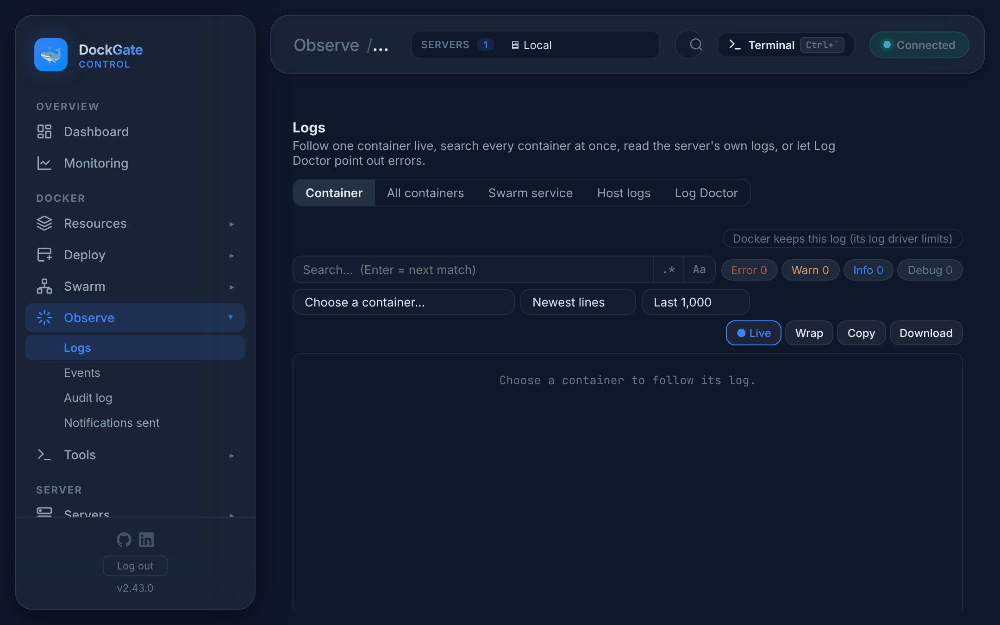
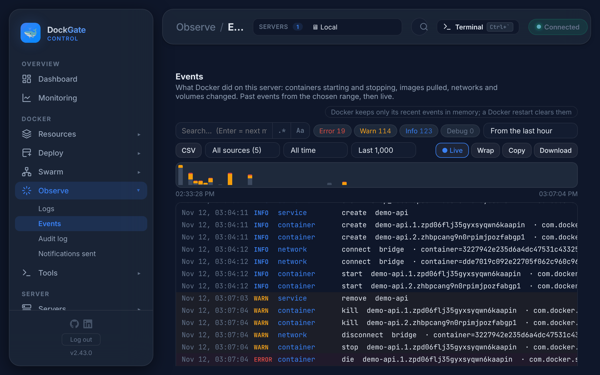
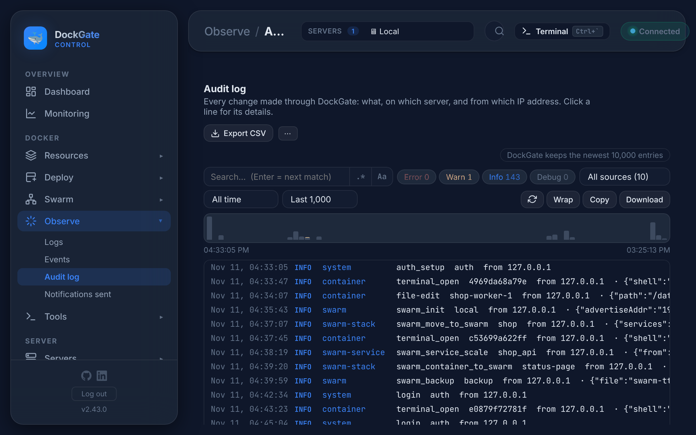

# Observe → Logs, Events, Audit log, Notifications sent

> **Where:** sidebar **Observe**
>
> **Works on:** the server picked in the top bar (**SERVERS ▾**). The audit log and the notification log cover all servers.

---

## The log viewer

Every log in DockGate (these pages, the container page, Swarm services, Server Console → Logs) uses the same viewer:

| Control | What it does |
|---|---|
| **Search** | Highlights matches; **Enter** jumps to the next one. **.\*** turns on regular expressions, **Aa** makes it case-sensitive |
| **Error · Warn · Info · Debug** | Show or hide lines by level, with the count of each |
| **Time range** | All time, or the last 15 min, hour, 24 h… |
| **Last 1,000** | How many of the newest lines to load (1,000 to 10,000), remembered per place |
| **Live** / **Paused** | Follow new lines, or stop to read |
| **Wrap** | Wrap long lines |
| **Copy** / **Download** | The lines shown, as text or a `.txt` file |
| Timeline | A bar per minute above the lines, red for errors. Click a bar to zoom to that minute. Click a line for its details |

Timestamps can be turned on in **Settings → General → Log timestamps**.

---

## Logs

| Tab | What it shows |
|---|---|
| **Container** | One container, live. Pick it, and how far back: *Newest lines*, *Last 15 min*, *Last hour*, *Last 24 h* |
| **All containers** | Search every container of the server at once. With the Edge agent the newest 10,000 lines per server are kept, so stopped containers can be searched too; without it, DockGate reads from Docker |
| **Swarm service** | All tasks of one service, wherever they run |
| **Host logs** | The server's own logs: the system journal and log files. Most sources need passwordless `sudo` |
| **Log Doctor** | Scans recent logs for known problems: out-of-memory kills, proxy 502/504 errors, port conflicts and security warnings |

Docker keeps container logs by its log driver (`json-file` by default, often without a size limit). To keep them small, set `max-size` in the Docker daemon or the compose file.

---

## Events

What Docker did on the server: containers created, started, stopped, killed and removed, images pulled, networks and volumes changed. It shows past events from the chosen range (*From the last 15 min* … *From the last 7 days*), then new ones live. Red lines are errors, such as a container that exited with a non-zero code or went unhealthy.

**CSV** downloads the loaded events. Docker keeps only recent events in memory: a Docker restart clears them.

---

## Audit log

Every change made through DockGate: the action, the server, the resource and the IP address it came from. Click a line for its details (the values sent, without secrets). Logins and failed logins are here too.

- **Export CSV** downloads the whole log.
- **⋯ → Clear the log…** deletes every entry.
- DockGate keeps the newest 10,000 entries.

---

## Notifications sent

Every alert DockGate sent: when, the event, the subject, the channel and recipient, and whether it arrived. A failed one shows the error from the channel (a wrong SMTP password, a blocked Telegram bot…).

**Notification settings** opens **Settings → Notifications**, where channels and rules are set. DockGate keeps the newest 10,000 entries.

## Errors and fixes

| You see | Why | What to do |
|---|---|---|
| *Choose a container to follow its log.* | Nothing picked yet | Pick a container |
| *No container log lines.* | The container wrote nothing, or the time range is too short | Choose *Newest lines* |
| Host logs: `sudo: a password is required` | The SSH user has no passwordless `sudo` | Give the user passwordless `sudo`, or use the deploy user (Server Console → Setup) |
| Events empty after a Docker restart | Docker keeps events only in memory | They appear again as Docker reports them |
| Notifications sent: *failed* | The channel refused the message | Read the error, then fix the channel in **Settings → Notifications** and press **Test** |
