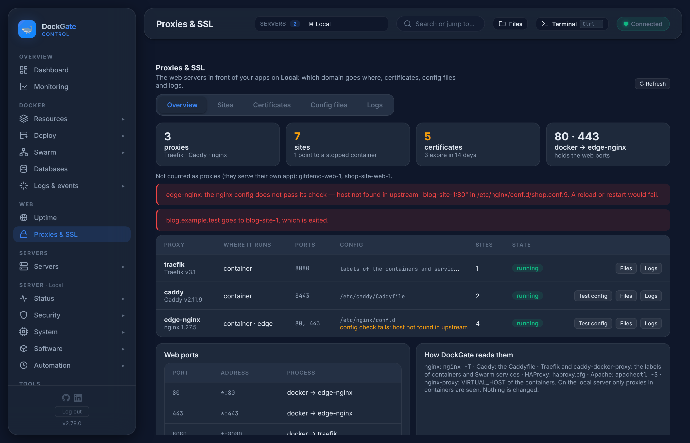
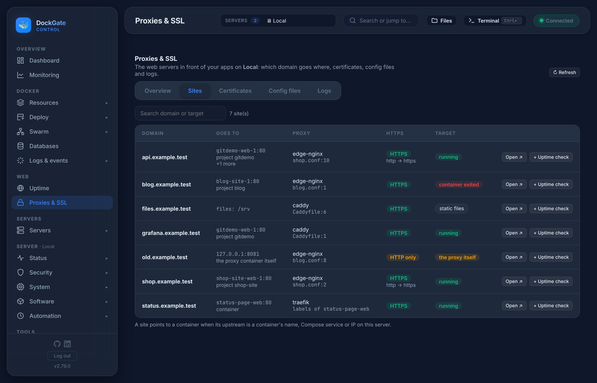
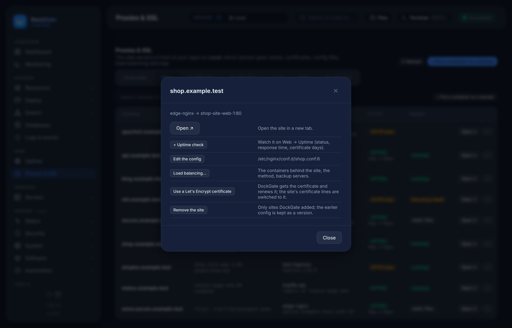
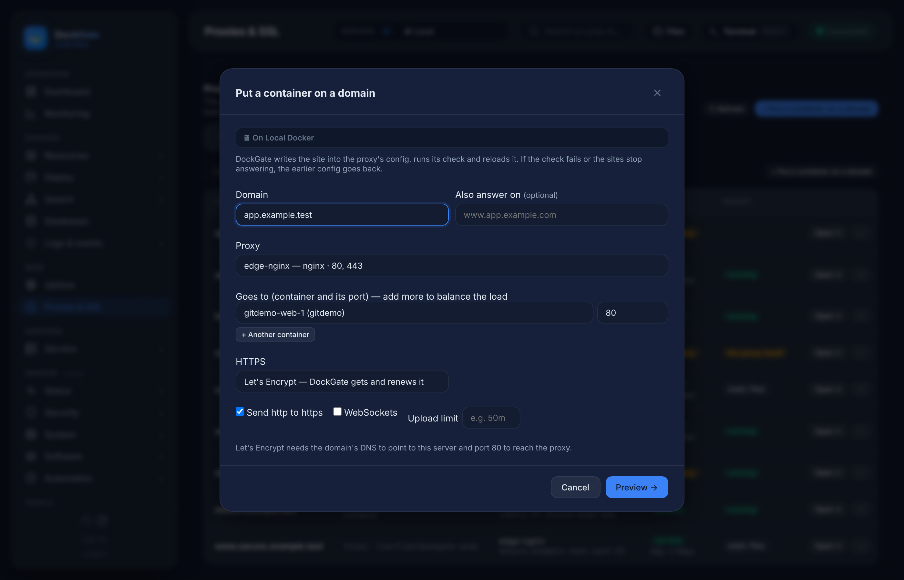
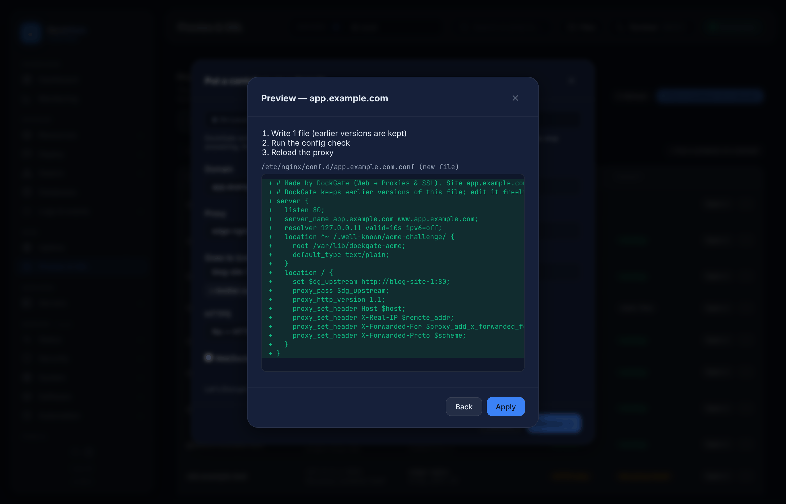
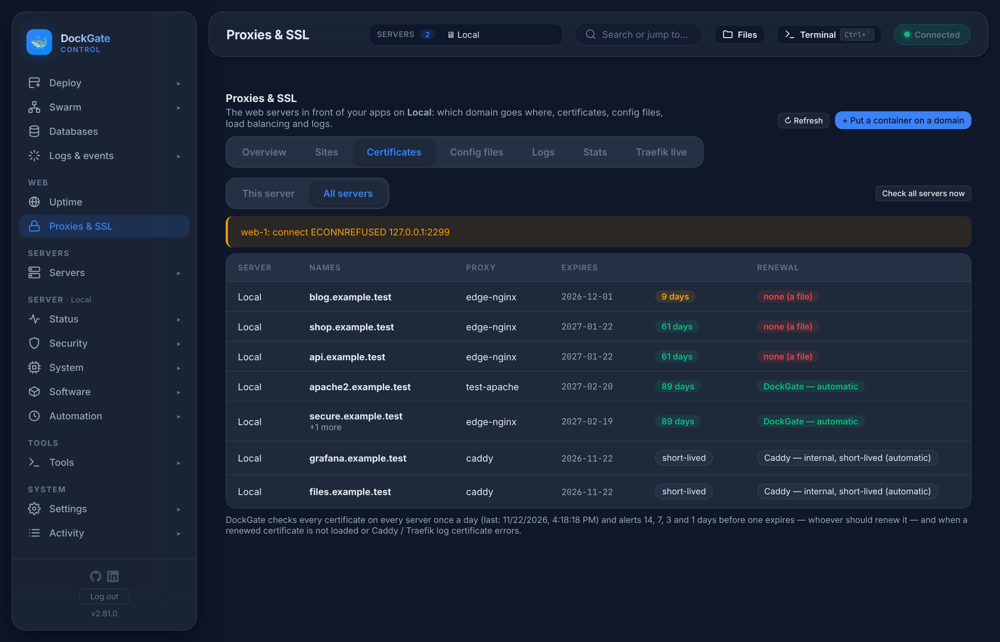
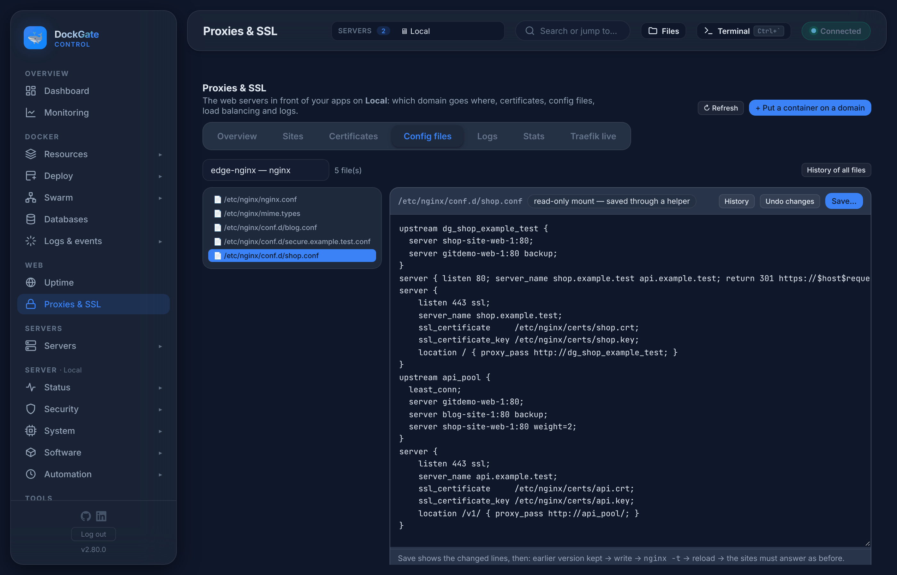
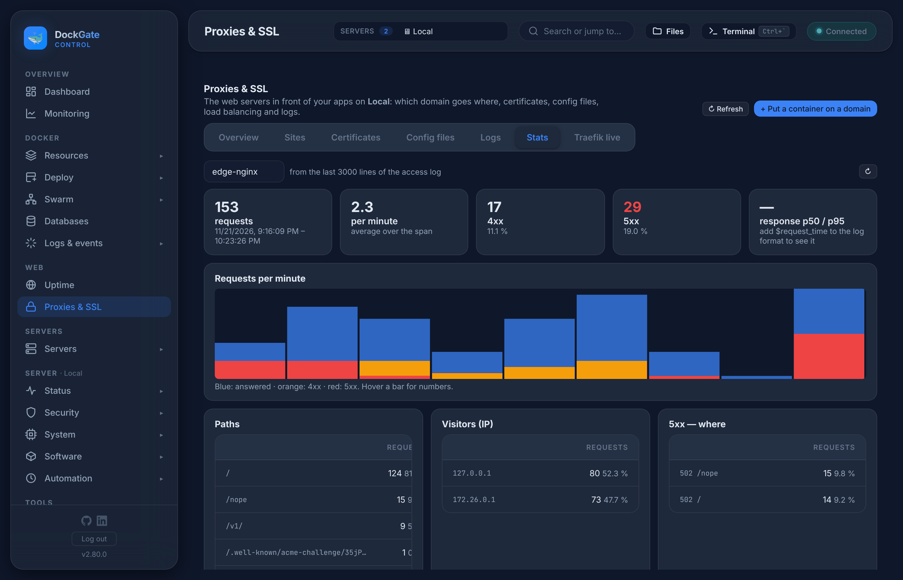

# Proxies & SSL

> **Where:** Web -> **Proxies & SSL**
>
> **Works on:** the local server and SSH servers - proxies in containers and proxies installed on the server itself (nginx, Caddy, HAProxy, Apache).

This page is for the web servers in front of your apps on the server in use. With it you can:

- see which domain goes to which container;
- put a container on a domain;
- get Let's Encrypt certificates, which DockGate then renews;
- edit config files safely;
- set up load balancing;
- read logs and stats, and Traefik's live routers.

## How DockGate changes a proxy

Every change goes through the same steps, whether it is a saved file, a new site, a load balancing change, a certificate or a restored version:

1. DockGate keeps the current file as a version (the last 30 per file).
2. It writes the new file.
3. It runs the proxy's own check: `nginx -t`, `caddy validate`, `haproxy -c`, or `httpd -t` / `apachectl configtest`.
4. It reloads the proxy (nginx `-s reload`, `caddy reload`, HAProxy `USR2`, Apache `graceful`). Running connections are kept.
5. It asks each site through the proxy itself (127.0.0.1, with the site's name, on every port the proxy listens on). Each site must answer as well as it did before the change. A proxy container is asked from a short-lived helper that shares its network, so images without curl or wget (the official httpd and haproxy) are checked too.

**If any step fails, the earlier files go back** (and are reloaded). For example, if the check fails, or a site that answered 200 now answers 502, nothing stays changed. The result window shows each step and the check's output.

Notes:

- **Read-only mounts.** Configs are often mounted read-only (`./conf.d:/etc/nginx/conf.d:ro`). DockGate then writes through a short-lived helper container that mounts the same folder read-write.
- **Files inside the container.** A file that is not on a mount is marked **inside the container**: it is lost when the container is re-created.
- **SSH servers.** Host proxies on SSH servers need passwordless `sudo` for files in `/etc`.

### A stopped proxy

A proxy container that stopped (or keeps restarting) is not hidden:

- **Overview** shows it in red with **why it stopped**: the last error lines of its log, for example `host not found in upstream "app-1:80"`. The warning at the top has **Edit the config** and **Start**.
- **Sites** still lists its sites, marked **proxy stopped**. The configs are read with Docker's archive API (`docker cp`), which works on a stopped container.
- **Config files** opens its files. **Save** goes another way, because a stopped proxy can not run its check or reload:
  1. DockGate keeps the current file as a version and writes the new one.
  2. It starts the proxy and watches it for a few seconds.
  3. If it stops again, the earlier file goes back and the result shows the log lines that say why. The proxy stays stopped, as before.
- **Start** starts it and watches it the same way. If it stops again, you see why.

## Overview

**Proxies.** DockGate finds them in three places:

- **Containers.** By the image name (`nginx`, `caddy`, `traefik`...), and also images built from a proxy image - a Compose `build:` gives names like `shop-proxy`, so DockGate looks at what the image inherits (`NGINX_VERSION`, `CADDY_VERSION`, `HAPROXY_VERSION`, `HTTPD_VERSION`, or the program it starts).
- **The server itself.** nginx, Caddy, HAProxy and Apache installed with the package manager: a systemd service, or (without systemd) the program and its running processes. Processes of containers are left out.
- **Containers on the host network** (`network_mode: host`). They are marked **host network**. They can not join Docker networks, so they reach containers at their published ports, like a proxy installed on the server.

**Reaching the server itself.** On SSH servers DockGate uses the SSH connection. On the local server:

- DockGate runs in a container (the usual install): a short-lived helper container shares the server's processes and network and runs the command in the server's root folder (`chroot`). DockGate can already do this through the Docker socket it is given; the helper only makes it visible. Set `DG_HOST_ACCESS=off` in DockGate's environment to turn it off; proxies installed on the server are then not seen.
- DockGate runs straight on the server: the command runs there.

What DockGate reads from each proxy:

| Proxy | How DockGate reads it | What you can change |
|---|---|---|
| nginx, OpenResty | `nginx -T`. If the config fails its check, the `.conf` files are read directly and the error is shown. | everything |
| Caddy | the Caddyfile and the files it `import`s | everything |
| HAProxy | `haproxy.cfg` | everything (HTTPS routing only when the frontend already has a certificate) |
| Apache | `httpd -S` / `apache2ctl -S` and the files it names. The official image (`/usr/local/apache2`) and Debian / Ubuntu based ones (`/etc/apache2`) are both read. | everything, Let's Encrypt included |
| Traefik | the labels of containers and Swarm services, and the files of its file provider (`--providers.file.filename` / `directory`, or in `traefik.yml`) | labels: added to a Compose project (override) or copied; file provider files are shown read-only |
| caddy-docker-proxy | the labels of containers and Swarm services | labels: added to a Compose project (override) or copied |
| Nginx Proxy Manager, nginx-proxy | their own configs | read-only: use their own UI or `VIRTUAL_HOST` |

**Read-only proxies.**

- A proxy that runs as a **Swarm service** is one entry, with its number of replicas. Its config is not changed here: a file written into one task container would miss the other replicas and be lost when Swarm replaces it. Change it where the service gets it (its image, a Docker config or a shared mount), then update the service in Swarm > Services.
- **Caddy with a JSON config** (`caddy run --config caddy.json`): its sites are read, and the JSON can be edited in Config files (checked with `caddy validate`). Site settings, load balancing and new sites write Caddyfiles, so they are not offered.

**HAProxy** with several `-f` files or a folder: every file is read, and the check runs with all of them.

**A stopped proxy** can get a new site too (not with Let's Encrypt): saving starts it and watches it.

An nginx container that only serves its own app is not counted as a proxy. That means it has no `proxy_pass`, no domain and no port 80 or 443. The same goes for an Apache image built for an app (for example `php:apache`) without `ProxyPass`.

**When nginx's config check fails.** DockGate reads nginx's sites with `nginx -T`, which prints nothing when the config does not pass its check - most often a `proxy_pass` to a container that was removed or stopped (`host not found in upstream`). nginx keeps running, but a reload or restart would fail. DockGate then reads the files itself, from `nginx.conf` through every `include` (`conf.d/*.conf`, `sites-enabled/*` of any name), lists the sites as usual, and marks the proxy red with nginx's own reason. Such an nginx is never taken for an app's own web server.

**Web ports** shows who holds 80, 443, 8080, 8443 and the proxies' own ports: a container (`docker -> edge-nginx`), a proxy on the server, or a container on the host network.

**Warnings** are shown at the top, for example:

- a config that fails its check, so a reload or restart would fail;
- a domain that goes to a stopped container;
- a domain set up in two proxies;
- two proxies that want the same port.

## Sites

Each domain is one row. It shows where the domain goes, which proxy serves it and where, HTTPS, and the state of the container behind it.

**Sites without a domain** are listed too, marked **no domain**: a server reached by IP or port (`server_name _;`, `server_name 192.168.1.10;`, a server with only `listen 8080;`, Caddy's `:8080 { }`, a HAProxy `default_backend`, a Traefik rule with only `PathPrefix`). Their name is their address - `:8080`, `192.168.1.10`, `/api`. **Open** goes to the server's address on the port the proxy publishes for it (none when the port is not published). Site settings, load balancing and Let's Encrypt need a domain, so they are not offered: change such a site in the editor, or give it a domain with **Put a container on a domain**. A default page without `proxy_pass` is not listed. **⋯** opens what you can do with a site:

- **Open ↗** and **+ Uptime check**.
- **Edit the config** opens the file at the site's lines.
- **Site settings...** (nginx, Caddy) - the site as a form:
  - names;
  - where it goes (one container);
  - WebSockets, upload limit, and **Send http to https** (nginx).

  Save shows the changed lines, then goes the safe way. Only the names that change are touched, so an HTTP server shared with other sites keeps their names. The redirect of a shared HTTP server is changed in the editor.
- **Load balancing...** (see [Load balancing](#load-balancing)).
- **Add HTTPS** or **Use a Let's Encrypt certificate** (nginx and Apache sites).
- **Remove the site.** Only sites DockGate added can be removed. Others are removed in the editor.

## Put a container on a domain

**+ Put a container on a domain** (top right).

| Field | |
|---|---|
| **Domain** / **Also answer on** | `app.example.com`, and other names such as `www.app.example.com` |
| **Proxy** | the proxies on this server; the one holding ports 80 / 443 comes first |
| **Goes to** | the container and its port. **+ Another container** balances the load between several. |
| **Balancing** | round robin, least connections, or same visitor -> same container (IP hash) |
| **HTTPS** | nginx / Apache: **Let's Encrypt** (DockGate gets and renews it), **a certificate already on the proxy**, or none. Caddy and Traefik: automatic. |
| **Send http to https**, **WebSockets**, **Upload limit** | |

**Preview -> ** shows the steps and the exact lines that will be written, before anything changes:

**Networks.** The proxy must reach the container. If they share no network, DockGate joins the proxy to the container's network (`docker network connect`, no restart) and uses the container's name.

A `docker network connect` is lost when the proxy container is re-created (for example by `docker compose up` after a change). So:

- **The proxy is part of a Compose project:** DockGate also writes the network into its override for that project (your compose files are not changed). The proxy is on it again after a re-create.
- **It is not:** the preview and the result warn you. Add the network to how you start the proxy.

 If both are only on Docker's default network, where names do not work, the container's IP is used and you are warned that it changes when the container is re-created. A proxy on the host uses the container's published port (`127.0.0.1:port`).

**What gets written:**

- **nginx:** a new file `<domain>.conf` in a folder nginx really loads into `http { }`: the one that already holds sites (`conf.d/`, `sites-enabled/`, `vhosts/`, SWAG's `site-confs/` ...). If nginx loads no folder of sites, DockGate makes `conf.d/` and adds its `include` to `http { }`. After the reload DockGate checks that nginx lists the new file (`nginx -T`); if not, the site is taken out again. The new site is then asked once: a 502 means the proxy can not reach the container. The site listens where the proxy already listens (8080 for nginx-unprivileged). A single container is reached through Docker's DNS, so nginx still starts while the container is down. Several containers go into an `upstream` block; see [Load balancing](#load-balancing) for what nginx needs so it still starts when one of them is missing.
- **Caddy, HAProxy:** a block between `# dockgate:begin` and `# dockgate:end` in the Caddyfile or `haproxy.cfg`.
- **Apache:** a file in `conf/dockgate/` (container) or `sites-enabled/` (Debian). The proxy modules it needs are loaded.
- **Traefik and caddy-docker-proxy:** the labels. Traefik's entry points and certificate resolvers are read from its command line.
  - **Add to** *(the project)* (when the container is part of a Compose project): the labels go into DockGate's override for the project - your compose files are not changed - and the service is re-created so they apply. If the re-create fails, the earlier override is put back.
  - **Show the labels**: as a Compose snippet and as `docker run` flags, to add yourself.
  - **Remove the site** takes DockGate's labels for that domain out again and re-creates the service.

## Certificates

Every certificate the proxies use is listed, with **who renews it**. DockGate renews its own Let's Encrypt certificates and **watches all the others**, so a renewal that stopped working is noticed before the certificate expires.

### Who renews what

| Certificate | Renewed by | What DockGate does |
|---|---|---|
| Let's Encrypt from DockGate (nginx, Apache) | DockGate | gets it, renews it, alerts when a renewal fails |
| certbot (`/etc/letsencrypt`) | certbot | shows its timer or cron, whether a deploy hook reloads the web server, **Renew now** (SSH servers), **Add a reload hook** |
| Caddy, Traefik | Caddy / Traefik | reads their certificates and shows the certificate errors in their logs |
| Caddy `tls internal`, Traefik's default | Caddy / Traefik | marked internal; not counted as expiring |
| Nginx Proxy Manager | Nginx Proxy Manager | its Let's Encrypt certificates are automatic; uploaded ones are not renewed |
| nginx-proxy | acme-companion | automatic when an acme-companion container runs; a stopped one is shown |
| acme.sh (`~/.acme.sh`) | acme.sh's own cron | reads them and watches their expiry |
| A file (nginx `ssl_certificate`, Apache `SSLCertificateFile`, HAProxy `bind ... crt`) | nobody | red **none (a file)**; nginx and Apache sites get **Use Let's Encrypt** |

**Where certificates are read from.** nginx's `ssl_certificate` wherever it is written: in the server block, at `http` level, or in an included snippet (`include snippets/ssl.conf;`). Paths with variables (`$ssl_server_name`) can not be read. Also Apache's `SSLCertificateFile`, HAProxy's `bind ... crt`, Traefik's file provider `certFile`, `acme.json`, Caddy's data folder, and on the server itself `/etc/letsencrypt/live` and `~/.acme.sh`. These are read as root when DockGate can (`sudo` is not needed when DockGate logs in as root).

**Is the new certificate served?** For nginx, Apache and HAProxy, DockGate asks the proxy (from inside it, on 127.0.0.1:443) which certificate it really serves. "✓ served" means it answers with the certificate on disk. **Old one still served** means the file was renewed but the proxy was not reloaded. **Reload** fixes it (after a config check).

### Renewing by hand

Each certificate in the list has **Renew now** when someone can be asked to renew it. It asks for a new certificate at once, even when the current one is not due yet, then checks and reloads the proxies that use it:

| Kept by | Renew now does |
|---|---|
| DockGate (Let's Encrypt) | gets a new certificate, writes it, checks, reloads |
| certbot on the server | `certbot renew --cert-name <name> --force-renewal`, then the web servers using it are reloaded |
| certbot in a container next to the proxy | the same, inside that container (it must be running) |
| acme.sh | `acme.sh --renew -d <name> --force` (its own `reloadcmd` runs), then the proxies are reloaded |
| Caddy, Traefik, Nginx Proxy Manager | nothing to ask: they renew by themselves. Their errors are shown above the list. |
| A file nobody renews | **Use Let's Encrypt** on its site gets a new certificate from DockGate |

To renew only by hand, turn **Auto renew** off for a DockGate certificate: DockGate then keeps it, warns before it expires, and renews it only when you press **Renew now**. Let's Encrypt allows 5 new certificates for the same names a week.

### Expired or expiring: "Why?, fix"

Certificates that expired or expire within 14 days are listed in a box above the table. **Why?, fix** checks what the renewal needs and tells you what is wrong:

| Check | What it looks at |
|---|---|
| Who renews it | DockGate's last error; certbot's method (`webroot`, `standalone`, `dns`), its timer or cron and its container; acme.sh; the errors in Caddy's and Traefik's logs; Let's Encrypt's limit of 5 certificates a week |
| DNS | each name points to this server. Cloudflare's addresses are marked (Let's Encrypt then talks to Cloudflare); a private address may be NAT |
| Challenge path | a real token is written where the proxy serves `/.well-known/acme-challenge/`, then fetched by name the way Let's Encrypt does (following redirects), then removed |
| Port 80 | for certbot `standalone`: whether something else already holds port 80 |
| Served | the proxy serves the newest file, not an old one |

Then it offers the fix that applies. Each one asks first:

| Kept by | Fix |
|---|---|
| DockGate | **Put the files back, then renew** (when the files on disk were changed or removed), **Renew now** |
| certbot | **certbot test run** (`certbot renew --dry-run`, changes nothing), **Renew now**, or **Let DockGate get and renew it** |
| acme.sh | **Renew now** (`--force`) |
| Caddy | **Make Caddy get it again**: the stored certificate is moved to `dockgate-backup/` in Caddy's data folder and Caddy is reloaded |
| Traefik | **Make Traefik get it again**: `acme.json` is copied to `acme.json.dockgate-<time>`, the certificate is taken out of it, and Traefik is restarted |
| Nginx Proxy Manager | renew it in Nginx Proxy Manager (DockGate only shows the checks) |
| A file nobody renews | **Let DockGate get and renew it** (nginx and Apache sites) |
| certbot with its timer off | **Turn on certbot.timer** (`systemctl enable --now`) |
| Any | **Reload the proxy** (all proxies that use it) when an old certificate is still served |

If DNS or the challenge path fails, fix that first: a renewal can not work until Let's Encrypt reaches the server by name on port 80.

### Let's Encrypt from DockGate

DockGate is the ACME client. It answers the certificate check through the proxy itself, so nothing else is installed:

1. The HTTP server of the site gets a `/.well-known/acme-challenge/` location.
   - A new site has it in its file.
   - An existing nginx or Apache site gets it added.
   - An HTTPS-only nginx site gets an HTTP server added; it answers the check and sends the rest to https.
2. DockGate asks Let's Encrypt for a certificate holding the names of that HTTP server (`server_name`, `ServerName` / `ServerAlias`), and writes the answer where that location reads it.
3. The certificate and key are written next to the site config (`dockgate-certs/<domain>/`). When the config folder is a mount, they outlive the container.
4. The site switches to HTTPS, with the usual check, reload and site test. DockGate starts renewing the certificate only once the site uses it.

**Before the first certificate:**

- The domain's DNS must point to this server.
- Port 80 must reach the proxy.
- You must accept the certificate authority's terms (a box in the wizard, or under Let's Encrypt account).

**Limits:**

- Wildcards (`*.example.com`) need a DNS check and are not supported.
- HAProxy serves no files, so it can not answer the check. Use certbot with a reload hook for HAProxy.

**Let's Encrypt certificates DockGate renews:**

- Renewed 30 days before expiry (you can change this); DockGate looks every 6 hours.
- Each renewal is written, checked and reloaded. If it fails, the earlier files go back, the old date is kept (so DockGate tries again), and an alert goes to your notification channels.
- **Renew now**, **Put back** (writes the files again after the container was re-created), **Auto renew** on / off, **Forget**.
- Removing a site DockGate made also stops renewing its certificate.

**Let's Encrypt account:** your email, the certificate authority (Let's Encrypt, Let's Encrypt staging for tests, or another ACME URL) and the terms. The account key is kept encrypted.

### Wildcards and the DNS check (Cloudflare)

DockGate normally answers Let's Encrypt's check over HTTP (port 80). A **wildcard** certificate (`*.example.com`) can only be checked through DNS, and the DNS check also works when port 80 is closed or the site is behind Cloudflare's proxy.

Under **Let's Encrypt account > DNS check (Cloudflare)**: choose Cloudflare, paste an API token with **Zone > DNS > Edit** for your zones (stored encrypted; **Test the token** asks Cloudflare whether it is active), and choose **Wildcard names only** or **Every certificate**. Then, for each name, DockGate:

1. adds the TXT record `_acme-challenge.<name>` in the right Cloudflare zone,
2. waits until public DNS (1.1.1.1 and 8.8.8.8) answers it,
3. lets Let's Encrypt check it,
4. removes the record.

With it set up, **Use Let's Encrypt** on a site also covers its wildcard names (`server_name *.example.com`), renewals use the DNS check too, and **Why?, fix** offers **Let DockGate get and renew it** for wildcard certificates.

### All servers and alerts

**All servers** shows every certificate on every server, the one that expires first at the top. The list comes from a check DockGate runs once a day; **Check all servers now** runs it at once.

The daily check sends an alert to your notification channels:

- **14, 7, 3 and 1 days** before a certificate expires and on the day it ends - then **every day** while it stays expired. The alert says who should renew it ("certbot should have renewed it by now", or "nothing renews it"), **why** - the failed checks of **Why?, fix** (DNS, the challenge path, certbot's method and timer...) - what DockGate fixed by itself, and the fixes to choose from.
- When a **renewed certificate is not loaded** (the proxy still serves the old one) - unless DockGate reloaded the proxy by itself.
- When **Caddy or Traefik log certificate errors** (once a day per proxy).

Internal (Caddy `tls internal`) and test (staging) certificates are left out.

**Fix safe problems by itself** (Let's Encrypt account, on by default): the daily check reloads a proxy that still serves an old certificate and turns on certbot's timer when it is installed but off. Everything else (renewing, taking a certificate over, Caddy / Traefik re-issue) is only suggested in the alert. Each automatic fix is written to the audit log.

## Config files

These are the files the proxy loads. Files that Nginx Proxy Manager, nginx-proxy or certbot keep are read-only.

**Save...** shows the changed lines first. You can add a note, which is shown in History:

If someone changes the file on the server after you opened it, DockGate does not overwrite it. Reopen it to see the current text.

**History** lists the file as it was before each change DockGate made. **Compare** shows that version against the current file. **Restore** puts it back, with the same check, reload and site test.

## Load balancing

From a site's **⋯ > Load balancing...**:

- **Method:** round robin, least connections, IP hash; for Caddy also random and first available (failover).
- **Servers:** host:port, weight, **Backup** (used only when the others are down) and **Off** (kept in the list without traffic).
- **What DockGate edits:**
  - **nginx:** the `upstream` block, in whichever file it is (an `upstreams.conf` too). If other sites use the same upstream, the dialog names them: they change too. A site with one `proxy_pass` gets an upstream made for it.

    nginx reads the names in an `upstream` when it starts. If one container is missing, nginx does not start, and every site on it stops answering. **nginx 1.27.3 or newer** (in a container) can look the names up while it runs. DockGate then adds `zone`, Docker's `resolver` and `resolve` to the upstream, and a missing container does not stop nginx. For an older nginx, the dialog and the preview warn you.
  - **Caddy:** the site's `reverse_proxy` and `lb_policy`.
  - **HAProxy:** the backend's `server` lines and `balance`.

Several replicas of one Compose service behind one name are balanced by Docker's DNS. Deploy > Compose > Scale handles that case.

## Logs

Shows the access log and error log of a proxy. DockGate reads the container's output and also the log files the config names (nginx `access_log` / `error_log`, Apache `CustomLog` / `ErrorLog`), so a proxy that logs to files is read too. The tab says where the lines came from. Paths with variables (`$host.log`) are not read. Access lines are read into time, status, method, path and response time; two formats are read: nginx / Apache combined and Caddy JSON. You can filter by `2xx` to `5xx`, or by IP, path or domain.

## Stats

Stats come from the last 3,000 lines of the access log:

- requests and requests per minute;
- 4xx and 5xx, with their share;
- response time p50 / p95 (when the log format has `$request_time`);
- requests per minute over time, with 4xx and 5xx marked;
- the top paths, visitors and domains, and where the 5xx errors come from.

## Traefik live

Shows Traefik's routers (rule, entry points, service, TLS, errors) and its services with the state of each server. The data comes from Traefik's API inside the container, so Traefik must run with `--api.insecure=true` or an `api@internal` router. The tab also lists Traefik's entry points and certificate resolvers.
