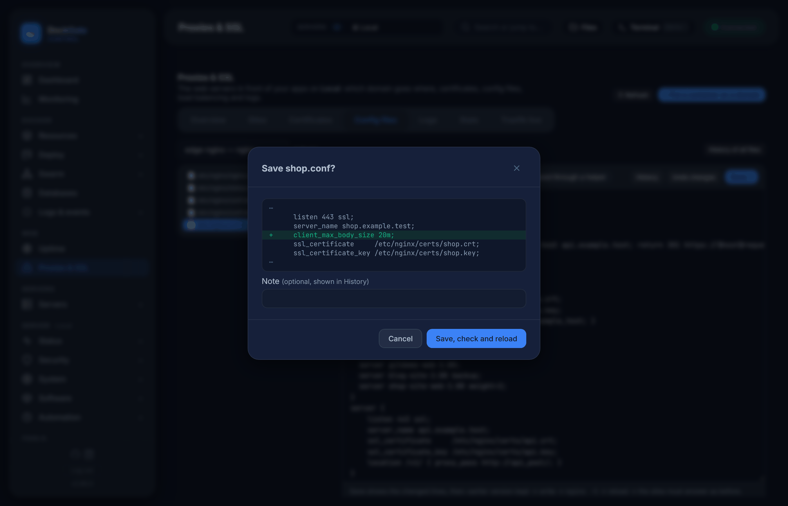
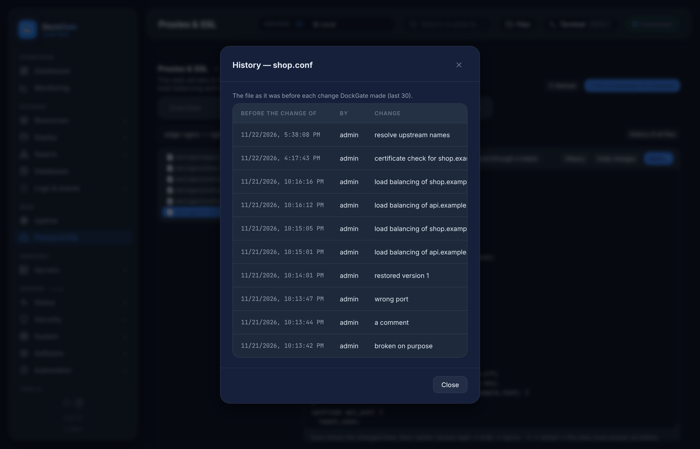
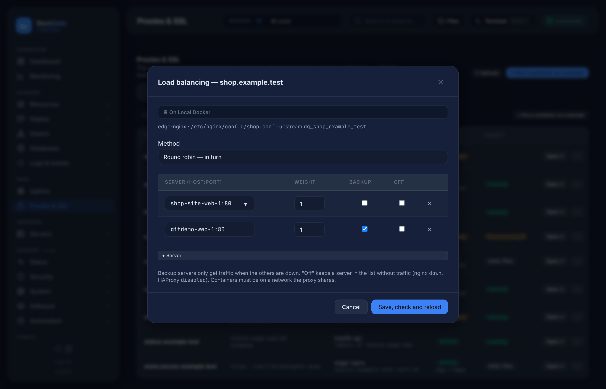
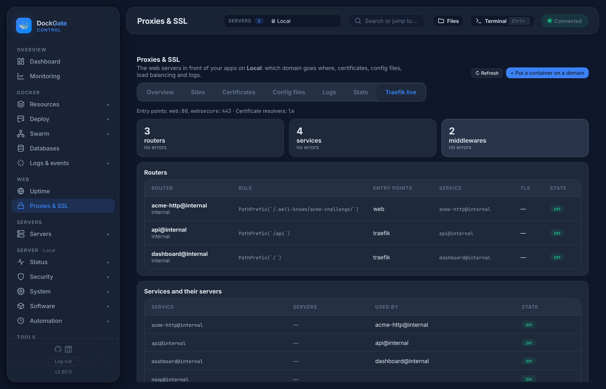

# Proxies & SSL

> **Where:** Web → **Proxies & SSL**
>
> **Works on:** the local server and SSH servers. On the local server DockGate sees proxies that run in containers. On an SSH server it also sees nginx, Caddy, HAProxy and Apache installed on the host.

This page is for the web servers in front of your apps on the server in use. With it you can:

- see which domain goes to which container;
- put a container on a domain;
- get Let's Encrypt certificates, which DockGate then renews;
- edit config files safely;
- set up load balancing;
- read logs and stats, and Traefik's live routers.

## How DockGate changes a proxy

Every change goes through the same steps, whether it is a saved file, a new site, a load balancing change, a certificate or a restored version:

1. DockGate keeps the current file as a version (the last 30 per file).
2. It writes the new file.
3. It runs the proxy's own check: `nginx -t`, `caddy validate`, `haproxy -c`, or `httpd -t` / `apachectl configtest`.
4. It reloads the proxy (nginx `-s reload`, `caddy reload`, HAProxy `USR2`, Apache `graceful`). Running connections are kept.
5. It asks each site through the proxy itself (127.0.0.1, with the site's name). Each site must answer as well as it did before the change.

**If any step fails, the earlier files go back** (and are reloaded). For example, if the check fails, or a site that answered 200 now answers 502, nothing stays changed. The result window shows each step and the check's output.

Notes:

- **Read-only mounts.** Configs are often mounted read-only (`./conf.d:/etc/nginx/conf.d:ro`). DockGate then writes through a short-lived helper container that mounts the same folder read-write.
- **Files inside the container.** A file that is not on a mount is marked **inside the container**: it is lost when the container is re-created.
- **SSH servers.** Host proxies on SSH servers need passwordless `sudo` for files in `/etc`.

## Overview

**Proxies.** DockGate finds them by image and by what is installed:

| Proxy | How DockGate reads it | What you can change |
|---|---|---|
| nginx, OpenResty | `nginx -T`. If the config fails its check, the `.conf` files are read directly and the error is shown. | everything |
| Caddy | the Caddyfile | everything |
| HAProxy | `haproxy.cfg` | everything (HTTPS routing only when the frontend already has a certificate) |
| Apache | `apachectl -S` and the files it names | everything, Let's Encrypt included |
| Traefik, caddy-docker-proxy | the labels of containers and Swarm services | labels to copy (they apply when the container is re-created) |
| Nginx Proxy Manager, nginx-proxy | their own configs | read-only: use their own UI or `VIRTUAL_HOST` |

An nginx container that only serves its own app is not counted as a proxy. That means it has no `proxy_pass`, no domain and no port 80 or 443.

**Warnings** are shown at the top, for example:

- a config that fails its check, so a reload or restart would fail;
- a domain that goes to a stopped container;
- a domain set up in two proxies;
- two proxies that want the same port.

## Sites

Each domain is one row. It shows where the domain goes, which proxy serves it and where, HTTPS, and the state of the container behind it. **⋯** opens what you can do with a site:

- **Open ↗** and **+ Uptime check**.
- **Edit the config** opens the file at the site's lines.
- **Load balancing…** (see [Load balancing](#load-balancing)).
- **Add HTTPS** or **Use a Let's Encrypt certificate** (nginx and Apache sites).
- **Remove the site.** Only sites DockGate added can be removed. Others are removed in the editor.

## Put a container on a domain

**+ Put a container on a domain** (top right).

| Field | |
|---|---|
| **Domain** / **Also answer on** | `app.example.com`, and other names such as `www.app.example.com` |
| **Proxy** | the proxies on this server; the one holding ports 80 / 443 comes first |
| **Goes to** | the container and its port. **+ Another container** balances the load between several. |
| **Balancing** | round robin, least connections, or same visitor → same container (IP hash) |
| **HTTPS** | nginx / Apache: **Let's Encrypt** (DockGate gets and renews it), **a certificate already on the proxy**, or none. Caddy and Traefik: automatic. |
| **Send http to https**, **WebSockets**, **Upload limit** | |

**Preview →** shows the steps and the exact lines that will be written, before anything changes:

**Networks.** The proxy must reach the container. If they share no network, DockGate joins the proxy to the container's network (`docker network connect`, no restart) and uses the container's name. If both are only on Docker's default network, where names do not work, the container's IP is used and you are warned that it changes when the container is re-created. A proxy on the host uses the container's published port (`127.0.0.1:port`).

**What gets written:**

- **nginx:** a new file `conf.d/<domain>.conf`, made by DockGate. A single container is reached through Docker's DNS, so nginx still starts while the container is down.
- **Caddy, HAProxy:** a block between `# dockgate:begin` and `# dockgate:end` in the Caddyfile or `haproxy.cfg`.
- **Apache:** a file in `conf/dockgate/` (container) or `sites-enabled/` (Debian). The proxy modules it needs are loaded.
- **Traefik and caddy-docker-proxy:** labels as a Compose snippet and as `docker run` flags. Traefik's entry points and certificate resolvers are read from its command line.

## Certificates

Every certificate the proxies use is listed, with **who renews it**. DockGate renews its own Let's Encrypt certificates and **watches all the others**, so a renewal that stopped working is noticed before the certificate expires.

### Who renews what

| Certificate | Renewed by | What DockGate does |
|---|---|---|
| Let's Encrypt from DockGate (nginx, Apache) | DockGate | gets it, renews it, alerts when a renewal fails |
| certbot (`/etc/letsencrypt`) | certbot | shows its timer or cron, whether a deploy hook reloads the web server, **Renew now** (SSH servers), **Add a reload hook** |
| Caddy, Traefik | Caddy / Traefik | reads their certificates and shows the certificate errors in their logs |
| Caddy `tls internal`, Traefik's default | Caddy / Traefik | marked internal; not counted as expiring |
| Nginx Proxy Manager | Nginx Proxy Manager | its Let's Encrypt certificates are automatic; uploaded ones are not renewed |
| nginx-proxy | acme-companion | automatic when an acme-companion container runs; a stopped one is shown |
| A file (nginx `ssl_certificate`, Apache `SSLCertificateFile`, HAProxy `bind … crt`) | nobody | red **none (a file)**; nginx and Apache sites get **Use Let's Encrypt** |

**Is the new certificate served?** For nginx, Apache and HAProxy, DockGate asks the proxy (from inside it, on 127.0.0.1:443) which certificate it really serves. "✓ served" means it answers with the certificate on disk. **Old one still served** means the file was renewed but the proxy was not reloaded. **Reload** fixes it (after a config check).

### Let's Encrypt from DockGate

DockGate is the ACME client. It answers the certificate check through the proxy itself, so nothing else is installed:

1. The HTTP server of the site gets a `/.well-known/acme-challenge/` location.
   - A new site has it in its file.
   - An existing nginx or Apache site gets it added.
   - An HTTPS-only nginx site gets an HTTP server added; it answers the check and sends the rest to https.
2. DockGate asks Let's Encrypt for a certificate holding the names of that HTTP server (`server_name`, `ServerName` / `ServerAlias`), and writes the answer where that location reads it.
3. The certificate and key are written next to the site config (`dockgate-certs/<domain>/`). When the config folder is a mount, they outlive the container.
4. The site switches to HTTPS, with the usual check, reload and site test. DockGate starts renewing the certificate only once the site uses it.

**Before the first certificate:**

- The domain's DNS must point to this server.
- Port 80 must reach the proxy.
- You must accept the certificate authority's terms (a box in the wizard, or under Let's Encrypt account).

**Limits:**

- Wildcards (`*.example.com`) need a DNS check and are not supported.
- HAProxy serves no files, so it can not answer the check. Use certbot with a reload hook for HAProxy.

**Let's Encrypt certificates DockGate renews:**

- Renewed 30 days before expiry (you can change this); DockGate looks every 6 hours.
- Each renewal is written, checked and reloaded. If it fails, the earlier files go back, the old date is kept (so DockGate tries again), and an alert goes to your notification channels.
- **Renew now**, **Put back** (writes the files again after the container was re-created), **Auto renew** on / off, **Forget**.
- Removing a site DockGate made also stops renewing its certificate.

**Let's Encrypt account:** your email, the certificate authority (Let's Encrypt, Let's Encrypt staging for tests, or another ACME URL) and the terms. The account key is kept encrypted.

### All servers and alerts

**All servers** shows every certificate on every server, the one that expires first at the top. The list comes from a check DockGate runs once a day; **Check all servers now** runs it at once.

The daily check sends an alert to your notification channels:

- **14, 7, 3 and 1 days** before a certificate expires, and when it has expired — whoever should renew it. The alert says who that is ("certbot should have renewed it by now — check it", or "nothing renews it").
- When a **renewed certificate is not loaded** (the proxy still serves the old one).
- When **Caddy or Traefik log certificate errors** (once a day per proxy).

Each alert is sent once per threshold. Internal (Caddy `tls internal`) and test (staging) certificates are left out.

## Config files

These are the files the proxy loads. Files that Nginx Proxy Manager, nginx-proxy or certbot keep are read-only.

**Save…** shows the changed lines first. You can add a note, which is shown in History:

If someone changes the file on the server after you opened it, DockGate does not overwrite it. Reopen it to see the current text.

**History** lists the file as it was before each change DockGate made. **Compare** shows that version against the current file. **Restore** puts it back, with the same check, reload and site test.

## Load balancing

From a site's **⋯ → Load balancing…**:

- **Method:** round robin, least connections, IP hash; for Caddy also random and first available (failover).
- **Servers:** host:port, weight, **Backup** (used only when the others are down) and **Off** (kept in the list without traffic).
- **What DockGate edits:**
  - **nginx:** the `upstream` block. A site with one `proxy_pass` gets an upstream made for it.
  - **Caddy:** the site's `reverse_proxy` and `lb_policy`.
  - **HAProxy:** the backend's `server` lines and `balance`.

Several replicas of one Compose service behind one name are balanced by Docker's DNS. Deploy → Compose → Scale handles that case.

## Logs

Shows the access log and error log of a proxy. Access lines are read into time, status, method, path and response time; two formats are read: nginx / Apache combined and Caddy JSON. You can filter by `2xx` to `5xx`, or by IP, path or domain.

## Stats

Stats come from the last 3,000 lines of the access log:

- requests and requests per minute;
- 4xx and 5xx, with their share;
- response time p50 / p95 (when the log format has `$request_time`);
- requests per minute over time, with 4xx and 5xx marked;
- the top paths, visitors and domains, and where the 5xx errors come from.

## Traefik live

Shows Traefik's routers (rule, entry points, service, TLS, errors) and its services with the state of each server. The data comes from Traefik's API inside the container, so Traefik must run with `--api.insecure=true` or an `api@internal` router. The tab also lists Traefik's entry points and certificate resolvers.
