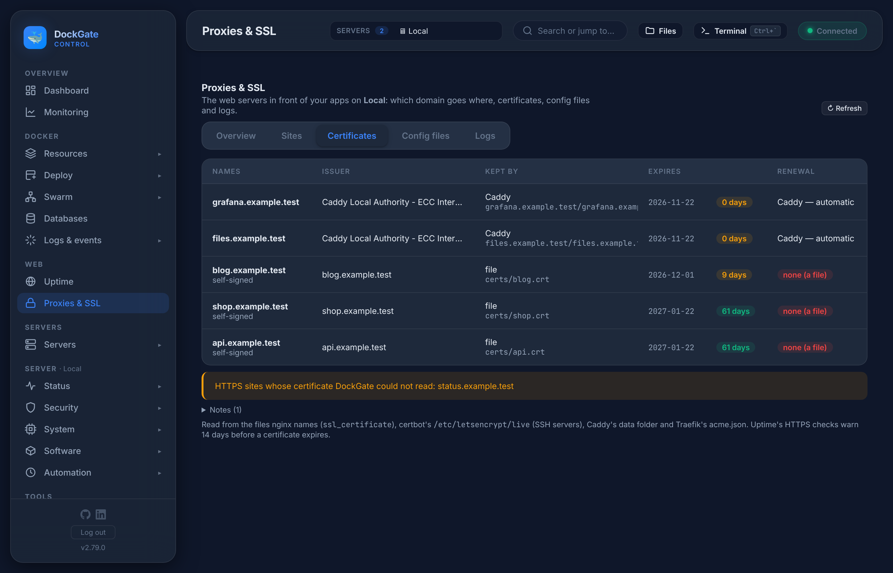
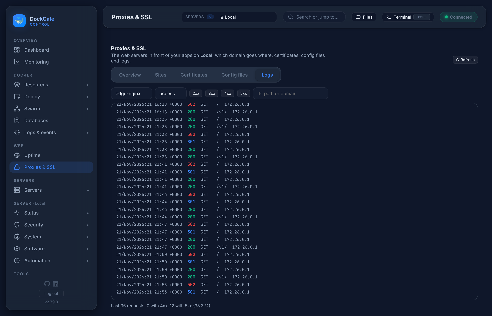

# Proxies & SSL

> **Where:** Web → **Proxies & SSL**
>
> **Works on:** the local server and SSH servers. On the local server DockGate sees proxies that run in containers; on an SSH server it also sees nginx, Caddy, HAProxy and Apache installed on the host.

This page shows the web servers in front of your apps on the server in use: which domain goes to which container, which certificates they use and when those expire, their config files and their logs.

For now the page only reads. It changes nothing. The one action is **Test config**, which runs the proxy's own check (`nginx -t`, `caddy validate`, `haproxy -c`, `apachectl configtest`).

## Overview

- **Proxies.** DockGate finds them by image and by what is installed:

  | Proxy | How DockGate reads it |
  |---|---|
  | nginx, Nginx Proxy Manager | `nginx -T`. If the config fails its check, DockGate reads the `.conf` files directly and shows the error. |
  | nginx-proxy | `VIRTUAL_HOST` of the containers |
  | Caddy | the Caddyfile |
  | caddy-docker-proxy, Traefik | the labels of containers and Swarm services |
  | HAProxy | `haproxy.cfg` |
  | Apache | `apachectl -S` |

  An nginx container that only serves its own app is not counted. That means it has no `proxy_pass`, no domain names and no port 80 or 443. These containers are listed under the warnings.
- **Web ports.** Shows who holds 80, 443, 8080 and 8443.
- **Warnings.** Examples:
  - a config that does not pass its check, so a reload or restart would fail;
  - a domain that goes to a stopped container;
  - the same domain in two proxies;
  - certificates that expire soon.

## Sites

Each domain is one row. Its columns show:

- where the domain goes;
- the file and line that set it up;
- HTTPS, and whether HTTP is redirected to HTTPS;
- the state of the target.

A target is linked to a container when the upstream is a container's name, a Compose service or an IP on this server. With an `upstream` of several servers, the first one is shown and the rest are counted.

Each row has two buttons:

- **Open ↗** opens the site.
- **+ Uptime check** adds an HTTPS check for the domain to Web → Uptime.

## Certificates

DockGate reads certificates from:

- the files named by nginx `ssl_certificate`;
- Caddy's data folder;
- Traefik's `acme.json`;
- on SSH servers, certbot's `/etc/letsencrypt/live`.

For each certificate the page shows its names, issuer, expiry date and days left, and whether it is self-signed. It also shows what renews it: Caddy, Traefik, certbot (timer or cron), or **none (a file)**, which you have to renew yourself.

**HTTPS sites whose certificate DockGate could not read** lists the sites served over HTTPS with no certificate found. Traefik's default certificate is a common cause.

## Config files

Lists the files the proxy loads, read-only, with line numbers. For Traefik and caddy-docker-proxy you get a summary of the labels instead.

## Logs

Shows the access log and the error log of a proxy. Access lines are read into time, status, method, path and response time. Two log formats are read: nginx and Apache combined, and Caddy JSON.

- To narrow the lines, filter by `2xx` to `5xx`, or by IP, path or domain.
- Below the log, the share of 4xx and 5xx responses in the last requests is shown.
- Logs of container proxies come from Docker. Host proxies use `/var/log/nginx`, `/var/log/apache2` or the systemd journal.

## Coming next

- Editing configs, with a check before reload and automatic undo.
- Putting a container on a domain with a Let's Encrypt certificate.
- Renewing certificates from here.
