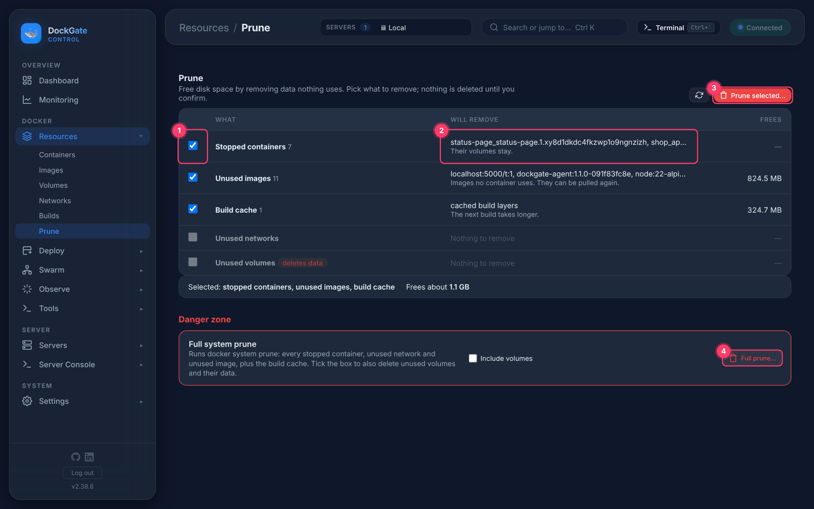

# Resources → Prune

> **Where:** sidebar **Resources → Prune**
>
> **Works on:** the server picked in the top bar (**SERVERS ▾**).

Free disk space by removing what nothing uses. Nothing is deleted until you confirm.

1. **Pick** the kinds to remove. Everything except volumes is ticked by default.
2. **Will remove** names exactly what goes, and **Frees** how much space comes back.
3. **Prune selected…** asks once, then removes the ticked kinds in order.
4. **Full prune…** in the danger zone runs `docker system prune` (see below).

| Row | What it removes | Note |
|---|---|---|
| **Stopped containers** | Every container that is not running | Their volumes stay |
| **Unused images** | Images no container uses | They can be pulled again |
| **Build cache** | Cached build layers | The next build takes longer |
| **Unused networks** | Networks you created that nothing uses | Docker's own and Swarm's networks are never included |
| **Unused volumes** — *deletes data* | Volumes no container uses | **The data inside is gone for good.** Never ticked by default |

**Full system prune** removes every stopped container, unused network and unused image, plus the build cache. Tick **Include volumes** to also delete unused volumes and their data.

## Good to know

- **A container moved to Swarm is a stopped container.** DockGate keeps it so you can move back. Pruning stopped containers removes it, and **Move back to the container** is then no longer possible.
- To prune on a schedule, use **Tools → Schedules → Prune**.
- **Resources → Images → Remove unused** does the same as the *Unused images* row.

## Errors and fixes

| You see | Why | What to do |
|---|---|---|
| `a prune operation is already running` | Docker runs one prune at a time | Wait and try again |
| *Frees* shows `—` | Docker does not report a size for that kind | Nothing is wrong |
