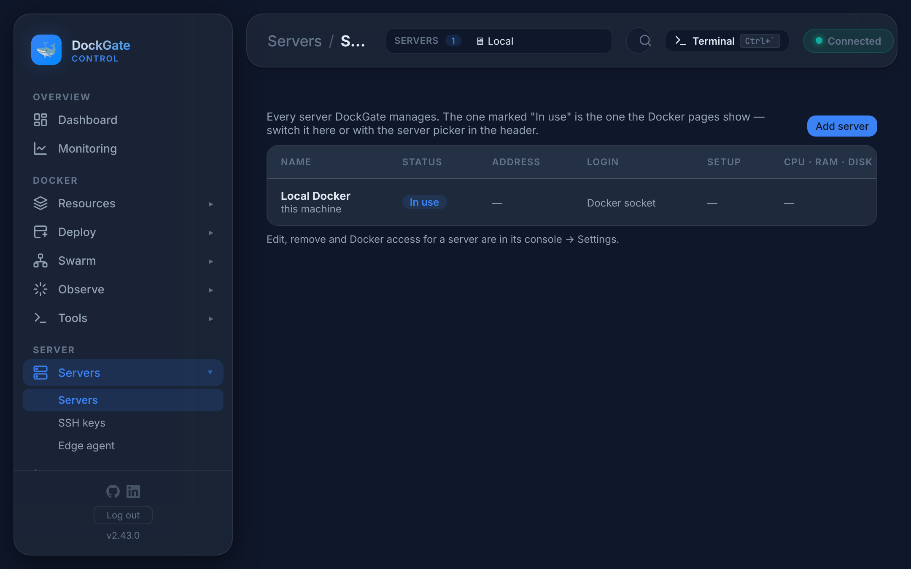
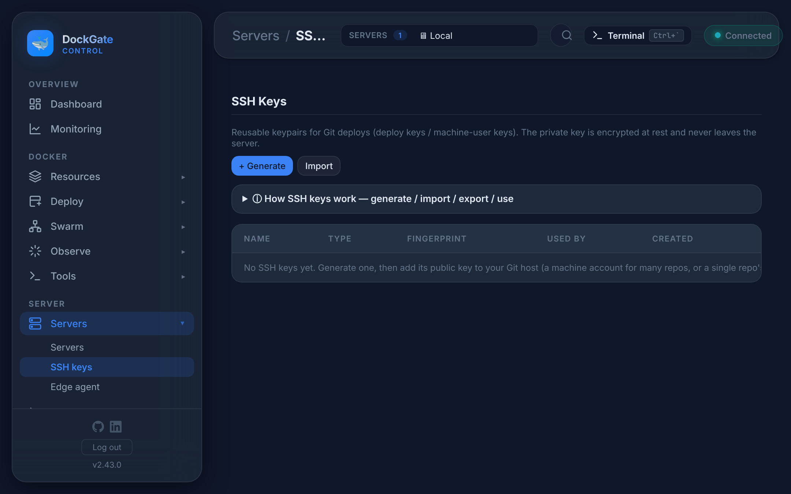
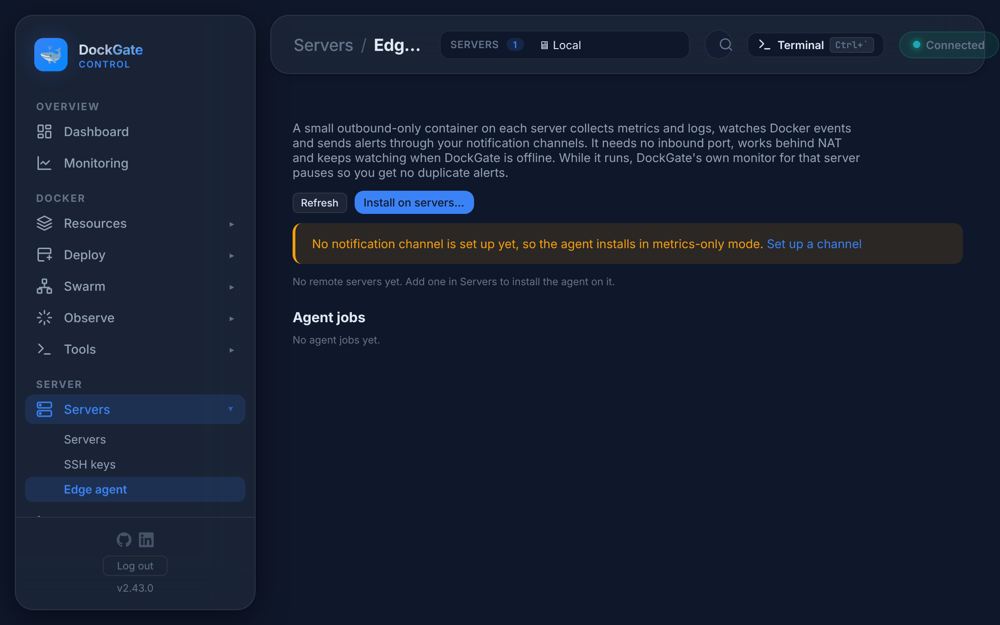

# Servers → Servers, SSH keys, Edge agent

> **Where:** sidebar **Servers**

---

## Servers

Every server DockGate manages. **Local** is the host DockGate runs on (through the Docker socket); other servers are reached over **SSH**. The one marked **In use** is the one the Docker pages show: switch it here or with **SERVERS ▾** in the top bar.

The list shows each server's status, address, login, setup state, and CPU, memory and disk. Click a server to open its [Server Console](server-console.md).

### Add server

**Add server** walks through:

1. **Name and ID**: the ID is used in links and can not change later (letters, digits, `-` and `_`).
2. **Address**: host and SSH port.
3. **How DockGate logs in**: a user with a **private key** (paste it, or pick one from SSH keys) or a **password**. Both are stored encrypted. A key is safer.
4. **Test**: DockGate connects, reads the server's **host key** and shows its fingerprint, and checks Docker (*Docker 27.x · 5 containers*, or *Docker is not installed yet — Setup installs it after adding*).
5. **Server identity**: compare the fingerprint with the one your provider shows. DockGate keeps it and refuses to connect if it changes later (a sign of a different machine or an attack).

After adding, DockGate offers to **create a deploy user**: a non-root user with `sudo`, Docker access and an SSH key DockGate makes. DockGate then connects as that user. Nothing is locked down by this step; you can also do it later from **Server Console → Setup**.

Edit, remove and Docker access of a server are in its console → **Settings**. A server can have an **access password**: a second password asked before anyone switches to that server in DockGate, and before it is changed or removed.

---

## SSH keys

Reusable key pairs for **Git deploys** (deploy keys or machine-user keys). The private key is stored encrypted and never leaves DockGate.

| Action | What it does |
|---|---|
| **+ Generate** | Makes a new key pair (ed25519 or RSA). Copy its **public key** to your Git host: a repository's *Deploy keys*, or a machine user for many repositories |
| **Import** | Paste an existing private key (OpenSSH format, no passphrase) |
| **Public key** | Shows the public key to copy again |
| **Delete…** | Removes the key. DockGate says which Git stacks still use it |

**Used by** lists the Git stacks that pull with each key. Use a key when you deploy from Git with an `git@host:owner/repo.git` URL ([Compose stacks](compose.md)).

---

## Edge agent

A small, **outbound-only** container on each server. It collects metrics and logs, watches Docker events and sends alerts through your notification channels. It needs no inbound port, works behind NAT, and keeps watching when DockGate is offline. While it runs, DockGate's own monitor for that server pauses, so you get no duplicate alerts.

| Action | What it does |
|---|---|
| **Install on servers…** | Pick the servers. Already-installed servers start unchecked; ticking one reinstalls it |
| **Update all servers (N)** | When a newer agent is available. The new image is on the server before the old agent stops; if the new one does not start, the previous one is put back. Your containers keep running |
| **Channel override** | Per server: send that server's alerts to another Telegram chat, email or webhook. Empty fields use the global channel |
| **Remove** | Removes the agent from the server |

It also keeps the **Scaling & health** rules of Compose stacks (replicas, auto-heal) while DockGate is offline. It has no port for this either: DockGate signs each rule and command with a key only it holds — see [How DockGate commands the agent, safely](agent-security.md).

Installs and updates run as **agent jobs** with a log; closing the window does not stop them. Without a notification channel the agent installs in *metrics-only* mode: set up a channel in **Settings → Notifications** first.

## Good to know

- **Local** needs no SSH: DockGate talks to the Docker socket mounted into its container.
- A server's host key is pinned on first connection. If you rebuild a server with the same address, re-trust its new key in **Server Console → Access & SSH**.
- For servers with many containers, the Edge agent is lighter than reading everything over SSH.

## Errors and fixes

| You see | Why | What to do |
|---|---|---|
| `Host and user are required` | Empty field | Fill them in |
| `Paste the private key` / `Private key required` | No key given | Paste the whole key, `-----BEGIN … KEY-----` included |
| `SSH OK — Docker not detected` | Docker is not installed, or the user can not use it | Run **Server Console → Setup**, or add the user to the `docker` group |
| `Could not reach the server` | Wrong address or port, or a firewall blocks SSH | Check the address and that SSH is open |
| `All configured authentication methods failed` | Wrong user, key or password | Check the login; the key's public part must be in `~/.ssh/authorized_keys` |
| `Host key mismatch — this server presented a different SSH host key than the one DockGate pinned. …` | The server's host key changed | If you rebuilt or reinstalled the server, re-trust it in **Server Console → Access & SSH**. Otherwise do not connect (possible man-in-the-middle) |
| `Current access password is incorrect — cannot change or remove this server` | The server has an access password | Enter the right one |
| `SSH key not found` | The key was deleted | Pick another key |
| *No notification channel is set up yet, so the agent installs in metrics-only mode.* | No channel | Set up Telegram, email or a webhook first |
| Edge agent: **Moved to Swarm** | The agent container was moved to Swarm (docker run → Swarm, before DockGate kept its own containers out). DockGate can not find, update or command it that way | **Update** — DockGate removes that Swarm service and runs the agent as a container on the server again |
| Many *High Error Spike* alerts from Caddy (`"level":"warn"`, `aborting with incomplete response`) | Agents older than 1.1.1 counted Caddy's warnings as errors. The line itself usually means a visitor closed the page before the answer ended | **Update all servers** on the Edge agent page |
