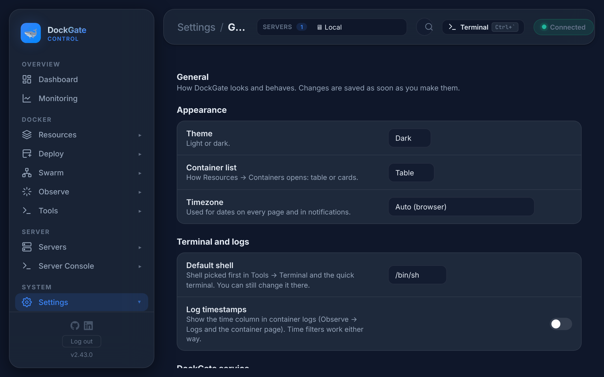
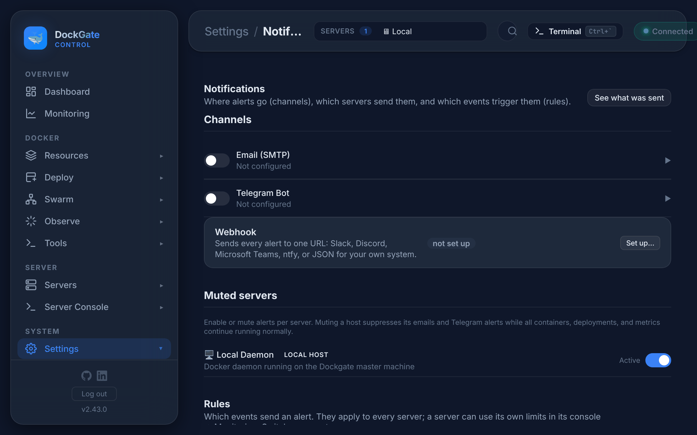
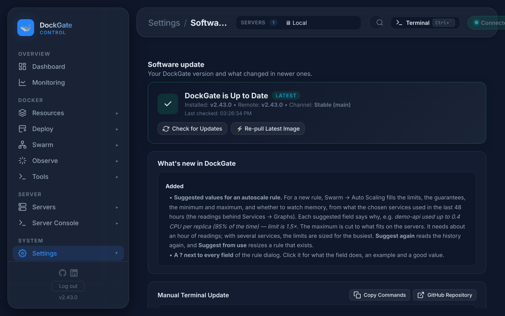

# Settings

> **Where:** sidebar **Settings**
>
> Changes save as soon as you make them. Settings are for the whole DockGate, unless a row says otherwise.

---

## General

| Row | Meaning |
|---|---|
| **Theme** | Light or dark |
| **Container list** | How **Resources → Containers** opens: table or cards |
| **Timezone** | Used for dates on every page, in notifications and for schedule times. *Auto (browser)* follows your computer |
| **Default shell** | The shell picked first in **Tools → Terminal** and the quick terminal (`/bin/sh`, `/bin/bash`…). You can still change it there |
| **Log timestamps** | Show the time column in container logs. Time filters work either way |
| **Start with Docker** | Start the DockGate container whenever Docker starts on this machine (restart policy `unless-stopped`). Off means you start it by hand after a reboot |

---

## Notifications

### Channels

| Channel | What to fill in |
|---|---|
| **Email (SMTP)** | SMTP host, port (587), username, password, *From* and *To* addresses. **Test Email** sends one |
| **Telegram Bot** | **Bot Token** and **Chat ID**. The page has a step-by-step guide: talk to `@BotFather`, make a bot, send it a message, open the URL shown to read your chat ID. **Test Message** sends one |
| **Webhook** | One URL for every alert: Slack, Discord, Microsoft Teams, ntfy (the topic URL, e.g. `https://ntfy.sh/my-dockgate`) or JSON for your own system. **Send test** sends one |

Passwords, tokens and the webhook URL are stored encrypted.

### Muted servers

Turn alerts off for one server, for example while you work on it. Its containers, deploys and metrics keep running; only its emails, Telegram and webhook alerts stop.

### Rules

Which events send an alert. Each rule has an on/off switch and a **quiet period** (how long before the same alert is sent again). Switches save at once.

| Group | Rules |
|---|---|
| Containers | stopped / crashed / out of memory, restarted, unhealthy, started, paused, unpaused |
| Docker | disk usage, build failed, newer image, image update failed, scheduled task failed |
| Servers | down, back, disk, memory, CPU |
| Compose | auto-heal restarted a container (or gave up), Auto Scaling changed a service or the server was full — see [Scaling & health](compose-scaling.md) |
| Swarm | service short of replicas, node down / back, update rolled back, quorum lost, autoscale changed a service |

Server limits (CPU %, memory %, disk %) are **shared** by every server. A server can have its own in **Server Console → Monitoring → Alerts**; the rule then shows *This server*.

**See what was sent** opens **Observe → Notifications sent**. For alerts that keep coming when DockGate is offline, install the [Edge agent](servers.md#edge-agent).

---

## Software update

Your DockGate version, the newest one, and **What's new** (the changelog of newer versions).

| Button | What it does |
|---|---|
| **Check for updates** | Asks GitHub for the newest release |
| **Update to vX Now** (or **Re-pull Latest Image** when up to date) | Pulls the image and recreates the DockGate container. The page reconnects by itself when it is back. Your data (`data/`) stays |
| **Manual Terminal Update** | The commands to update by hand (**Copy Commands**), and a link to the repository |

The self-update works for DockGate's own host only.

---

## System

The Docker engine and system DockGate is connected to (the server in use): Docker version, OS, kernel, architecture, CPUs and memory, storage and logging driver, cgroup version, Docker root folder, runtimes, plugins and registries.

---

## Security

| Row | Meaning |
|---|---|
| **Admin password** | Needed to sign in. **Change…** keeps you signed in here and signs out every other browser and device |
| **Sign out everywhere…** | Ends every DockGate session, this one too. Use it if you signed in on a machine you do not trust, or think a session was copied |

Forgot the password? See [Getting started → Forgot password](getting-started.md).

## Errors and fixes

| You see | Why | What to do |
|---|---|---|
| Test email: `Invalid login` / `535` | Wrong SMTP user or password; Gmail needs an *app password* | Use the right password or an app password |
| Test email: `ECONNREFUSED` / timeout | Wrong host or port, or the provider blocks the port | Try port 587 or 465 |
| Telegram: `chat not found` | Wrong Chat ID, or you never wrote to the bot | Send the bot a message, then read the Chat ID again |
| Telegram: `Unauthorized` | Wrong bot token | Copy the token from `@BotFather` again |
| Webhook test fails | Wrong URL, or the service refuses it | Check the URL; Slack, Discord and Teams URLs are made in their own settings |
| `Could not check for updates` | No connection to GitHub | Check DockGate's internet access, then try again |
