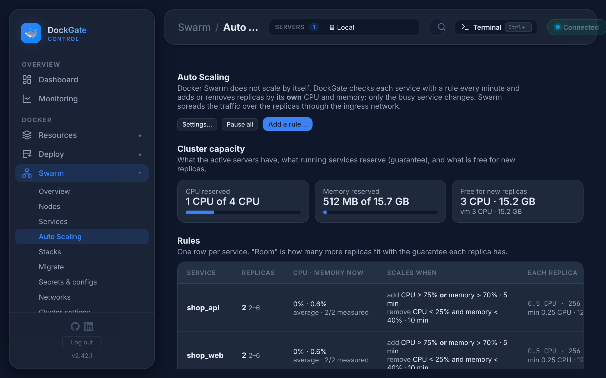
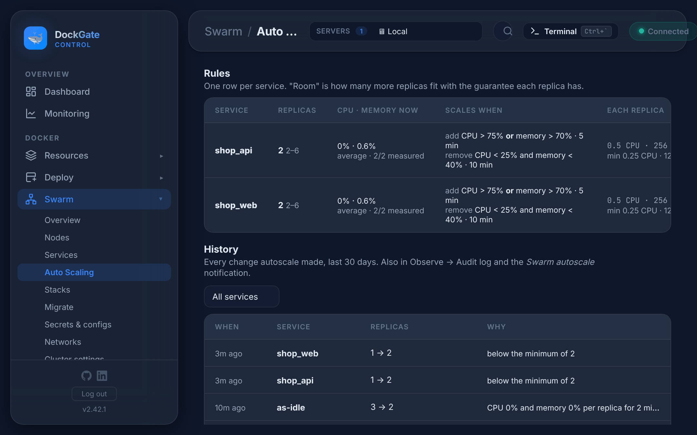
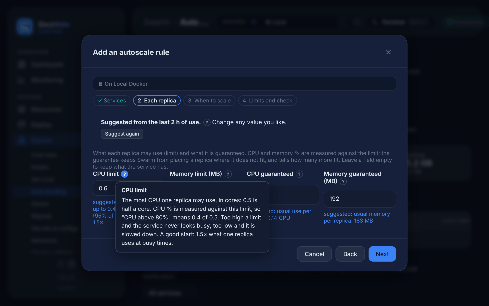
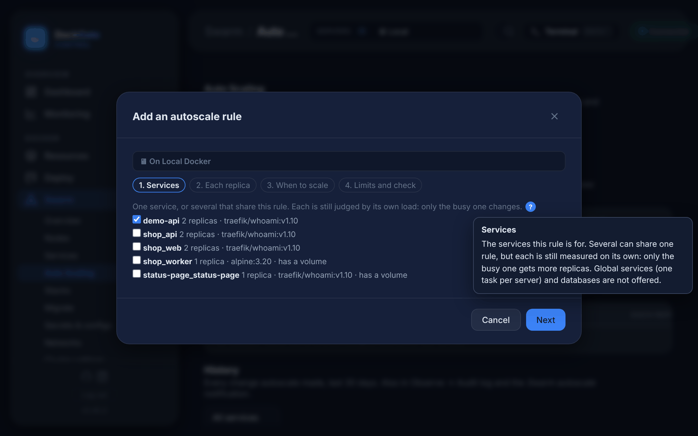
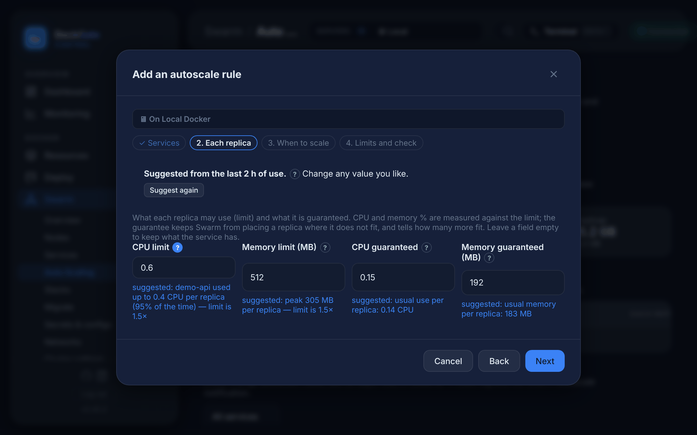
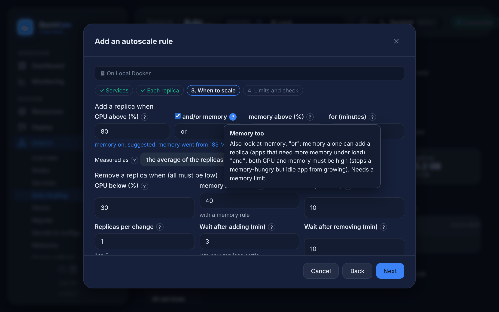
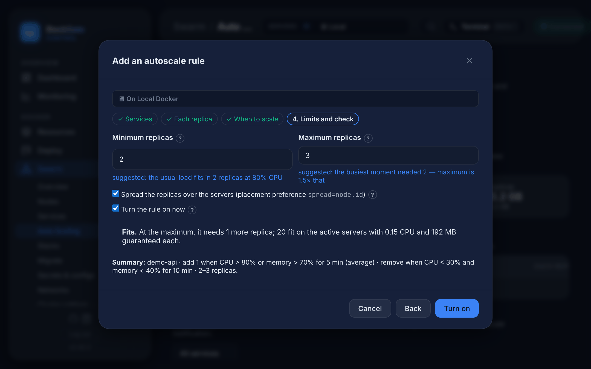

# Swarm → Auto Scaling

> **Where:** sidebar **Swarm → Auto Scaling**
>
> **Works on:** the server picked in the top bar (**SERVERS ▾**). Swarm must be active and that server must be a manager.

Docker Swarm keeps the number of replicas you set, but it does not change that number by itself. DockGate does: it watches the CPU and memory of each service that has a rule and adds or removes replicas. Each service is judged by **its own** load, so only the busy one changes. Swarm spreads the traffic over the replicas through the ingress network.

The page has four parts:

1. **Cluster capacity**: the CPU and memory of the active servers, how much the running tasks have reserved, and what is free for new replicas (also per server).
2. **Rules**: one row per service.
3. **History**: every change in the last 30 days.
4. Buttons: **Settings…**, **Pause all** / **Resume all** and **Add a rule…**.

## Rules

| Column | What it shows |
|---|---|
| **Replicas** | Replicas now, then the range (`2 2–6`). `±2` means two replicas per change |
| **CPU · memory now** | The last reading per replica, in % of the replica's limit. *average* or *every replica*, and how many replicas were measured |
| **Scales when** | When it adds and when it removes |
| **Each replica** | Its CPU and memory limit, and below it the guarantee (`min`) |
| **State** | See the table below. Under it, **room**: how many more replicas fit on the servers |

| State | Meaning |
|---|---|
| *steady* | Nothing to do |
| *busy: adds after 5 min* | Over the add limit. It adds a replica if the load stays high for the window |
| *quiet: removes after 10 min* | Under the remove limits and above the minimum |
| *busy, at the maximum* | Busy, but already at the maximum |
| *busy, no room* | Busy, but another replica would fit on no server |
| *a replica does not fit* | A replica added earlier waits as *pending* |
| *next change in 2 min* | Waiting after the last change |
| *not measured* | No replica runs on a server DockGate knows, so there is nothing to read |
| *paused* / *all paused* | This rule, or every rule, is paused |

The **⋯** menu of a row has **Edit…**, **Pause** / **Resume**, **Open service** and **Remove rule…**. Removing a rule keeps the service as it is: same replicas, same limits.

## Add a rule

**Add a rule…** opens four steps. Every field has a **?** next to it: click it for what the field does, an example and a good value.

### 1. Services

Pick one service, or several that should share the rule. Each one is still judged by its own load. A service that already has a rule shows *has a rule (it is replaced)*.

Not offered:

- **global** services, which run one task on every server;
- **databases** (`postgres`, `mysql`, `mongo`, `redis` and the like). More replicas would be separate databases, not copies.

*has a volume* is a warning, not a block: each replica uses the volume of the server it runs on, so a new replica on another server starts with an empty one. Fine for caches and stateless apps.

### 2. Each replica

| Field | Meaning |
|---|---|
| **CPU limit** | Most CPU one replica may use, e.g. `0.5`. CPU % is measured against it; without one, against one core |
| **Memory limit (MB)** | Most memory one replica may use. **Needed for a memory rule** |
| **CPU guaranteed** | CPU Swarm keeps free for each replica (reservation), e.g. `0.25` |
| **Memory guaranteed (MB)** | Memory Swarm keeps free for each replica, e.g. `256` |

Leave a field empty to keep what the service has. The guarantee is how DockGate knows whether one more replica fits: without one, *room* is unknown.

#### Suggested values

For a new rule, DockGate fills this step and the range (step 4) from what the chosen services really used. It keeps the CPU and memory of every service for 48 hours (the same readings as **Services → Graphs**, one every 2 minutes). Under each suggested field it says why, in blue.

| Field | Suggested as |
|---|---|
| **CPU limit** | 1.5× what one replica used at busy times (95% of the time), at least 0.1 CPU |
| **CPU guaranteed** | what one replica usually uses, at least 0.05 CPU |
| **Memory limit** | 1.5× the highest memory of one replica, in 64 MB steps, at least 64 MB |
| **Memory guaranteed** | the usual memory of one replica, in 32 MB steps |
| **Minimum** | replicas the usual load needs at the add % |
| **Maximum** | replicas the busiest moment needed × 1.5, cut to what fits on the servers |
| **Memory too** (step 3) | on when memory rose with load (busy memory 1.5× the usual), off when it stayed flat |

- It needs about an hour of readings. With less, the box says *Not enough history yet* and the usual values stay.
- With several services, the limits are sized for the busiest one, since one rule gives all of them the same limits.
- Services that were almost idle get small, safe values. Look again after a busy day.
- **Suggest again** reads the history again and puts the suggested values back. For a rule that exists, click **Suggest from use** to resize it from its real use.

### 3. When to scale

**Add a replica when** the CPU per replica is above a % (default **80%**), optionally **or** / **and** the memory is above a % (default **70%**), for some minutes (default **5**).

**Measured as:**

- **the average of the replicas** (default);
- **every replica is busy**: the least busy replica must be over the limit. One hot replica (a long request, a stuck job) then does not add more.

**Remove a replica when** CPU **and** memory are both below their % (default **30%** and **40%**) for some minutes (default **10**). Removing waits longer than adding, so the service does not shrink during a short pause.

| Field | Default | Meaning |
|---|---|---|
| **Replicas per change** | 1 | 1 to 5 replicas added or removed at once |
| **Wait after adding** | 3 min | Lets new replicas start and take traffic before the next look |
| **Wait after removing** | 10 min | |

The remove % must be **at least 10 below** the add %, or the service would go up and down.

### 4. Limits and check

- **Minimum** and **maximum** replicas. A service out of the range is put right at once, without waiting for load.
- **Spread the replicas over the servers** (placement preference `spread=node.id`).
- **Turn the rule on now.**

The box under them says how many replicas fit with the guarantee from step 2. The **Summary** line shows the rule in one sentence.

**Turn on** (or **Save** for a rule that exists) applies the limits to the services and saves the rule. Changing the limits makes Swarm restart the replicas one by one.

## How it works

- DockGate checks every **minute** (or every **30 seconds**, see Settings). For each running replica it reads `docker stats` on the server the replica runs on. The servers must be in **Servers**.
- A change needs enough readings to fill the window. One missed reading is allowed.
- **Never during a rolling update.** It waits until the update ends.
- The rule runs on the manager it was saved on, whichever server is picked in the top bar.
- If a service is removed, its rule goes too.
- **It does not add servers.** A replica that fits nowhere waits as *pending*. This is recorded once in History as **not placed: …** and sent through the notification.

## Settings

| Setting | Choices |
|---|---|
| **Check every** | 1 minute (default), 30 seconds |
| **When a replica does not fit** | *Add it anyway: it waits as pending, you are told* (default), or *Add no more until the waiting one is placed* |
| **Notifications** | Opens the **Swarm autoscale changed a service** rule in **Settings → Notifications** (Telegram, email, webhook) |

**Pause all** stops every rule at once. Replicas stay as they are until you resume.

## On the service page

A service with a rule has an **Autoscale** tab on its page (**Swarm → Services →** the name). It shows the rule in short, the last change and the service's history, with **Pause** / **Resume** and **Edit on Auto Scaling**. The rule is edited only on this page.

Each change is also in **Observe → Audit log** (`swarm_autoscale`).

## Good to know

- **Set the limits to what one replica really needs.** CPU % is measured against the limit, so a limit far too high means the service never looks busy.
- Scaling helps **stateless** services: web servers, APIs, workers. A database, or an app that keeps data in memory, needs more than more replicas.
- Keep the **maximum** within what the servers can hold. Watch *room* and **Cluster capacity**.
- Rules from DockGate 2.41 keep working. Their single wait is used after adding, and also after removing (at least 5 min).

## Errors and fixes

| You see | Why | What to do |
|---|---|---|
| `Swarm must be active and the server in use a manager` | The server picked in the top bar is a worker, or not in a swarm | Pick a manager in **SERVERS ▾** |
| `Choose at least one service` | Step 1 is empty | Tick a service |
| `<service> is global: it runs one task on every server — autoscale works for replicated services` | Global service | Use a replicated service |
| `<service>: <image> looks like a database. …` | Databases are not offered | Scale the database by its own replication |
| `<service> has no memory limit: set one (Each replica) so memory % can be measured` | Memory rule without a memory limit | Set **Memory limit** in step 2, or untick memory |
| `The maximum must be at least the minimum` | Min above max | Fix the range |
| `Remove at a CPU % at least 10 below the add %, or the service would go up and down` | The two % are too close | e.g. add at 80, remove at 30 |
| `Remove at a memory % at least 10 below the add %, …` | Same for memory | e.g. add at 70, remove at 40 |
| `The CPU guarantee can not be above the CPU limit` | Guarantee > limit | Lower the guarantee |
| `The memory guarantee can not be above the memory limit` | Same for memory | Lower the guarantee |
| `<field>: a whole number from <a> to <b>` | A value out of range | Use a value in the range |
| `CPU limit: CPU from 0.01 to 256` (or *CPU guaranteed*) | A CPU value out of range | e.g. `0.5` |
| `Memory limit: MB from 6` (or *Memory guaranteed*) | Memory below 6 MB | e.g. `256` |
| `The manager server of this rule is no longer in DockGate` | The server the rule was saved on was removed from **Servers** | Add the rule again from another manager |
| History: `not placed: no suitable node (insufficient resources on N node)` | No server has the guarantee free | Lower the guarantee or the maximum, free capacity, or add a server |
| State *not measured* | No replica runs on a server in **Servers** | Add those servers to DockGate |
