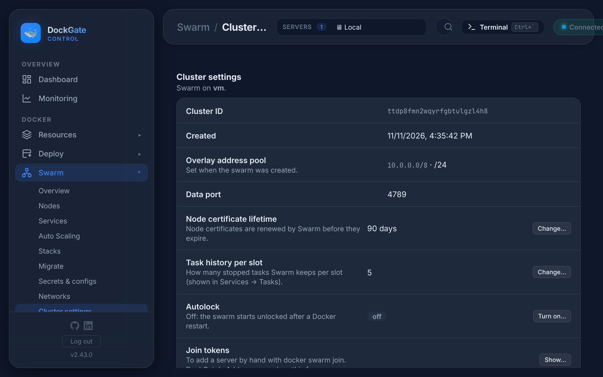

# Swarm → Cluster settings

> **Where:** sidebar **Swarm → Cluster settings**
>
> **Works on:** the server picked in the top bar (**SERVERS ▾**). Swarm must be active and that server must be a manager.

Settings of the whole swarm, its keys and certificates, backups, and the way back when something breaks.

## Settings

| Row | What it does |
|---|---|
| **Cluster ID**, **Created** | For reference |
| **Overlay address pool**, **Data port** | Set when the swarm was created. Can not be changed |
| **Node certificate lifetime** | 1–3650 days (default 90). Swarm renews certificates before they expire |
| **Task history per slot** | How many stopped tasks Swarm keeps per slot (0–100, default 5), shown in a service's Tasks |
| **Autolock** | **Turn on…**: Swarm encrypts its keys at rest, and a manager stays locked after every Docker restart until it is unlocked. DockGate keeps the key (encrypted) and shows it once: save it somewhere safe too. **Turn off…** removes the stored key. Services keep running either way |
| **Unlock key → Show unlock key… / Rotate…** | With autolock on. **Rotate…** makes a new key; the old one stops working. DockGate stores the new one and shows it once |
| **Join tokens → Show…** | The worker and manager tokens for `docker swarm join` by hand. **Rotate** makes a new token; servers already in the swarm are not affected. Showing them is recorded in the audit log |
| **Root CA → Rotate…** | A new root CA, and a new certificate for every server signed by it (`docker swarm ca --rotate`). Use it after a manager was compromised or a key may have leaked. Services keep running; servers that are down get theirs when they come back |

### Tuning

The defaults suit most clusters. Change them only with a reason.

| Row | Meaning |
|---|---|
| **Heartbeat period** | How often servers report to the managers (1–60 s, default 5). Higher means less traffic, but a lost server is noticed later |
| **Raft snapshot interval** | Log entries between snapshots of the cluster state (100–1,000,000, default 10,000). Lower means smaller logs and more frequent snapshots |

## Backups

A backup is a `.tar` with:

- `RESTORE.txt`: the restore steps;
- `cluster.json`: services, networks, configs and nodes, as plain JSON;
- `swarm-dir.tar.gz`: the swarm state (Raft) of this manager;
- with autolock, the unlock key, encrypted for this DockGate.

**Back up now** makes one; **Back up every night** keeps the last 7 in DockGate's data folder. Each can be downloaded. Secrets are kept **by name only**: Swarm never gives their values out. Volume data is not in the backup.

**Upload a backup…** adds a `.tar` downloaded earlier, for example from a server that is gone.

## When something breaks

| Situation | What to do |
|---|---|
| **A manager restarted and the swarm is locked** | **Unlock…** on Swarm → Overview. DockGate has the key stored |
| **Most managers can not be reached** | Running services keep running, but nothing can be deployed or changed. **Wait** if the managers will come back (power, network). If they will not: **Recover cluster…**. DockGate takes a backup, runs `docker swarm init --force-new-cluster` on the server in use (a one-manager cluster that keeps every service) and removes the managers that are gone. Then add managers again |
| **Only the services are gone** (removed by mistake, or a new swarm on new servers) | **Restore…** on a backup: DockGate creates what the backup describes and is missing here. Names that exist are left alone. You type the secret values again; a service whose secret has no value is skipped |
| **Every manager is lost** | On a new server (the same Docker version is best): stop Docker, put the backup's `swarm-dir.tar.gz` in `/var/lib/docker`, start Docker and run `docker swarm init --force-new-cluster --advertise-addr <its address>`. With autolock, `docker swarm unlock` first. Then add the other servers again. The exact commands are in **How to restore** and in `RESTORE.txt` |

## Turn Swarm off

**Turn Swarm off…** makes the server leave the swarm. With one server that removes the swarm with its services, secrets and configs. Compose containers are not touched. You type the server name to confirm.

## Errors and fixes

| You see | Why | What to do |
|---|---|---|
| `Certificate lifetime must be 1–3650 days` | Out of range | e.g. `90` |
| `Task history must be 0–100` | Out of range | e.g. `5` |
| `Heartbeat period must be 1–60 seconds` | Out of range | e.g. `5` |
| `Raft snapshot interval must be 100–1,000,000 log entries` | Out of range | e.g. `10000` |
| `Nothing to change` | The value is the same | — |
| `The cluster has a leader — nothing to recover. …` | Recover on a healthy cluster | Not needed |
| `Not a DockGate Swarm backup (no cluster.json inside)` | Upload of another file | Use a `.tar` made by DockGate |
| `More than 512 MB` | The backup is too large to upload | Restore by hand with `RESTORE.txt` |
| `Type the server name (<name>) to confirm` | The name does not match | Type it exactly |
