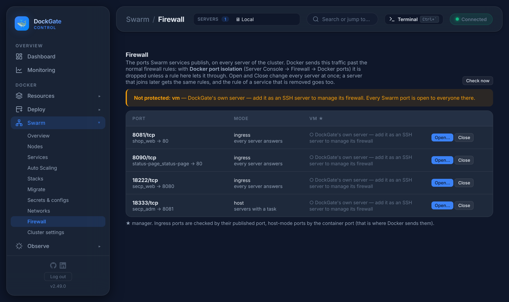

# Swarm → Firewall

> **Where:** **Swarm → Firewall**
>
> **Works on:** the Swarm cluster of the server picked in the top bar (a manager).

The ports Swarm services publish, on **every server of the cluster**, in one table — and opening or closing one on all of them at once.

## Why a page of its own

A Swarm port is published on every server (**ingress**: every server answers, whichever runs the task) or on the servers that run a task (**host** mode). Docker sends this traffic **past UFW's normal rules**: an `ufw allow 8080` does not open it, and `ufw deny 8080` does not close it.

With DockGate's **Docker port isolation** (Server Console → Firewall → Docker ports) that traffic is dropped unless a `ufw route allow` rule lets it through. This page writes those rules, the same on every server.

| Mode | The rule names |
|---|---|
| ingress | the **published** port (Docker forwards it to the ingress network on that same port) |
| host | the **container** port (Docker forwards straight to the task) |

## The table

One row per published port, one column per server (★ = manager):

| You see | Meaning |
|---|---|
| ● open to anyone / to 203.0.113.7, office … | A rule lets it through, from these sources |
| ○ closed | Isolation is on and no rule lets it through — nobody outside reaches it |
| ⚠ open to everyone | Nothing filters it there: no firewall, firewalld, or Docker port isolation off |
| DockGate's own server — add it as an SSH server … | DockGate manages firewalls over SSH; add its own server under Servers to include it |

A box above the table lists the servers where every Swarm port is open to everyone.

## Open and Close

- **Open…** — choose who may reach the port: **anyone**, an **IP list** (made in Server Console → Firewall → IP lists), or **addresses** (one or more, ranges allowed). It is written on every server with UFW and Docker port isolation; the others are listed with the reason they were skipped.
- **Close** — removes the rule on every server.

What you asked for is **kept**:

- a server that **joins the cluster later** gets the same rules;
- if a port moves between ingress and host mode, the old rule goes and the right one comes;
- when **no service publishes the port any more**, its rule is removed from every server and forgotten.

DockGate checks this every 10 minutes; **Check now** does it at once. Every change is in the audit log (`swarm_fw_open`, `swarm_fw_close`).

The SSH port of a server is never changed from here (Server Console → Firewall handles it, with its safety checks).

## Errors and fixes

| You see | Why | What to do |
|---|---|---|
| `Docker port isolation is off — the port is open to everyone` | Docker publishes past UFW on that server | Server Console → Firewall → Docker ports → turn isolation on |
| `firewalld: Docker publishes past it — not managed here` | The server uses firewalld | Filter in front of the server (cloud firewall), or use UFW |
| `no firewall on this server` | UFW / firewalld is not active | Server Console → Firewall → turn it on |
| `not a DockGate server — add it in Servers` | A node DockGate does not know | Add the server in Servers |
| `No Swarm service publishes 8080/tcp` | The service changed meanwhile | Refresh |
