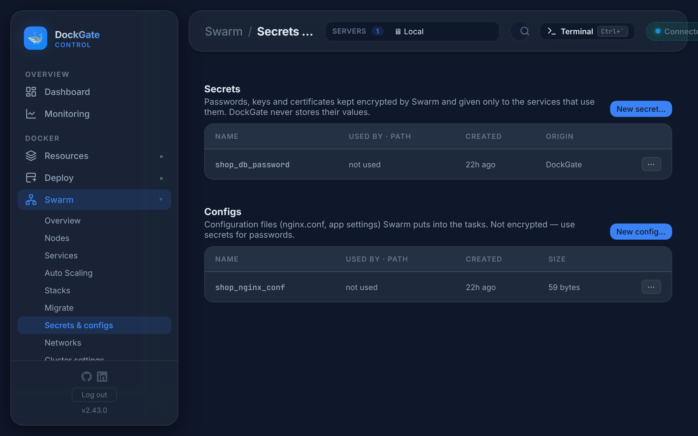
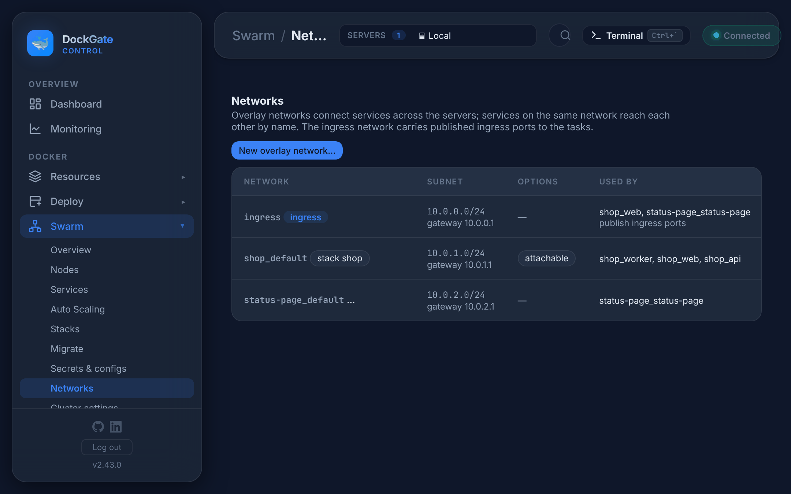

# Swarm → Secrets & configs and Networks

> **Where:** sidebar **Swarm → Secrets & configs** and **Swarm → Networks**
>
> **Works on:** the server picked in the top bar (**SERVERS ▾**). Swarm must be active and that server must be a manager.

---

## Secrets

Passwords, keys and certificates kept encrypted by Swarm and given only to the services that use them.



**New secret…** asks for a name and the value. The value goes to Swarm only: **DockGate does not store or log it, and it is not shown again**.

In a task a secret is the file `/run/secrets/<name>`, readable only inside the task. Most images read it through a `*_FILE` variable:

```yaml
environment:
  POSTGRES_PASSWORD_FILE: /run/secrets/db_password
```

Give a service a secret in its form: **Settings… → Env & secrets → Secrets**.

## Configs

Configuration files (`nginx.conf`, app settings) Swarm puts into the tasks, at the path you choose in the service (**Settings… → Env & secrets → Configs**). **Not encrypted**: use a secret for passwords.

## Actions

| Action | What it does |
|---|---|
| **Rotate…** (secret) / **Edit…** (config) | Swarm can not change a secret or config in place. DockGate creates a new version (`name_v2`, then `name_v3`…), moves the services that use it to the new one, one service at a time with a rolling update (the file path in the container stays the same), then removes the old one. If an update fails, it stops and the old one stays |
| **View** (config) | Shows the file's content |
| **Remove…** | Only when no service uses it |

The list shows which services use each one, at which path, when it was made and whether DockGate or a stack made it.

---

## Networks

Overlay networks connect services across the servers. Services on the same network reach each other **by name** (`http://api:8080`). The **ingress** network carries published ingress ports to the tasks, whichever server they run on.



**New overlay network…**

| Option | Meaning |
|---|---|
| **Subnet** (optional) | e.g. `10.210.0.0/24`. Empty: Swarm takes one from the address pool |
| **Attachable** | Plain containers (Compose, `docker run`) can join it and talk to the services |
| **Encrypted** | Encrypts traffic between the servers (IPsec). For traffic over public addresses. DockGate allows ESP between the cluster servers it manages. Costs some CPU |
| **Internal** | No traffic to the internet from this network |

| Action | What it does |
|---|---|
| **Remove…** | Only when no service uses it. A stack's network goes with the stack |
| **Change subnet…** (ingress) | Gives the ingress network another subnet, when it overlaps a network your servers use. Only when no service publishes ports through it |

Networks of a single server (bridge, host) are in [Resources → Networks](networks.md).

## Good to know

- To change a password: **Rotate…** the secret. The services restart one at a time and get the new file.
- A backup of the swarm keeps the **names** of secrets only, never their values. You type them again when you restore.
- Two stacks that must talk: put both on one attachable overlay network, created here.

## Errors and fixes

| You see | Why | What to do |
|---|---|---|
| `Name: letters, digits, dot, dash or underscore` | Invalid name | e.g. `db_password` |
| `At most 500 KB (a Swarm limit)` | The value or file is too large | Split it, or mount a volume instead |
| `Still used by <services>` | Remove on something in use | Take it out of those services first |
| `<secret> "<name>" does not exist` | It was removed meanwhile | Reload the page |
| `Subnet: write it like 10.250.0.0/24 (a /16 to /28)` | Wrong subnet | e.g. `10.250.0.0/24` |
| `The ingress network is changed with Change subnet…, not removed` | Remove on ingress | Use **Change subnet…** |
| `Network not found` | Removed meanwhile | Reload the page |
