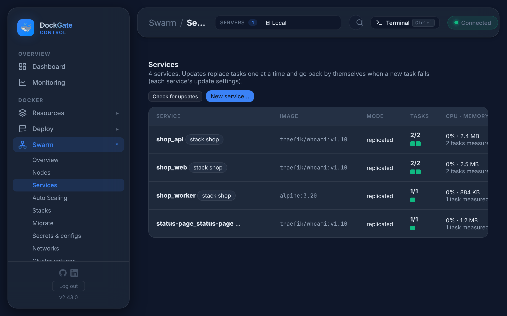
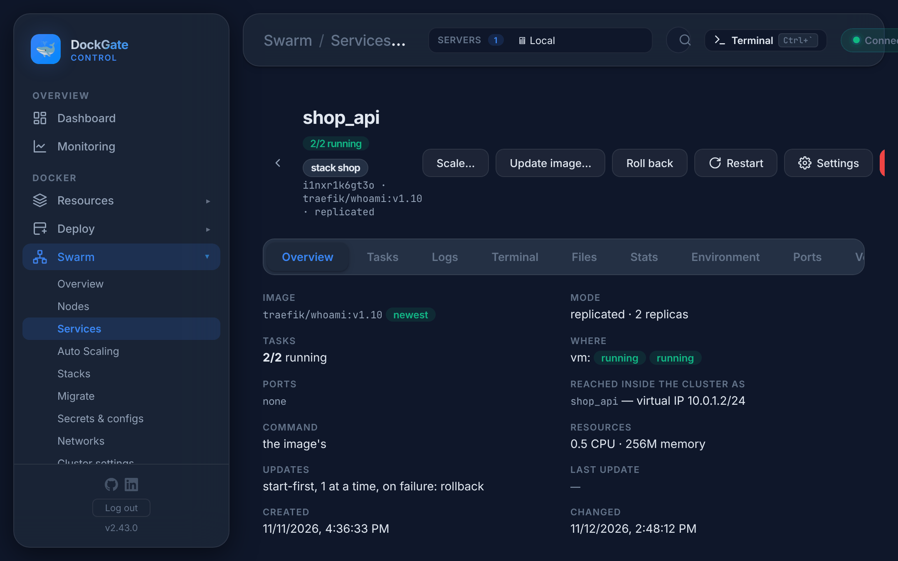

# Swarm → Services and the service page

> **Where:** sidebar **Swarm → Services**
>
> **Works on:** the server picked in the top bar (**SERVERS ▾**). Swarm must be active and that server must be a manager.

A **service** is an app Swarm runs as one or more **tasks** (containers). *Replicated* services run the number of replicas you set; *global* services run one task on every server.

| Column | What it shows |
|---|---|
| **Service** | Name, its stack, and *auto 1–3* when it has an autoscale rule |
| **Image** | The image and tag; a badge when a newer image exists |
| **Mode** | replicated or global |
| **Tasks** | Running of desired, with a dot per task |
| **CPU · Memory** | All running tasks summed |
| **Ports** | Published ports |
| **Last update** | The state of the last rolling update (*completed*, *updating*, *paused*, *rolled back*) |

**Check for updates** looks for newer images of every service. **New service…** opens the form below.

## Actions (⋯)

| Action | What it does |
|---|---|
| **Scale…** | Set the number of replicas. `0` stops every task but keeps the service |
| **Update image…** | Change the tag (e.g. `nginx:1.27` → `nginx:1.28`). Swarm replaces tasks one at a time |
| **Update to newest…** | Pull the newest image of the same tag and roll it out |
| **Roll back to previous** | Go back to the previous version of the service (image and settings) |
| **Restart (one by one)** | Restart every task in turn, without changing anything |
| **Settings…** | The full form |
| **Traffic** | How the service is reached: ingress ports, host ports, and inside the cluster by name |
| **Inspect (JSON)** | Docker's raw data |
| **Remove…** | Removes the service and its tasks. Volumes stay |

Swarm does the update; closing the window does not stop it. With *start-first* updates the old task keeps running until the new one is healthy.

## The service form

**New service…** and **Settings…** use one form in 10 sections:

| Section | Fields |
|---|---|
| **General** | Name, image, mode, replicas, entrypoint, command, user, working directory, hostname |
| **Resources** | CPU and memory limit and reservation, PID limit, generic resources (GPU) |
| **Placement** | Constraints (`node.role==worker`, `node.labels.db==true`), spread over a label, at most N per server |
| **Updates & rollback** | Order (*start-first* / *stop-first*), tasks at a time, delay, how long to watch each new task, what to do when it fails (*rollback*, *pause*, *continue*), failures allowed; the same for roll back |
| **Restart** | Restart when (*any*, *on-failure*, *none*), wait, max attempts, window |
| **Health check** | Command, every, timeout, failures before unhealthy, start period |
| **Env & secrets** | Environment, service and container labels, secrets and configs (mounted as files) |
| **Ports & network** | Published ports (*ingress* or *host* mode), networks and aliases, endpoint mode (*vip* / *dnsrr*), DNS servers, extra hosts |
| **Mounts** | Volumes, bind mounts and tmpfs |
| **Advanced** | Capabilities, sysctls, ulimits, stop grace period and signal, log driver and options, read-only root filesystem, init process |

Values are written like `512M`, `1G`, `10s`, `1m30s`. The mode of a service can not be changed: create a new one.

---

## The service page

Click a service's name for its page. The header has **Scale…**, **Update image…**, **Roll back**, **Restart**, **Settings** and **Remove**.

| Tab | What it shows |
|---|---|
| **Overview** | Image, mode, replicas, ports, stack, last update, and what is wrong when tasks fail |
| **Tasks** | Where each task runs, and when and why one stopped. Swarm keeps a few stopped tasks per slot |
| **Logs** | All tasks, or one, in the [log viewer](observe.md#the-log-viewer) |
| **Terminal** | A shell in a running task, on whichever server it runs (that server must be in DockGate) |
| **Files** | Browse and edit files inside a task. Changes are in that task only, and are lost when it is replaced |
| **Stats** | CPU and memory: live, and the last 1 h to 48 h |
| **Environment** | Variables, with *changed from DockGate* marks |
| **Ports** | Published ports and protocol; how other services reach it by name |
| **Volumes** | Mounts and where they live |
| **Networks** | Networks and aliases |
| **Secrets & configs** | Which ones the service uses and the path in the task. Values are changed in **Swarm → Secrets & configs** |
| **Placement** | Constraints and preferences, and which servers qualify |
| **Updates** | Update and roll back settings, the last update, **Check for updates** and **Resume the update…** |
| **Autoscale** | The service's autoscale rule in short; edited on [Swarm → Auto Scaling](swarm-auto-scaling.md) |
| **Events** | Docker events of this service, last 24 hours |
| **Inspect** | Raw JSON |

### A paused update

When a new task fails and the service's *When it fails* is *pause*, Swarm stops the update half-way: some tasks run the new version, some the old. A banner at the top of the page says so. Fix the cause (wrong image, wrong setting), then **Resume the update…**, or **Roll back**.

## Good to know

- **Databases**: more than one replica means separate databases, not copies. Keep them at 1 replica and pin them to one server.
- **Named volumes live on the server where the task runs.** A task moved to another server starts with an empty volume.
- Sticky sessions and weighted (canary) routing are not part of Swarm: put Traefik or Caddy in front for that.
- Services in a stack can also be changed through the stack file in **Swarm → Stacks**. A change made here is kept until the stack is deployed again.

## Errors and fixes

| You see | Why | What to do |
|---|---|---|
| `Image is required (e.g. nginx:1.27)` | Empty image | Enter `name:tag` |
| `Name: letters, digits, dot, dash or underscore (up to 63)` | Invalid name | e.g. `web-api` |
| `The mode of a service can not be changed — create a new service` | Replicated ↔ global | Create a new service |
| `Only replicated services can be scaled` | Scale on a global service | Global services run one task per server |
| `Memory reservation is bigger than the limit` | Reservation > limit | Lower the reservation |
| `<field>: write it like 512M or 1G` / `write it like 10s, 1m30s or 500ms` | Wrong unit | Use the format shown |
| `Constraint "<c>": write e.g. node.labels.db==true or node.role!=manager` | Wrong constraint | Use `==` or `!=` |
| `DNS round robin can not publish ports in ingress mode — use host mode` | *dnsrr* with ingress ports | Use host mode, or *vip* |
| `Bind mount source "<path>" must be an absolute path on the server` | Relative path | e.g. `/srv/app/data` |
| `This service has no previous version` | Roll back on a new service | Nothing to roll back to |
| `The update of this service is not paused` | Resume when nothing is paused | No action needed |
| Task: `no suitable node (insufficient resources on N node)` | No server has the reservation free | Lower the reservation or replicas, or add a server |
| Task: `No such image` | The image or tag does not exist, or the registry needs a login | Check the tag; add the login in **Deploy → Registries** |
