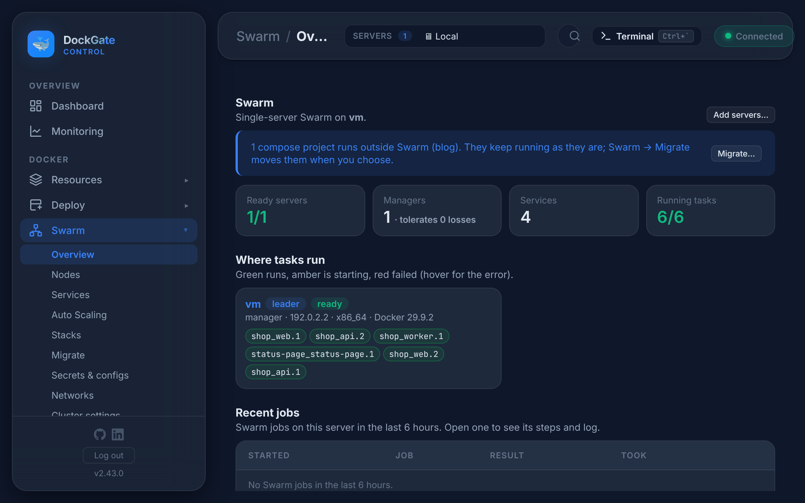
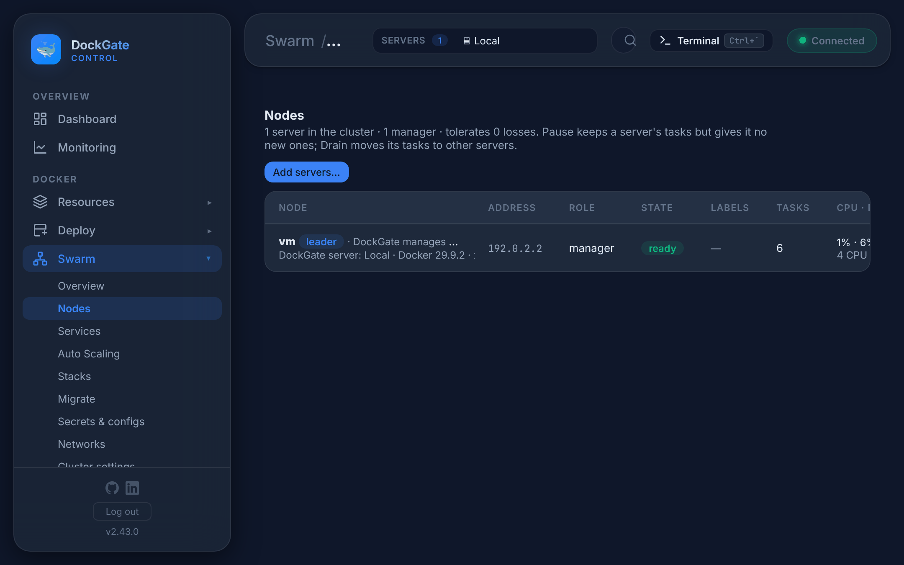

# Swarm → Set up, Overview and Nodes

> **Where:** sidebar **Swarm → Overview** and **Swarm → Nodes**
>
> **Works on:** the server picked in the top bar (**SERVERS ▾**). After setup that server must be a manager.

**Docker Swarm** runs your apps as **services** over one or more servers. A service runs as several containers (*tasks*, *replicas*); Swarm restarts a task that dies, updates a service one task at a time and goes back to the previous version when the new one fails. Passwords and config files are kept by Swarm as **secrets** and **configs**.

It is built into Docker, so nothing extra is installed. It works on one server too: you get replicas, rolling updates with roll back and secrets on a single VPS, and add servers later.

---

## Set up Swarm

On a server without Swarm, **Swarm → Overview** shows what you get and **Set up Swarm…**.

1. **How many servers**
   - **One server now, more later**: this server is manager and worker.
   - **Several servers**: this server is the first manager; pick the others and their role. Only servers already in **Servers** can be chosen. Keep **1, 3 or 5 managers**: managers keep the cluster state, workers only run tasks.
2. **Checks**: DockGate checks every server over SSH (Docker version, not in another swarm, the addresses reach each other, the firewall). Fix the red items, then check again.
3. **Addresses**: the address each server uses for Swarm traffic. A **private network** (Hetzner vSwitch, a cloud network, a VPC, WireGuard) is best: the Swarm ports then never face the internet.
4. **Firewall**: DockGate opens the Swarm ports between the servers only (UFW or firewalld): `2377/tcp`, `7946/tcp+udp`, `4789/udp` (and ESP for encrypted networks). On DockGate's own server, open them yourself.
5. **Advanced** (can not be changed later): the overlay address pool (default `10.0.0.0/8`, `/24` networks; must not overlap networks your servers use) and the data port (`4789/udp`, change it only if a cloud network uses it). Also: **autolock**, node certificate lifetime (90 days), task history (5).

**Create Swarm** runs as a job with a live log. If a step fails, DockGate undoes what it did.

---

## Overview

| Part | What it shows |
|---|---|
| **Counters** | Ready servers, managers (and how many losses the cluster survives), services, running tasks |
| **Where tasks run** | One card per server: role, state, address, and its tasks. Green runs, amber is starting, red failed (hover for the error) |
| **Recent jobs** | Swarm jobs of the last 6 hours (setup, add servers, moves, rebalance…). Open one to see its steps and log, also after it finished |
| **Recent Swarm events** | Services, nodes, secrets and configs changed in the last 24 hours |

A bar above every Swarm tab shows a running job, or one that ended in the last 10 minutes, with **Open log**. The sidebar shows **Swarm ▶ N** while jobs run. Closing a job window does not stop the job.

**Swarm is locked**: with autolock on, a manager stays locked after a Docker restart. Services keep running, but the swarm can not be managed until you **Unlock** it. DockGate keeps the key, so you can leave the field empty.

---

## Nodes

Every server in the swarm: role (manager / worker, *leader*), state, availability, address, labels, tasks, CPU and memory, Docker version and its DockGate server.

**Add servers…** joins more servers, with the same checks and firewall steps as setup. They must be in **Servers** first.

| Action (⋯) | What it does |
|---|---|
| **Pause** | Keeps the tasks, but the server gets no new ones |
| **Drain…** | Moves its tasks to the other servers (for maintenance). DockGate shows which services move first, and refuses when no other server is active |
| **Activate** | Takes new tasks again. Then **Rebalance** spreads the tasks |
| **Promote to manager** / **Demote to worker** | Change the role. The last manager can not be demoted; the leader hands over leadership first |
| **Labels…** | `key=value` labels used by placement rules, e.g. `node.labels.db==true` |
| **Inspect (JSON)** | Docker's raw data of the node |
| **Add to DockGate…** | For a node joined by hand: add its server to DockGate, so DockGate can read its tasks, logs and stats |
| **Remove…** | A manager is demoted first; then its tasks move away (drain), the server leaves the swarm and DockGate deletes the firewall rules it added. Compose containers on it are not touched. For a node not in DockGate, run `docker swarm leave` on it yourself. You type the node name to confirm |

**Rebalance…** (above the list) restarts services one at a time (`docker service update --force`) so Swarm spreads them over the active servers. Services pinned to a server, global services and services with a data volume are left alone.

### The node page

Click a node's name for its page:

| Tab | What it shows |
|---|---|
| **Overview** | Role, state, availability, address, CPU and memory, OS, Docker, its DockGate server, joined and last change |
| **Tasks** | Tasks on it now, or with history; open a service from here |
| **Resources** | CPU and memory of its server: live, the last 48 hours, and its alert rules |
| **Labels** | Edit the labels, and see which services use them |
| **Events** | Docker events of this node, last 24 hours |
| **History** | Changes made through DockGate (audit log) |
| **Inspect** | Raw JSON |

## Good to know

- **Managers: 1, 3 or 5.** With 3 managers the cluster survives losing one; with 5, two. With 2 managers, losing one stops the cluster. That is worse than 1.
- **Volumes stay on their server.** A task moved to another server starts with an empty named volume. Pin a service with data to one server (Placement), or use shared storage.
- If most managers are lost, use **Cluster settings → Recover cluster** (see [Cluster settings](swarm-cluster.md)).

## Errors and fixes

| You see | Why | What to do |
|---|---|---|
| `The server in use is a worker — switch to a manager at the top` | A worker is picked in **SERVERS ▾** | Pick a manager |
| `Swarm is not active on the server in use` | No swarm on that server | Set it up, or pick a server in the swarm |
| `A Swarm job is already running` | One job at a time | Wait, or open it from the bar |
| `<address> is given for two servers — each server needs its own address` | Same address twice | Give each server its own address |
| `The address pool must be a network such as 10.200.0.0/16 (a /24 or bigger)` | Wrong pool | e.g. `10.200.0.0/16` |
| `The data port must be between 1024 and 49151` | Port out of range | Keep `4789` unless it is taken |
| `No other active server: draining would stop every service …` | Drain on the only active server | Use **Pause**, or add a server first |
| `This is the last manager — promote another server first` | Demote or remove the last manager | Promote another node first |
| `This node is the leader — demote it first (leadership moves to another manager)` | Remove the leader | Demote it, then remove |
| `DockGate manages the cluster through this server — switch DockGate to another manager first (server picker at the top)` | Removing the server picked in the top bar | Pick another manager first |
| `Type the server name (<name>) to confirm` | The name does not match | Type it exactly |
| `Label "<key>": use letters, digits, dot, dash or underscore` | Invalid label | e.g. `zone=eu-1` |
