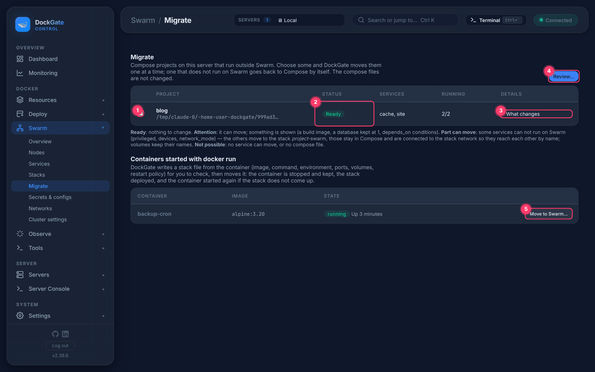
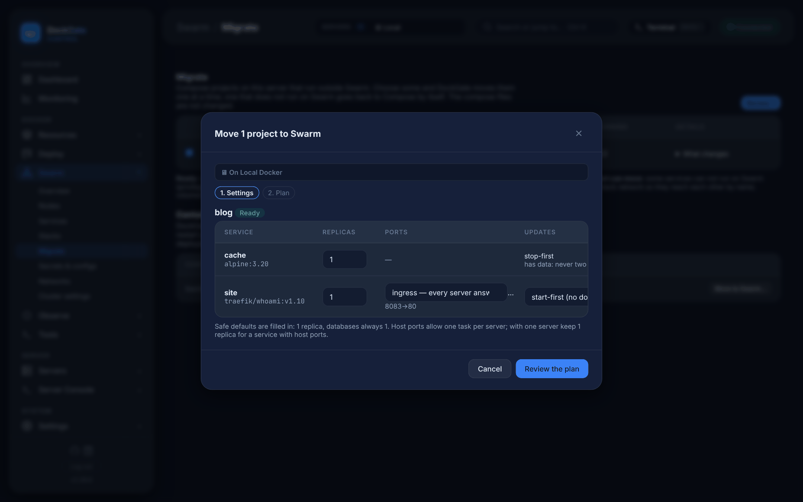
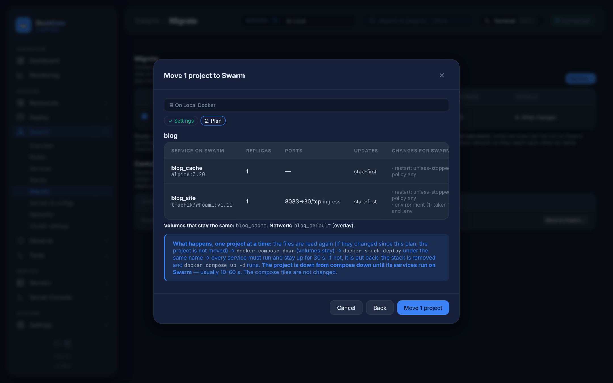
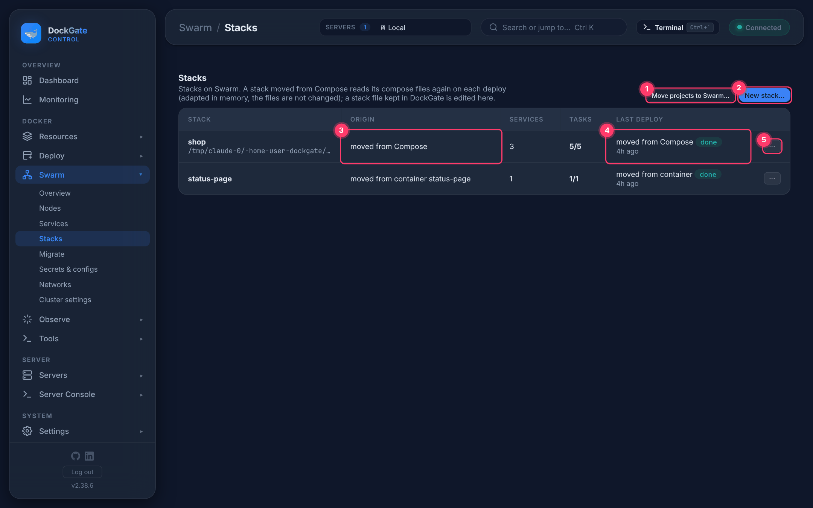
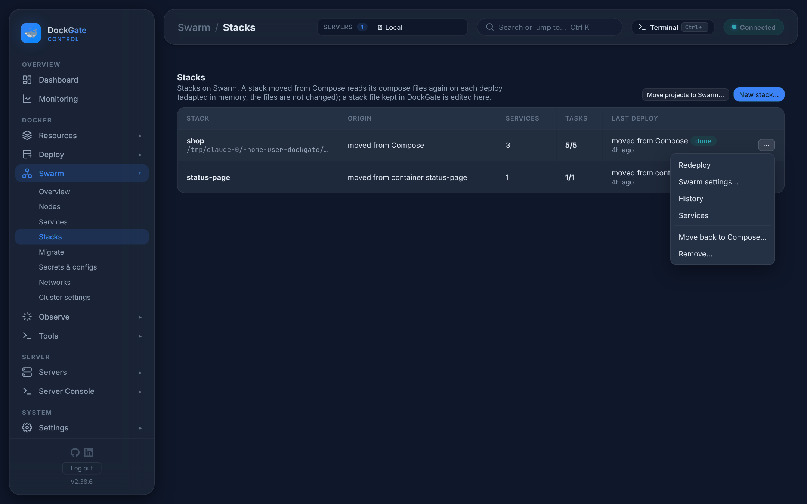
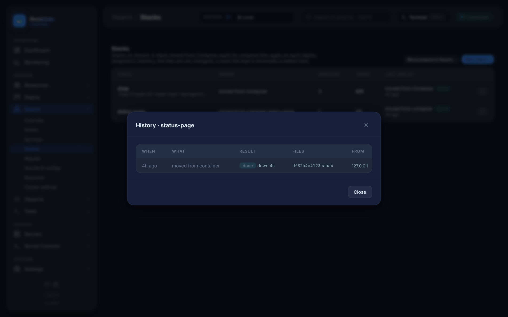
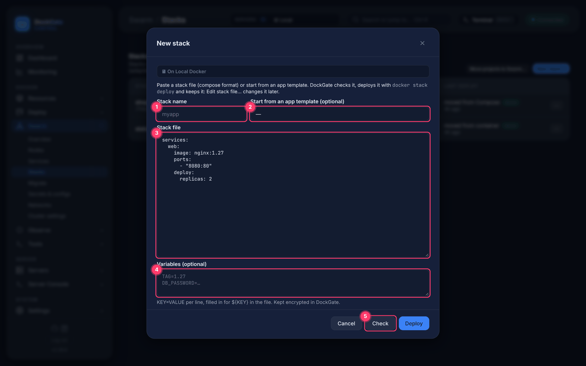

# Swarm → Stacks and Migrate

> **Where:** sidebar **Swarm → Stacks** and **Swarm → Migrate**
>
> **Works on:** the server picked in the top bar (**SERVERS ▾**). Swarm must be active and that server must be a manager.

A **stack** is a group of Swarm services deployed together from one compose-format file (`docker stack deploy`).
DockGate can make a stack in four ways:

| From | Where | What happens to the original |
|---|---|---|
| A Compose project | **Migrate** (or **Deploy → Compose stacks → Move to Swarm…**) | `docker compose down`, volumes stay; the compose files are never changed |
| Part of a Compose project | **Migrate**, project marked *Part can move* | only the moving services stop; the rest keep running in Compose |
| A `docker run` container | **Migrate → Containers started with docker run** | the container is stopped and **kept** (restart policy set to `no`) |
| A stack file you write | **Stacks → New stack…** | — |

Every move can be undone: **Stacks → ⋯ → Move back to Compose…** (also in the project's ⋯ menu on **Deploy → Compose stacks**) or **Move back to the container…**.

---

## Migrate

1. **Pick** one or more projects. Projects marked *Not possible* can not be picked.
2. **Status** of each project after DockGate read its compose files:

   | Status | Meaning |
   |---|---|
   | **Ready** | nothing to change |
   | **Attention** | it can move, but read the notes first (a `build:` image, a database kept at 1 replica, `depends_on` conditions…) |
   | **Part can move** | some services can not run on Swarm (`privileged`, `devices`, `network_mode`). The others move to a stack named *project*`-swarm`; the rest stay in Compose and are joined to the stack network, so names still resolve |
   | **Not possible** | no service can move, or DockGate can not find the compose file |

3. **What changes** opens the list of notes for each service.
4. **Review…** opens the move dialog.
5. **Move to Swarm…** next to a container started with `docker run` (see [Move a container](#move-a-docker-run-container)).

### The move dialog

**Step 1 — Settings.** Safe defaults are filled in; change them per service if you need to.

| Column | Choices | Notes |
|---|---|---|
| **Replicas** | 0–100 (default 1) | Databases are always 1 (postgres, mysql, mariadb, mongo, redis, elasticsearch, rabbitmq, minio and similar images). |
| **Ports** | `ingress` — every server answers · `host` — the real client IP | With `host`, only one task per server can use the port. On a single server keep 1 replica for such a service. |
| **Updates** | `start-first` (no downtime) · `stop-first` | A service with a volume or bind mount is always `stop-first`, so two copies never write the same data. |

A port that was only on `127.0.0.1` in the compose file gets its own choice: **inside only — not published** (default; other services reach it by name) or **this server only (host mode)**. Swarm can not bind an address, so without this choice such a port would open on every server.

**Step 2 — Plan.** DockGate builds the Swarm version of each project and shows it before anything happens.

The plan lists every service with its replicas, ports, update order and *Changes for Swarm*, then the **volumes that stay the same** and the new **overlay network**.

### What changes for Swarm

Nothing in the compose file is dropped silently. Each field is turned into its Swarm form, or named in the plan:

| In the compose file | On Swarm |
|---|---|
| `mem_limit`, `mem_reservation`, `cpus`, `cpu_quota` / `cpu_period`, `pids_limit` | `deploy.resources` limits and reservations (what `deploy:` already says wins) |
| `shm_size` | a tmpfs of that size at `/dev/shm` |
| `container_name`, `links: [db:database]` | kept as names other services reach it by (network aliases) |
| `volumes_from` | the other service's volumes are mounted too, and both stay on one server |
| `depends_on` | on the move, services start in that order: each waits until the ones it depends on run (healthy, if they have a health check) |
| `ports: "127.0.0.1:…"` | not published (inside only), or host mode on this server — your choice |
| `ports: "10.0.0.5:…"` (one address) | host mode on this server; allow it in the firewall |
| `network_mode: host` | Docker's host network (no other network, no published ports) |
| `ipv4_address` (fixed address) | dropped; reach the service by name. The plan says which services use that address in their environment |
| `restart` | the restart policy |
| `privileged`, `devices`, `network_mode: service:…` | not possible on Swarm: that service stays in Compose, the rest move |
| `cpu_shares`, `cpuset`, `security_opt`, `pid`, `ipc`… | Swarm has no place for them: named in the plan as left out |

### Projects that share a network

Several projects often talk over one network made with `docker network create web` and declared `external: true` in each compose file (nginx, landing, frontend, app, api…). That network is a local bridge, and a stack can not join it.

DockGate makes its **Swarm twin**, an attachable overlay `web-swarm`:

- the moved services join `web-swarm` instead of `web`;
- the containers still in Compose on `web` are connected to `web-swarm` too, by their service and container names, so both sides keep finding each other by name. Nothing stops;
- if Compose re-creates one of them, DockGate connects it again within 30 seconds;
- a project moved back to Compose joins the twin again.

So the projects can move **one at a time**. Move the one that publishes the ports (nginx) last.

### What happens when you press Move

One project at a time:

1. The compose files are read again. **If they changed since the plan, that project is not moved** — review it again.
2. A shared network gets its Swarm twin (see above), and the containers still in Compose join it.
3. `docker compose down` — volumes stay.
4. `docker stack deploy` under the same name, in the order of `depends_on`.
5. Every service must run its replicas and **stay up for 30 seconds**.
6. If it does not, DockGate puts it back by itself: the stack is removed and `docker compose up -d` runs.

The project is **down from step 3 until its services run on Swarm** — usually 10–60 seconds.
A live log of each step opens while the job runs. Only one Swarm job runs at a time.

> **Data is kept.** Volumes keep their names (`<project>_<volume>`), so the stack uses the same data.
> On several servers, services with data get a placement rule that keeps them on this server.

### Move a `docker run` container

**Move to Swarm…** writes a stack file from the container (image, command, environment, ports, volumes, restart policy) and opens it so you can check it. Then:

- the container is stopped and kept, its restart policy set to `no`;
- the stack is deployed;
- if the service does not come up, the container is started again.

Containers that belong to a Compose project are not listed here — move the project instead.

---

## Build & push (services built from source)

A service with `build:` runs on Swarm only from an image: Swarm does not build, and on **several servers** every server must pull it from a registry. When the project has such services, the plan shows **Build & push** with the registry logins from **Deploy → Registries**:

- **Do not push** — the image Compose built on this server is used (fine with one server).
- **A registry** — on the move DockGate runs `docker compose build <service>` (your Dockerfile, context and build args), tags the image `<registry>/<project>-<service>:<time>` (for Docker Hub `<user>/<project>-<service>:<time>`), pushes it with the stored login, and the stack uses that tag. The build runs **before** anything stops, so it does not add to the downtime.

The choice is kept with the stack: every **Redeploy** builds and pushes again, so the servers run what the files say now (the registry keeps the earlier tags — **Redeploy → an earlier deploy** goes back to one). The servers pull with the same login (`--with-registry-auth`). Your compose files are not changed.

## Protected as before

Before a service moves, DockGate compares how it is protected in Compose with how it will be on Swarm, field by field: the user it runs as, a read-only file system, `no-new-privileges`, seccomp and AppArmor, the capabilities it drops and adds, privileged, the host PID / IPC namespace, the user namespace, whether its mounts are read-only, and where its ports can be reached.

| Verdict | Meaning |
|---|---|
| same | Nothing changes |
| changed | Different, not weaker — e.g. more isolated, or an ingress port that every server of the cluster answers on |
| **weaker** | Less protected on Swarm — e.g. a port tied to one address would be open on all of them, a custom AppArmor profile would be replaced by Docker's default |

- **Kept for you:** stack files drop `security_opt`. DockGate sets `no-new-privileges`, the seccomp profile (also your own file) and AppArmor *unconfined* on the Swarm service itself (Docker 25 or newer), and sets them again on every **Redeploy**. The plan says *kept on Swarm: …*.
- **A weaker service stays in Compose** by default. In the plan it shows what would be weaker, and a **Move anyway — less protected on Swarm** box. Ticking it moves the service; the choice is written to the audit log.
- **Checked after the move:** each Swarm task is compared with the Compose container it replaced. Weaker than the plan said, or `nginx -t` failing in an nginx task, puts the project back in Compose at once (the stack is removed, `docker compose up -d` runs). An image that was pulled again is noted.
- **Move back** compares the other way and reports, in its log and the audit log, anything the services had on Swarm and lost in Compose. Nothing is undone: your compose files decide.

## Stacks

1. **Move projects to Swarm…** — opens Migrate.
2. **New stack…** — write or paste a stack file (see below).
3. **Origin** — *moved from Compose*, *moved from container …*, *stack file in DockGate*, or *deployed outside DockGate*.
4. **Last deploy** — what the last deploy was and how it ended (`done`, `running`, `failed`).
5. **⋯** — the actions for this stack.

### Actions (⋯)

| Action | Shown for | What it does |
|---|---|---|
| **Redeploy** | stacks DockGate manages | Reads the compose files again and runs `docker stack deploy --prune`. Changed services update one task at a time and roll back by themselves if a new task fails; services removed from the files are removed. |
| **Edit stack file…** | stacks with a file kept in DockGate | Opens the file; **Save and deploy** deploys it. |
| **Swarm settings…** | stacks moved from Compose | Replicas, port mode and update order per service. Saved in DockGate (not in the compose file) and used by every later deploy. |
| **Take over…** | stacks deployed outside DockGate | DockGate writes a stack file from the running services for you to check. Nothing is deployed; afterwards Redeploy and Edit work. |
| **History** | all | Every deploy: when, what, result, downtime, file hash, source IP. **Deploy this again…** deploys the stored stack file of an earlier successful deploy. |
| **Services** | all | Opens Swarm → Services. |
| **Move back to Compose…** | stacks moved from Compose | Removes the stack, waits until its network is gone, then runs `docker compose up -d` in the project folder. Down for about 20–60 s. |
| **Move back to the container…** | stacks moved from a container | Removes the stack, gives the container its restart policy back and starts it. |
| **Remove…** | all | Removes the services and networks. **Volumes, secrets and configs stay**; compose files are not touched. You type the stack name to confirm. |

### New stack

1. **Stack name** — lower-case letters, digits, `-` or `_`. It becomes the start of every service name.
2. **Start from an app template** (optional) — fills the file from the template. Swarm ignores `container_name` and `build`.
3. **Stack file** — compose format.
4. **Variables** (optional) — `KEY=VALUE`, one per line, filled in for `${KEY}` in the file. Stored encrypted.
5. **Check** validates the file without deploying. **Deploy** checks, deploys and keeps the file for later edits.

---

## Good to know

- **Remote servers.** When the server in the top bar is a remote SSH host, `docker stack deploy` runs on that server over the SSH session (password, key, or key with passphrase all work).
- **While part of a project runs on Swarm,** **Compose Up** for that project is refused, because it would start the moved services twice.
- **Swarm does not build.** A service with `build:` uses the image Compose already built (on one server), or must have an `image:` in a registry (on several servers).
- **`depends_on` conditions are ignored by Swarm.** Services start without waiting, so the app must retry its connections.
- **Ignored keys.** Swarm ignores `security_opt`, `pid`, `ipc`, `links`, `mem_limit`, `shm_size`, `volumes_from` and a few others; DockGate lists them under *What changes*.
- **Files inside a task are temporary.** Anything written inside a task (not in a volume) is lost when Swarm replaces the task.

---

## Errors and fixes

| You see | Why | What to do |
|---|---|---|
| `A network <name>-swarm already exists and is not an overlay — rename or remove it first` | The name of the Swarm twin is taken | Rename or remove that network, then move again |
| `<service> failed while starting: …` / `not running (healthy) in time: …` | A service others depend on did not start (or never became healthy) | Fix that service; the project is put back in Compose |
| `Swarm must be active and the server in use a manager` | Swarm is off on this server, or it is a worker | Set up Swarm in **Swarm → Overview**, or pick a manager in the top bar |
| `A Swarm job is already running` | Only one move/deploy runs at a time | Wait for the open job to finish |
| `the compose files changed after the plan was made — review it again` | Files edited between Review and Move | Open **Review…** again |
| `a stack named <name> already exists` | A stack with the project name is already on Swarm | Remove or rename that stack first |
| `already runs on Swarm` | The project was moved already | See it in **Stacks** |
| `DockGate can not find the compose file of this project (started with docker run, or the file is gone).` | The compose labels point to a missing file | Restore the file, or move the containers one by one under *Containers started with docker run* |
| `docker compose config failed: …` | The compose file has an error | Fix the file; the text after the colon is from Docker |
| `build: without image and no built image <name> here — build it first (Compose → Build)` | Swarm can not build | Build the project once in Compose, or add `image:` |
| `privileged: Swarm services can not be privileged …` / `devices: …` / `network_mode: … is not possible on Swarm` | Swarm does not support these | That service stays in Compose (*Part can move*) |
| `a task can not be placed: …` | No server meets the service's needs (memory, placement, port in `host` mode already used) | Lower replicas, use `ingress` ports, or add a server |
| `not running in time: web 0/2, …` | Services did not reach their replicas in 3 minutes | Open the service's **Logs**; the project was put back in Compose |
| `a task of <service> failed: …` / `a task stopped while watching: …` | A task crashed during the 30-second watch | Check the service logs; the project was put back |
| `The stack network was not removed in 2 minutes — tasks may still be shutting down` | Move back waited for the old network | Try **Move back** again in a minute |
| `Name: lower-case letters, digits, - or _ (it starts the service names)` | Invalid stack name | Use e.g. `my-app` |
| `A compose project named <name> runs on this server — choose another name, or move that project with Migrate` | Name clash with a Compose project | Pick another name |
| `The stack file is not valid: …` | `docker stack config` rejected the file | Use **Check**; the text after the colon says where |
| `Variables: "<line>" is not KEY=VALUE` | A line in Variables has no `=` | One `KEY=VALUE` per line |
| `This stack is deployed from its compose files — use Redeploy` | Edit was tried on a stack moved from Compose | Change the compose files, then Redeploy |
| `This container belongs to a compose project — move the project with Migrate` | Container move used on a Compose container | Use Migrate for the project |
| `The container <name> is gone — remove the stack instead, or keep it on Swarm` | Move back to the container, but the container was deleted | Keep the stack, or remove it |
| `Job not found (DockGate restarted?)` | DockGate restarted while a job ran | Check **History** for the result |
| `less protected on Swarm — published ports: 10.0.0.5:8080/tcp → 0.0.0.0:8080/tcp …` | A port tied to one address; Swarm can not bind an address | Keep it in Compose, or tick *Move anyway* and allow the port only from that network in the firewall |
| `less protected on Swarm — AppArmor: custom → default` | A custom AppArmor profile; Swarm has only Docker's default | Keep it in Compose, or *Move anyway* |
| `security_opt: this Docker is older than 25 (API 1.44) …` | DockGate can not put no-new-privileges / seccomp back on the service | Update Docker on the managers, or *Move anyway* |
| `nothing moves — every service would be less protected on Swarm` | Every service is weaker and none was ticked | Tick *Move anyway* for the ones that may move |
| `less protected on Swarm than planned — …` (the project is put back) | A Swarm task came up weaker than the plan said | Read the field named; nothing changed in Compose |
| `build: without image — on several servers the image must be in a registry: choose one under "Build & push"` | A built service on a cluster of several servers | Choose a registry under Build & push (add the login in Deploy → Registries first) |
| `That registry login is no longer in Deploy → Registries` | The login chosen for the stack was removed | Add it again, then Redeploy with Build & push set |
| Push fails: `denied` / `unauthorized` | The login can not push to that repository | Check the login in Deploy → Registries → Test |
