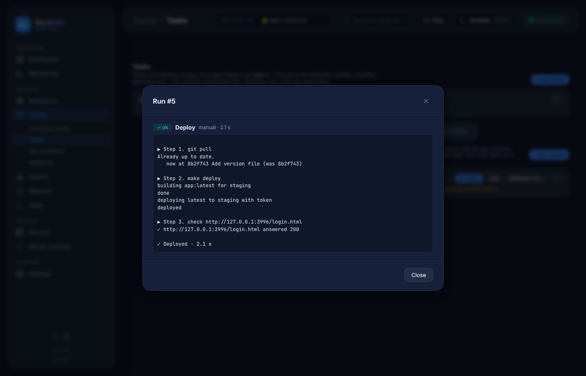

# Deploy → Tasks

> **Where:** sidebar **Deploy → Tasks** (or a Compose project's **⋯ → Tasks and deploy recipes**)
>
> **Works on:** the **SSH server** picked in the top bar (**SERVERS ▾**). Tasks run on that server, in the project folder, as the SSH user — or as root with `sudo -n`.

Most projects already say how they are built and deployed: a `Makefile`, a `deploy.sh`, a `justfile`, npm scripts. **Tasks** reads those files, lists what is in them, and runs them with a live log — and **deploy recipes** put them together into a deploy that pulls the code, runs your tasks, checks the app and goes back when something fails. A recipe can run by hand, on a schedule, on a push to **GitHub, GitLab or Bitbucket**, or from your CI.


## Project folders

The list on the left holds the **Compose projects** of the server (their folder) and the folders you add with **+ Add folder** (for example `/srv/myapp`). Removing a folder from the list never touches its files.

The top of a project shows its Git branch, the last commit and how many files are changed, the compose files, and the runs still going.

## What DockGate finds

The files are **read**, not run — finding the tasks never executes anything.

| File | Tasks | Description from |
|---|---|---|
| `Makefile` / `makefile` / `GNUmakefile` | targets (not `.PHONY`, pattern `%` or file targets) | `target: ## text` or a `# text` line above it; `VAR ?= value` variables can be changed when you run it |
| `justfile` | recipes (not `_private` or `[private]`) | a `# text` line above, or `[doc('…')]`; parameters asked when they have no default |
| `Taskfile.yml` | tasks (not `internal: true`) | `desc:` or `summary:` |
| `package.json` | `scripts` | the command; run with **npm, pnpm, yarn or bun** — found from the lock file |
| `*.sh` (the folder and up to 3 levels below; not `node_modules`, `.git`, `vendor`, `.venv`) | each script | its first comment lines |
| Ansible (`*.yml` in the folder, `playbooks/`, `ansible/` — files with `- hosts:` or `- import_playbook:`) | playbooks | with the inventory (`inventory`, `inventory.ini`, `hosts`, `hosts.ini`, `ansible/inventory`, `inventory/hosts`) when there is one |
| Kamal (`config/deploy.yml`) | deploy, redeploy, rollback, app details, app logs | — |

A warning shows when the tool (`make`, `just`, `task`, `pnpm`…) is not installed on the server for the SSH user.

## Running a task

| | |
|---|---|
| **▶ Run** | runs it at once and opens the live log |
| **Dry run** | shows what it would do: `make -n`, `just --dry-run`, `task --dry`, the npm script's command, `bash -n` and the script itself, `ansible-playbook --check --diff` (Kamal has none) |
| **Options…** | variables (`make deploy TAG=v1.2 ENV=prod`), just parameters, extra arguments, **run as root**, a time limit, dry run |
| **⋯ → Run a command…** | any command in the folder, with the same log, env and history |

- Names that sound like they change things — *deploy, prod, release, migrate, rollback, destroy, drop, clean, reset, delete, down, restore…* — are marked **asks first** and ask before they run.
- **One at a time per folder:** while something runs in a folder, another Run there is refused (and opens the running one); dry runs are always allowed.
- **■ Cancel run** stops the whole process group (what `make` started too), first with TERM, then KILL.
- The command runs with a **login shell** (`bash -l`), so the PATH of the SSH user is there (nvm, asdf, ~/.local/bin).
- **Runs** lists every run of the folder — what, how it started (manual, schedule, webhook, CI), the result and the time — with its log (the last 400 KB of each, the last 300 runs per folder).



## Env & secrets

Variables given to every task and recipe step of the folder. They are stored **encrypted** in DockGate; for a run they are written to a file only the SSH user can read, loaded, and the file is deleted before your command starts. Values marked **secret** are never shown again and are replaced by `••••` in the logs.

## Deploy recipes

A recipe is the steps of a deploy, in order; the first step that fails stops it.


| Step | What it does |
|---|---|
| **Git pull** | `git pull --ff-only` (or fetch + checkout + pull of a branch); the log shows the commit before and after |
| **A task of the folder** | a Makefile target, just recipe, npm script, script… with its variables and arguments |
| **Command** | any bash line |
| **docker compose up** | `docker compose up -d --remove-orphans` — with `--build`, and `pull` first if you tick it |
| **Check a URL** | asks the URL **from the server** until it answers well (200–399 or the status you set, optionally containing a text), N tries every N seconds |
| **Wait until a container is healthy** | its health check says *healthy* (or it runs, when it has none) |
| **Wait** | N seconds |
| **Back to the commit before the pull** | recovery only — `git reset --hard` to the commit of before this run's Git pull |

- **If it fails — recovery steps** run after a failed step: go back to the commit before, then `docker compose up --build` or your own `make rollback`.
- Each step can run as **root** (sudo -n). Each has the recipe's time limit.
- **Start from the usual recipe** fills in: Git pull → your `make deploy` / `just deploy` / `deploy.sh` (or docker compose up) → check a URL → if it fails, back to the commit before.
- **Servers:** tick several SSH servers and the recipe runs on each, one after another, in the same folder; it stops at the first server that fails unless you choose to go on.
- **Schedule:** a time of day, days of the week… (server time of DockGate's Settings timezone).
- **Alerts:** when a deploy fails (on by default) and when it works — through the channels of Settings → Notifications.
- While a recipe runs, **Uptime alerts of that server stay quiet**, as during Compose deploys.

## Webhooks — GitHub, GitLab, Bitbucket and CI

**Webhook / CI…** on a recipe turns on a **URL and a secret** for it:

```
https://dockgate.example.com/api/hooks/deploy/<id>
```


Every request is checked before anything runs:

| Sender | How it is checked | Event that deploys |
|---|---|---|
| **GitHub** (and Gitea / Forgejo) | `X-Hub-Signature-256` — HMAC-SHA256 of the body with the secret | `push` to a branch (the `ping` when you add the webhook is answered) |
| **GitLab** (gitlab.com or your own) | `X-Gitlab-Token` equals the secret | `Push Hook` |
| **Bitbucket Cloud** | `X-Hub-Signature` — HMAC-SHA256 | `repo:push` |
| **Bitbucket Server / Data Center** | `X-Hub-Signature` — HMAC-SHA256 | `repo:refs_changed` |
| **CI** (GitHub Actions, GitLab CI, Bitbucket Pipelines, Jenkins…) | `Authorization: Bearer <secret>` | any POST, with `{"branch": "...", "commit": "...", "author": "..."}` if you like |

- A wrong signature or token gets **401** and is written to the audit log; tags, deleted branches and other events are answered and skipped.
- **Only these branches:** `main`, or `main, release/*` — a push to another branch is skipped.
- The run's log starts with who pushed what: *Triggered by webhook:github — ann: main 8b2f743 "Add version file"*.
- The dialog has the steps for each provider and ready **GitHub Actions / GitLab CI / Bitbucket Pipelines** snippets. Calling from CI means the deploy runs only after your tests pass.
- **New secret** makes a new URL and secret (the old ones stop at once); **Turn the webhook off** removes them.

### The result on the commit

Give a token under **Show the result on the commit** and DockGate marks the pushed commit **pending → success / failed** as *DockGate deploy*:

| Provider | Token |
|---|---|
| GitHub | fine-grained token, **Commit statuses: Read and write** on the repository (or a classic token with `repo:status`) |
| GitLab | project access token with the **api** scope, role Developer |
| Bitbucket Cloud | `username:app-password` (Repositories: Read) or a repository access token (Repositories: Write) |
| Bitbucket Server / DC | HTTP access token with repository read |

### DockGate must be reachable

GitHub.com, GitLab.com and Bitbucket Cloud call DockGate from the internet: DockGate needs a **public HTTPS address** (a domain with a reverse proxy, or a tunnel such as Cloudflare Tunnel). The dialog warns when you opened DockGate on `localhost` or a local address. A self-hosted GitLab / Bitbucket or a CI runner on the same network can use a local address.

## Templates

Starting files for a folder that has none: a **Makefile** (help, pull, build, up, deploy, logs, ps, down), a **deploy.sh** (pull, build, up, health check, roll back on failure) and a **justfile**. A file that exists is not overwritten unless you say so; edit it afterwards in Files.

## Compose Git webhook

The **Auto-deploy webhook** of a Compose project deployed from Git (Compose → Services and details) now works: it was behind DockGate's login and answered 401 to GitHub. It is checked by its own key, as before.

## Troubleshooting

| Message | Why | What to do |
|---|---|---|
| *Tasks run on SSH servers* | The top bar shows the local server | Pick an SSH server |
| *The folder … is not on the server* | Wrong path, or the SSH user can not open it | Check the path in Files |
| *Something runs in this folder already* | One run at a time per folder | Wait, or open it and ■ Cancel |
| *sudo: a password is required* | Run as root needs sudo without a password | Add a sudoers rule for the SSH user, or run as the user |
| *make: command not found* | The tool is not installed for the SSH user | Install it (Server Console → Setup or the package manager) |
| *There is no tracking information for the current branch* (Git pull) | The clone has no upstream | Set a branch in the Git pull step, or `git branch -u origin/main` |
| Webhook: GitHub shows a red ✗ / 401 | Wrong secret, or the content type is form | Copy the secret again; content type **application/json** |
| Webhook: nothing arrives | DockGate is not reachable from the internet | Use its public HTTPS address |
| Webhook: *skipped — branch dev* | Branch filter | Change **Only these branches** |
