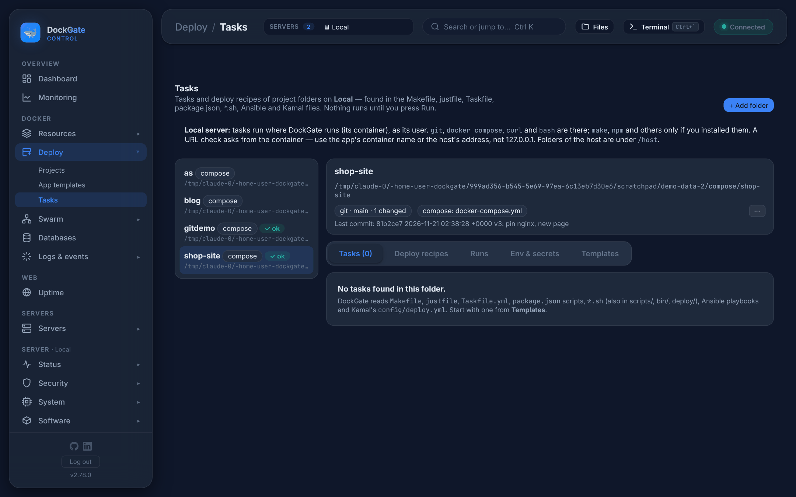
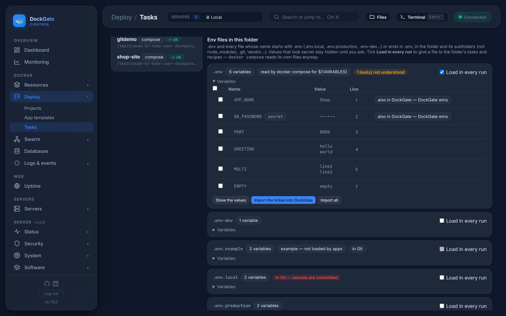
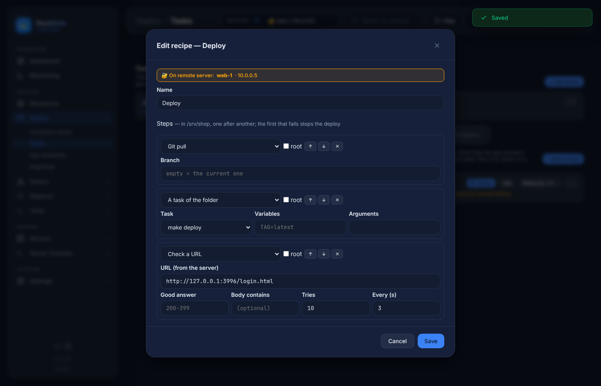
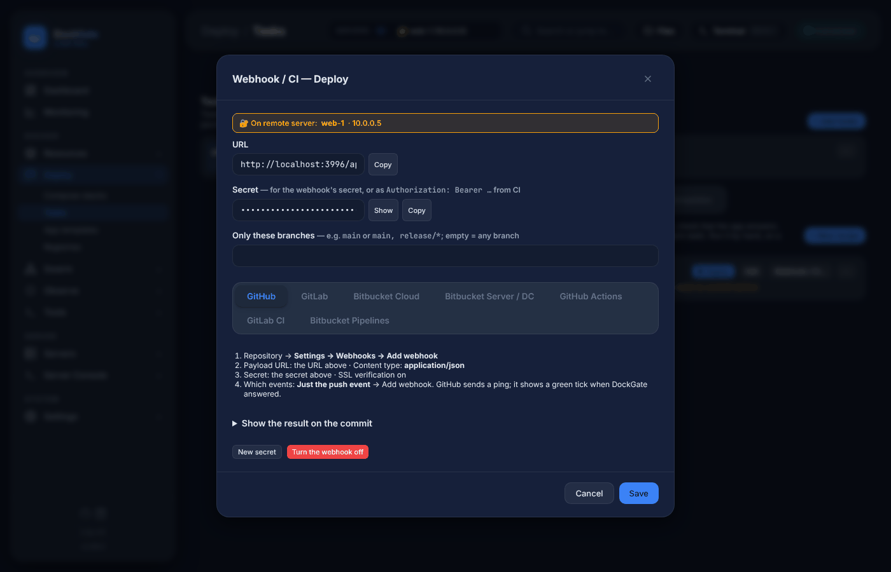

# Deploy > Tasks

> **Where:** sidebar **Deploy > Tasks** (or a Compose stack's page -> **Automation**)
>
> **Works on:** the server picked in the top bar (**SERVERS ▾**). On an **SSH server** tasks run there, in the project folder, as the SSH user - or as root with `sudo -n`. On the **local server** they run where DockGate runs - see [On the local server](#on-the-local-server).

Most projects already say how they are built and deployed: a `Makefile`, a `deploy.sh`, a `justfile`, npm scripts. **Tasks** reads those files, lists what is in them, and runs them with a live log - and **deploy recipes** put them together into a deploy that pulls the code, runs your tasks, checks the app and goes back when something fails. A recipe can run by hand, on a schedule, on a push to **GitHub, GitLab or Bitbucket**, or from your CI.



## On the local server

On the local server, tasks and recipes run where DockGate runs (its container), as DockGate's user - there is no *run as root*. In the usual setup that user **is root inside the container**, with the Docker socket: a task can do anything DockGate can (start, stop and remove containers, change the folders shared with it). Only people who may administer the server should have a DockGate login.

- `git`, `docker compose`, `curl` and `bash` are there, so the usual deploy works: **Git pull -> docker compose up > Check a URL -> back to the commit before**.
- `make`, `npm`, `just` and the others only if you installed them in DockGate's image; DockGate warns when a tool is missing.
- The folders are DockGate's: the stacks it deployed (its data folder) and the host folders you shared with it under `/host`. A stack started outside DockGate whose folder is not shared can not run tasks here.
- **Check a URL** asks from the container: `127.0.0.1` is DockGate itself. Use the app's container name (on a shared network) or the host's address. **Start from the usual recipe** leaves the URL check out on the local server - add one with the right address.

## Project folders

The list on the left holds the **Compose projects** of the server (their folder) and the folders you add with **+ Add folder** (for example `/srv/myapp`). Removing a folder from the list never touches its files.

The top of a project shows its Git branch, the last commit and how many files are changed, the compose files, and the runs still going.

## What DockGate finds

The files are **read**, not run - finding the tasks never executes anything.

| File | Tasks | Description from |
|---|---|---|
| `Makefile` / `makefile` / `GNUmakefile` | targets (not `.PHONY`, pattern `%` or file targets) | `target: ## text` or a `# text` line above it; `VAR ?= value` variables can be changed when you run it |
| `justfile` | recipes (not `_private` or `[private]`) | a `# text` line above, or `[doc('...')]`; parameters asked when they have no default |
| `Taskfile.yml` | tasks (not `internal: true`) | `desc:` or `summary:` |
| `package.json` | `scripts` | the command; run with **npm, pnpm, yarn or bun** - found from the lock file |
| `*.sh` (the folder and up to 3 levels below; not `node_modules`, `.git`, `vendor`, `.venv`) | each script | its first comment lines |
| Ansible (`*.yml` in the folder, `playbooks/`, `ansible/` - files with `- hosts:` or `- import_playbook:`) | playbooks | with the inventory (`inventory`, `inventory.ini`, `hosts`, `hosts.ini`, `ansible/inventory`, `inventory/hosts`) when there is one |
| Kamal (`config/deploy.yml`) | deploy, redeploy, rollback, app details, app logs | - (**rollback** asks for the version: DockGate lists the versions still on the servers from `kamal app containers`) |

A warning shows when the tool (`make`, `just`, `task`, `pnpm`...) is not installed on the server for the SSH user.

## Running a task

| | |
|---|---|
| **▶ Run** | runs it at once and opens the live log |
| **Dry run** | shows what it would do: `make -n`, `just --dry-run`, `task --dry`, the npm script's command, `bash -n` and the script itself, `ansible-playbook --check --diff` (Kamal has none) |
| **Options...** | variables (`make deploy TAG=v1.2 ENV=prod`), just parameters, extra arguments, **run as root**, a time limit, dry run |
| **⋯ > Run a command...** | any command in the folder, with the same log, env and history |

- Names that sound like they change things - *deploy, prod, release, migrate, rollback, destroy, drop, clean, reset, delete, down, restore...* - are marked **asks first** and ask before they run.
- **One at a time per folder:** while something runs in a folder, another Run there is refused (and opens the running one); dry runs are always allowed.
- **■ Cancel run** stops the whole process group (what `make` started too), first with TERM, then KILL.
- The command runs with a **login shell** (`bash -l`), so the PATH of the SSH user is there (nvm, asdf, ~/.local/bin).
- **Runs** lists every run of the folder - what, how it started (manual, schedule, webhook, CI), the result and the time - with its log (the last 400 KB of each, the last 300 runs per folder).


## Env & secrets

Variables given to every task and recipe step of the folder. They are stored **encrypted** in DockGate; for a run they are written to a file only the SSH user can read, loaded, and the file is deleted before your command starts. Values marked **secret** are never shown again and are replaced by `••••` in the logs.

### The folder's env files

Above DockGate's values, the tab lists **every env file of the folder**, each on its own: `.env` and every file whose name starts with `.env` (`.env.local`, `.env.production`, `.env.staging`, `.env-dev`, `.env_test`...) or ends in `.env` (`app.env`), in the folder and its subfolders up to 4 levels (not `node_modules`, `.git`, `vendor`, `.venv`, `dist`, `build`...). `.envrc` (direnv) is not an env file and is left out.



| On each file | |
|---|---|
| **Path and name** | `api/.env`, `web/app.env` - the folder is shown in grey |
| **Variables** | name, value, line. The file is read the way dotenv reads it: `export`, `'single'` (literal) and `"double"` quotes (with `\n`, and values over several lines), `# comments` after unquoted values. Lines it can not read are counted |
| **secret** | names with PASSWORD, SECRET, TOKEN, KEY, PRIVATE, AUTH, DSN, `DATABASE_URL`, `REDIS_URL`... - their values stay hidden until **Show the values** (written to the audit log) |
| **Used by** | *read by docker compose for ${VARIABLES}* (the `.env` next to a compose file) and *env_file in docker-compose.yml*. A file named in `env_file:` but missing from the folder is listed under the files |
| **in Git** | the file is tracked by Git - red when a real (not example) file with secret values is committed |
| **example** | `.env.example`, `.env.sample`, `.env.template`, `.env.dist` - shown, not loaded |
| **also in DockGate** | the same name is in DockGate's values below; in a run DockGate's value wins |

- **Import the ticked into DockGate** / **Import all** copies variables into DockGate's values (encrypted; secret-looking names marked secret). The values go from the server to DockGate directly, not through the browser.
- **Load in every run** gives the file to every task and recipe of the folder: the files in order (a later file wins), then DockGate's values on top. The run's log names the files it loaded, and secret-looking values are masked there. A file that is gone is skipped and named in the log.
- `docker compose` reads its own `.env` and `env_file:` files anyway - loading them here is for `make`, scripts, npm and the other tasks.
- A project's page -> **Settings > Environment** opens this tab for the project's folder.

## Deploy recipes

A recipe is the steps of a deploy, in order; the first step that fails stops it.



| Step | What it does |
|---|---|
| **Git pull** | `git pull --ff-only` (or fetch + checkout + pull of a branch); the log shows the commit before and after |
| **A task of the folder** | a Makefile target, just recipe, npm script, script... with its variables and arguments |
| **Command** | any bash line |
| **docker compose up** | `docker compose up -d --remove-orphans` - with `--build`, and `pull` first if you tick it |
| **Check a URL** | asks the URL **from the server** until it answers well (200–399 or the status you set, optionally containing a text), N tries every N seconds |
| **Wait until a container is healthy** | its health check says *healthy* (or it runs, when it has none) |
| **Wait** | N seconds |
| **Back to the commit before the pull** | recovery only - `git reset --hard` to the commit of before this run's Git pull |

- **If it fails - recovery steps** run after a failed step: go back to the commit before, then `docker compose up --build` or your own `make rollback`.
- Each step can run as **root** (sudo -n). Each has the recipe's time limit.
- **Start from the usual recipe** fills in: Git pull -> your `make deploy` / `just deploy` / `deploy.sh` (or docker compose up) -> check a URL -> if it fails, back to the commit before.
- **Servers:** tick several SSH servers and the recipe runs on each, one after another, in the same folder; it stops at the first server that fails unless you choose to go on. The folder's **Env & secrets** set on the recipe's server are given on every server; values set for that folder on another server win there.
- **Schedule:** a time of day, days of the week... (server time of DockGate's Settings timezone).
- **Alerts:** when a deploy fails (on by default) and when it works - through the channels of Settings > Notifications.
- While a recipe runs, **Uptime alerts of that server stay quiet**, as during Compose deploys.

### When a deploy is already running

A recipe runs once at a time. What comes in meanwhile is not lost:

| From | What happens |
|---|---|
| a push (webhook) or CI | it **waits** and starts when the running deploy ends - the card shows **⏳ waiting**, the running log says *Queued*. There is one waiting place per recipe: when more pushes come, the **newest** takes it (the commit it replaces is marked *skipped* on GitHub / GitLab / Bitbucket when a token is set) - so the last commit is always deployed, once |
| **▶ Deploy** by hand | DockGate asks: **Open its log**, **Deploy after it** (waits like a push) or **Stop it and deploy now** (the running one is cancelled, yours starts right after) |
| the schedule | skipped for this time |

A push that waits for a *task* running in the same folder starts as soon as that task ends (checked every 30 seconds; a wait older than 6 hours is dropped).

## Webhooks - GitHub, GitLab, Bitbucket and CI

**Webhook / CI...** on a recipe turns on a **URL and a secret** for it:

```
https://dockgate.example.com/api/hooks/deploy/<id>
```



Every request is checked before anything runs:

| Sender | How it is checked | Event that deploys |
|---|---|---|
| **GitHub** (and Gitea / Forgejo) | `X-Hub-Signature-256` - HMAC-SHA256 of the body with the secret | `push` to a branch (the `ping` when you add the webhook is answered) |
| **GitLab** (gitlab.com or your own) | `X-Gitlab-Token` equals the secret | `Push Hook` |
| **Bitbucket Cloud** | `X-Hub-Signature` - HMAC-SHA256 | `repo:push` |
| **Bitbucket Server / Data Center** | `X-Hub-Signature` - HMAC-SHA256 | `repo:refs_changed` |
| **CI** (GitHub Actions, GitLab CI, Bitbucket Pipelines, Jenkins...) | `Authorization: Bearer <secret>` | any POST, with `{"branch": "...", "commit": "...", "author": "..."}` if you like |

- A wrong signature or token gets **401**; tags, deleted branches and other events are answered and skipped.
- **The same delivery twice** (a retry, or *Redeliver* in GitHub) does not deploy again - the delivery id (`X-GitHub-Delivery`, `X-Gitlab-Event-UUID`, Bitbucket's `X-Request-UUID` / `X-Request-Id`) is kept for 24 hours. **The same commit** within 2 minutes is not deployed again either; from CI, send `"force": true` to deploy it anyway.
- **Guards of the open URL:** 30 requests a minute per address (then 429); **20 wrong signatures in 10 minutes block the address for 15 minutes** - one audit entry per address and window, so the log does not fill up; bodies over 1 MB are refused (413).
- **Only these branches:** `main`, or `main, release/*` - a push to another branch is skipped.
- The run's log starts with who pushed what: *Triggered by webhook:github - ann: main 8b2f743 "Add version file"*.
- The dialog has the steps for each provider and ready **GitHub Actions / GitLab CI / Bitbucket Pipelines** snippets. Calling from CI means the deploy runs only after your tests pass.
- **New secret** makes a new URL and secret (the old ones stop at once); **Turn the webhook off** removes them.

### The result on the commit

Give a token under **Show the result on the commit** and DockGate marks the pushed commit **pending -> success / failed** as *DockGate deploy*:

| Provider | Token |
|---|---|
| GitHub | fine-grained token, **Commit statuses: Read and write** on the repository (or a classic token with `repo:status`) |
| GitLab | project access token with the **api** scope, role Developer |
| Bitbucket Cloud | `username:app-password` (Repositories: Read) or a repository access token (Repositories: Write) |
| Bitbucket Server / DC | HTTP access token with repository read |

### DockGate must be reachable

GitHub.com, GitLab.com and Bitbucket Cloud call DockGate from the internet: DockGate needs a **public HTTPS address** (a domain with a reverse proxy, or a tunnel such as Cloudflare Tunnel). The dialog warns when you opened DockGate on `localhost` or a local address. A self-hosted GitLab / Bitbucket or a CI runner on the same network can use a local address.

## A folder that is not a Git clone

The **Git pull** step needs a Git checkout. A folder that was uploaded as files can become one in place: the folder's **⋯ > Connect to Git...** - see [Connect to Git](git-connect.md). When the repository is empty, the same dialog makes the first commit from the folder and pushes it.

## Templates

Starting files for a folder that has none: a **Makefile** (help, pull, build, up, deploy, logs, ps, down), a **deploy.sh** (pull, build, up, health check, roll back on failure) and a **justfile**. A file that exists is not overwritten unless you say so; edit it afterwards in Files.

## Compose Git webhook

The **Auto-deploy webhook** of a Compose project deployed from Git (the stack's page > Automation) now works: it was behind DockGate's login and answered 401 to GitHub. It is checked by its own key, as before.

## Troubleshooting

| Message | Why | What to do |
|---|---|---|
| *The folder ... is not on the server* (local server) | The folder is on the host but not shared with DockGate | Share it under `/host`, or add the machine as an SSH server |
| *The folder ... is not on the server* | Wrong path, or the SSH user can not open it | Check the path in Files |
| *Something runs in this folder already* | One run at a time per folder | Wait, or open it and ■ Cancel |
| *sudo: a password is required* | Run as root needs sudo without a password | Add a sudoers rule for the SSH user, or run as the user |
| *make: command not found* | The tool is not installed for the SSH user | Install it (Server > Software > Setup or the package manager) |
| *There is no tracking information for the current branch* (Git pull) | The clone has no upstream | Set a branch in the Git pull step, or `git branch -u origin/main` |
| Webhook: GitHub shows a red ✗ / 401 | Wrong secret, or the content type is form | Copy the secret again; content type **application/json** |
| Webhook: nothing arrives | DockGate is not reachable from the internet | Use its public HTTPS address |
| Webhook: *skipped - branch dev* | Branch filter | Change **Only these branches** |
| Webhook: *commit ... was deployed less than 2 minutes ago* | The same commit came again | Wait, deploy by hand, or from CI send `"force": true` |
| Webhook: 429 *too many wrong signatures* | 20 wrong signatures from that address in 10 minutes | Fix the secret; the address is let in again after 15 minutes |
| *Kamal rollback needs the version* | Rollback without a version | Pick one in the Rollback dialog |
