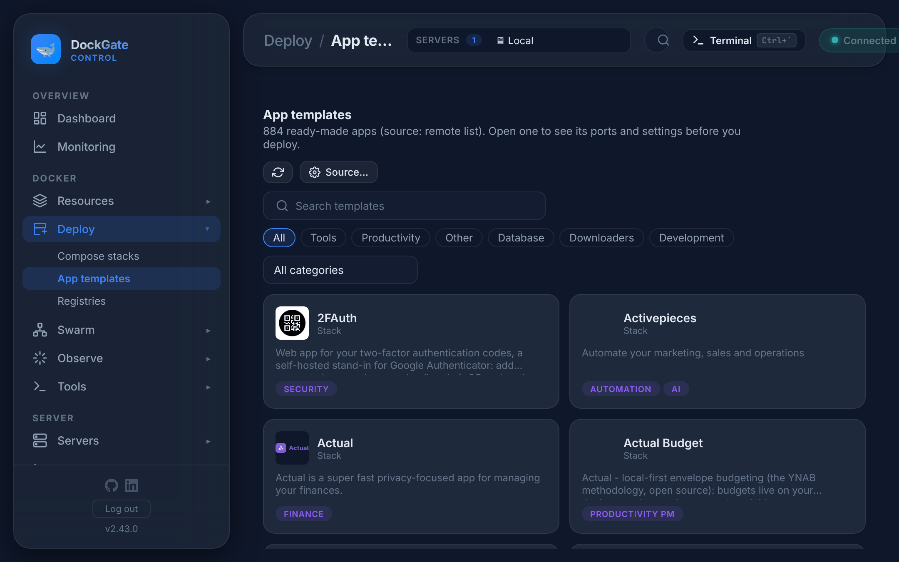
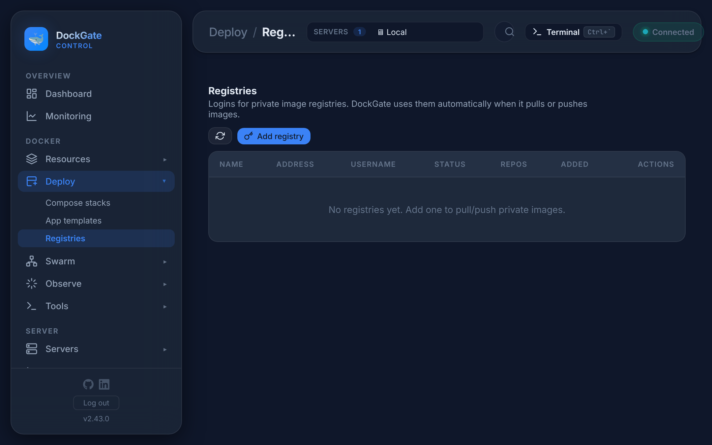

# Deploy → App templates and Registries

> **Where:** sidebar **Deploy → App templates** and **Deploy → Registries**
>
> **Works on:** the server picked in the top bar (**SERVERS ▾**).

---

## App templates

A catalog of more than 500 ready-made apps: databases, dashboards, media servers, developer tools and more.

1. **Search** by name, description or image, or filter by a chip (*Tools*, *Database*…) or a category.
2. **Open** an app to see its description, ports, volumes, environment variables and Docker Hub popularity.
3. **Deploy**:
   - a **container** template opens **Run container** (see [Containers](containers.md#run-container)) with everything filled in;
   - a **stack** template opens the Compose editor with its compose file. When Swarm is on for the server, you choose **Compose project** or **Swarm stack**.

Check the ports, passwords and volume paths before you deploy. Template defaults are a start, not a secure setup.

### Template source

**Source…** picks where the list comes from:

| Source | What it is |
|---|---|
| **Community 500+** (default) | The catalog that ships with DockGate. Works offline |
| **Portainer Official** | Portainer's own template list |
| **A URL** | Any list in the Portainer *App Templates v2* JSON format, for your own apps |

If the source can not be read, DockGate shows the bundled list and says so. **↻** reloads the list.

---

## Registries

Logins for private image registries: Docker Hub, GitHub (`ghcr.io`), GitLab, a self-hosted registry and so on. DockGate uses the matching login whenever it pulls or pushes an image, for containers, Compose, builds and Swarm.

**Add registry** asks for:

| Field | Example |
|---|---|
| **Address** | `ghcr.io`, `registry.gitlab.com`, `registry.example.com:5000`. Docker Hub: `docker.io` |
| **Username** | your user or robot account |
| **Password** | the password, or better an **access token** with only *read* (and *write*, to push) rights |

The password is stored encrypted (AES-256-GCM) and never shown again. When you edit a login, leave the password empty to keep it.

| Action | What it does |
|---|---|
| **Test login** | Logs in with the stored credential and shows the result in **Status** |
| **N repos** | Browse the repositories DockGate knows for this registry: the ones it pushed, and the ones you add by name (registries do not list all repositories). **Tags** lists the tags of one, with digest and size |
| **Edit** | Change the address, user or password |
| **Remove…** | Deletes the login. Pulling private images from that registry stops working |

## Errors and fixes

| You see | Why | What to do |
|---|---|---|
| `Templates could not be loaded` / *bundled — remote failed: …* | The template URL is wrong or unreachable | Check the URL in **Source…**, or go back to the default |
| `No compose content found for this template` | The template points to a compose file that is gone | Pick another template, or write the stack yourself |
| `Only http(s) URLs are allowed` | A template source that is not `http://` or `https://` | Use a web URL |
| `Registry address is required` / `Username is required` / `Password is required` | Empty field | Fill it in |
| `A credential for "<address>" already exists` | One login per address | Edit the existing login |
| Test login: `unauthorized` | Wrong user or token, or the token lacks rights | Make a new token with *read* rights |
| Pull: `pull access denied` / `requested access to the resource is denied` | No login for that registry, or the wrong one | Add or fix the login here |
