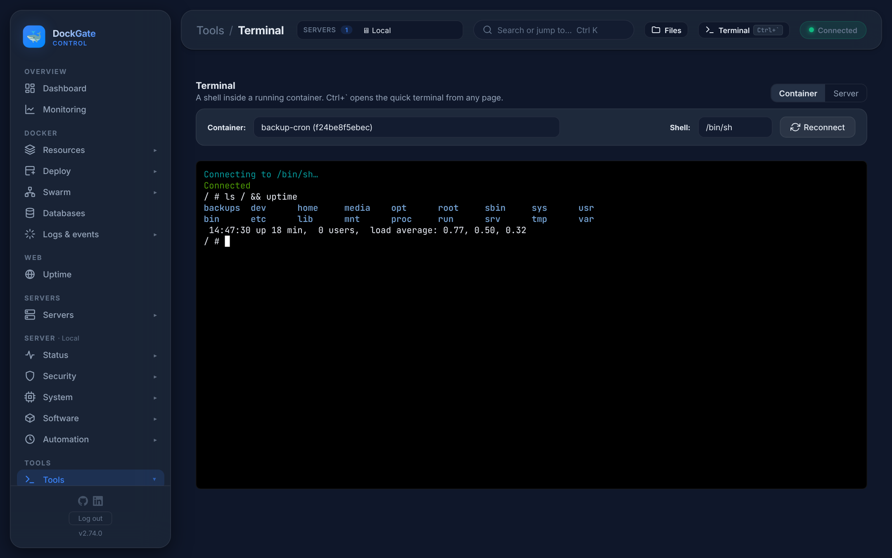

# Tools → Terminal, Files, Databases, Schedules

> **Where:** sidebar **Tools**
>
> **Works on:** the server picked in the top bar (**SERVERS ▾**).

---

## Terminal



| Tab | What you get |
|---|---|
| **Container** | A shell inside a running container. Pick the container and the shell (`/bin/sh`, `/bin/bash`…), then **Connect** |
| **Server** | A shell on the server. On a remote server it is a real SSH shell (`apt`, `systemctl`, `docker`…). On *Local* it is a shell inside the DockGate container, which has the `docker` CLI |

**Ctrl+`** opens the **quick terminal** from any page: a drawer at the bottom that keeps running while you move around. The **Terminal** button in the top bar does the same.

The default shell is set in **Settings → General → Default shell**. When a session ends, press **Reconnect**.

> Opening a container terminal is recorded in **Observe → Audit log** (`terminal_open`). What you type is not recorded.

---

## Files

**Remote server:** browse, edit, upload and download files on the server over SSH (SFTP).

**Local:** DockGate runs in a container, so it sees only the folders of this machine you share with it. Add them to the DockGate service in its `docker-compose.yml` and restart DockGate:

```yaml
    volumes:
      - /srv:/host/srv    # any folder you want to manage
```

They then appear under `/host/…`. Remote servers need nothing: pick one in the top bar.


| Action | What it does |
|---|---|
| Open a folder, **Up one level** | Move around; the path bar shows where you are |
| **New folder** / **New file** | Create in the current folder |
| **Upload** | Files or whole folders, with progress. Drop them on the page |
| **Edit** | Text files open in an editor (see below) |
| **👁 Preview** | Images (PNG, JPG, GIF, WebP, SVG, ICO…) open as a picture with their size in pixels |
| **📜 Tail** | Logs (`*.log`, files in `/var/log`) open in the log viewer and follow new lines every 3 s: search, levels, Live / Pause, Download. A log the SSH user may not read is read with sudo |
| **Permissions** | Click the `rw-r--r--` in a row: change the mode (ticks or a number like `644`) and the owner and group; for a folder, optionally everything inside too |
| **Rename** / **Delete** | One item, or tick several and **Delete selected** |
| **Download** | A file, or a folder as `.tar.gz` |
| **📦 Extract** | Unpacks `.zip`, `.tar`, `.tar.gz`, `.tar.bz2` and `.tar.xz` in place |
| **Two-pane transfer** | Your computer on one side, the server on the other: tick items and move them across |

### Places

The panel on the left jumps to:

- **Home** of the SSH user and **/**; on *Local*, the shared folders;
- folders that exist on this server: `/srv`, `/opt`, `/etc`, `/etc/nginx`, `/var/log`, `/var/www`, Docker volumes …;
- **Compose projects** of this server (their folders);
- your **Bookmarks** — ☆ bookmarks the folder you are in (kept in this browser, per server).

Deploy → Compose stacks → ⋯ → **Open folder in Files** (or the project's *Working Directory*) opens that folder in Quick Files.

### Quick Files

The **Files** button in the top bar (or **Ctrl+Shift+F**, or ⌘K → *Open quick files*) opens the same file browser in a window over any page — like the Terminal button. It works on the server picked in the top bar and switches with it.

- **—** or **Esc** minimizes it: the folder stays, and a dot on the Files button shows it is still open. Click the button to bring it back.
- **⤢** fills the screen; **Open page** goes to Tools → Files; **×** closes it.
- It opens in the folder you were last in on that server.

### The editor

| | |
|---|---|
| **Ctrl+S** (⌘S) | Save |
| **Esc** | Close — if something is not saved, DockGate asks first. A ● after the name means unsaved changes |
| **Save…** | Shows the changed lines (green added, red removed) before anything is written |
| **Versions** | The content the file had before each save from DockGate — the last 5 per file (up to 512 KB each). Pick one to compare it with the editor, then **Put it in the editor** and save. Kept encrypted in DockGate's database, not next to the file (a `default.conf.bak` in nginx's `conf.d/` would be loaded too) |

**Colours:** YAML, JSON, nginx, shell / Dockerfile and `.env` / ini files are coloured (keys, strings, numbers, comments). Files over 300 KB are shown without colours.

**Checks:**
- **System files:** `sshd_config` (`sshd -t`), `sudoers` (`visudo -c`) and `/etc/fstab` (`findmnt --verify`) are checked on the server before saving.
- **Compose files** (`docker-compose.yml`, `compose.yaml` …): **Check** — and every Save — runs `docker compose config` on what is in the editor, with the file's folder as the project folder. A mistake is shown before anything is written.
- **JSON:** Save says when the content is not valid JSON.
- **nginx** (files under `/etc/nginx/`): after Save, `nginx -t` checks the whole configuration. If nginx would not accept it, **Put the previous content back** restores the file (your edit stays under Versions). nginx keeps running with the old configuration until it is reloaded.

A save is never half written: the new content goes to a temporary file next to it, which gets the file's mode and owner, then replaces the file in one step. If the owner can not be kept (the file belongs to another user), the file is written in place, so its owner stays.

**Files of another user** (for example `/etc/nginx/nginx.conf` owned by root): DockGate offers **Open with sudo** / **Save with sudo**. This needs passwordless sudo for the SSH user — the deploy user made in Server Console → Setup has it. Owner and mode stay the same. Changing the owner (Permissions) always uses sudo on a remote server; on *Local* use numbers (uid and gid).

**Changed on the server:** if someone changed the file after you opened it, Save stops and asks: **Load theirs**, or **Save mine anyway**.

Files inside containers and volumes are edited on their own pages: **Resources → Containers →** a container **→ Files**, and **Resources → Volumes → Browse**.

---

## Databases

PostgreSQL running in containers on the server picked in the top bar — browse and edit tables, run SQL, manage users, back up and restore. A PostgreSQL container's page has **Open in Databases** too.

**How DockGate reaches it:** it runs `psql` (and `pg_dump`, `pg_restore`) **inside the container** with `docker exec`. No port is published, no tunnel, no client to install — the same on this machine and on SSH servers. It finds containers of the `postgres`, `postgis`, `timescaledb`, `pgvector`, `supabase/postgres`, `bitnami/postgresql` and similar images, and logs in as the container's `POSTGRES_USER` (or `postgres`) to its `POSTGRES_DB`. **Connection…** sets another user, login database or password (stored encrypted) — usually not needed, because inside the container the local socket trusts its users.

**Safety**

| | |
|---|---|
| **Read-only by default** | Every session runs with `default_transaction_read_only = on` until you turn on **Allow changes** (the button in the header). It is a guard against mistakes, not a permission system — the admin can always turn it on |
| **Asks first** | `DROP`, `TRUNCATE`, `ALTER … DROP`, and `DELETE` / `UPDATE` without `WHERE`. A connection marked **Production** asks before every statement that changes data |
| **Edits by primary key only** | A cell, a new row or deleted rows touch exactly the rows meant (a table without a primary key is changed with SQL) |
| **Limits** | 30 s per statement in the editor and the table view, `lock_timeout` 10 s; psql commands (`\…`) are not run |
| **Audit log** | Every change: SQL that writes, row edits, users, databases, backups, restores |

**The page:** pick the container and database on the left; tables, views, materialized views, sequences and functions are listed by schema (with a finder). On the right:

- **Data** — the table, 50–500 rows a page; click a column to sort; filters (`=`, `≠`, contains, starts with, `<`, `>`, in, is NULL…) and any `WHERE` condition; **Count rows** for the exact number; **Export** CSV or JSON lines (the whole table, streamed). With **Allow changes**: double-click a cell to edit it (or set it NULL), **+ Row**, tick rows and **Delete selected**. NULL and an empty text are told apart; big numbers stay exact.
- **Structure** — columns (type, NULL, default, identity), primary key, indexes with their size, constraints, foreign keys pointing here, triggers, a view's definition, a sequence's settings; VACUUM / ANALYZE of the table.
- **SQL** — the workbench (see below).

### SQL workbench

| | |
|---|---|
| **Editor** | Colours, line numbers, brackets that match and close, **completion** of keywords, tables and columns of the open database (`alias.` offers that table's columns; Ctrl+Space anytime), **Format** (Shift+Alt+F), Ctrl+/ comments a line. The editor loads only when the SQL tab opens |
| **Run** | **▶ Run** / Ctrl+Enter runs the statement at the cursor (or the selection); **▶▶ Run all** / Ctrl+Shift+Enter runs every statement. An error stops there and is **marked in the editor** where PostgreSQL points |
| **🧪 Test run** | Runs it inside a transaction and **always rolls back**: you see the rows it returns and how many rows it would change (`UPDATE 433`), and nothing stays. Works on a read-only connection too. It refuses statements that end a transaction or can not run in one (COMMIT, VACUUM, CREATE DATABASE, … CONCURRENTLY). Sequences that moved and effects outside the database (e.g. dblink) are not undone |
| **A session per tab** | Each tab keeps its own psql connection: `BEGIN` in one Run and the next Run is in the same transaction — the header shows **● Transaction open** with **Commit** / **Roll back** (a failed one: **Roll back**). `SET`, temp tables and cursors stay too. A tab idle for 10 minutes is closed (an open transaction rolls back); closing the tab asks first when a transaction is open |
| **Cancel** | Stops the running query (from another connection) |
| **Time limit** | 30 s, 1, 5 or 10 minutes per statement |
| **Results** | A tab per result plus **Messages** (command tags, notices, the error, timing). The first 1000 rows come back; **Load 1000 more** (up to 50 000 kept). Click a column to sort, filter the rows, double-click a cell to see all of it (JSON shown formatted); **copy** as CSV, TSV (for Excel), JSON or INSERT statements, or download |
| **📊 Explain** | **Explain** shows the plan PostgreSQL would use; **Explain analyze** runs the statement (inside a transaction that is rolled back) and shows the real time of each step as a tree — red bars take the most time, and it points out a whole table read, a row estimate that is far off, and a sort that used the disk |
| **Parameters** | Write `:name` in a query (`WHERE city = :city`); Run asks for the values and puts them in as quoted values (numbers as they are, or NULL). `::casts`, `[1:2]` and anything in quotes or comments stay as written |
| **Edit in the result** | When a query reads **one table with its primary key** (`SELECT id, name FROM customers WHERE …`), double-click a cell to change it (with Allow changes) |
| **Snippets** | Ready queries: largest tables, running queries, who blocks whom, unused indexes, tables read without an index, cache hit ratio, dead rows, connections, a read-only user, an index without blocking writes… — a click opens one in a new tab |
| **Tabs** | Kept on DockGate's side — open, rename (double-click), close; they come back on another browser too |
| **Beside the editor** | **Schema** (tables and their columns; a click puts the name in), **Snippets**, **Saved** queries (Ctrl+S / Save…, with folders and a description) and **History** (the last 500 runs with their time and result, searchable) |

Statements that change data still need **Allow changes** (or Test run), and DROP, TRUNCATE, ALTER … DROP and DELETE / UPDATE without WHERE still ask first. psql commands (a backslash outside quotes) are not run, and an unfinished text (an open quote or parenthesis) is not sent.
- **Admin** — connections used of `max_connections`, uptime and key settings; **sessions** (user, database, state, how long, the query) with **Cancel** (stop the query) and **Terminate** (close the connection); **users and roles** — **+ New user** (password, read-write or read-only access to a database, also for tables made later), **Set password…**, **Grant on a database…**, **Drop…**; **databases** — open, **+ New database** (with an owner), **Drop…** (type the name; its sessions are closed first); **tables** largest first with dead rows, last VACUUM / ANALYZE, and VACUUM ANALYZE / ANALYZE / REINDEX / VACUUM FULL; the slowest queries when the `pg_stat_statements` extension is installed.
- **Backups** — next to the database:

| | |
|---|---|
| **Back up now** | One database as `pg_dump` custom (`.dump`, compressed, a single table can be restored from it) or plain SQL (`.sql.gz`), or **the whole server** (`pg_dumpall`: every database and the users). It runs while the database is in use (a consistent snapshot) |
| **Where** | SSH server: `/var/backups/dockgate/postgres` on that server (made with sudo once, owned by the SSH user; `~/dockgate-backups/postgres` without sudo) — the dump runs there and never passes through DockGate. This machine: DockGate's data folder (`data/backups/postgres`) |
| **Names** | `<container>-<database or all>-<date-time>.dump` / `.sql.gz` — the same as Scripts' *Database backup* block, so scheduled backups show in the same list |
| **Restore…** | Always into a **new database** first (nothing that exists changes); then **Swap it in place of …** renames the current one to `<name>_before_<date>` and puts the restored one in its place (its sessions are closed for a moment). "Keep owners and grants" can be turned off when the backup's users do not exist here. A failed restore removes the new database |
| **Whole-server backup** | Restored by hand into an empty PostgreSQL (a new container) — **How to restore** shows the command |
| **Schedule…** | SSH servers: pick how often (every few hours, every day, days of the week, once a month) and the time from lists — hour 00–23 and minute 00–59, server time — or a custom cron line. Makes the script `pg-backup-<container>-<db>` in Server Console → Scripts (dump, delete files older than N days, disk check) with its Cron job, log, and alerts when it fails or does not run |
| **Download / Delete** | The file itself |

## Schedules

Jobs DockGate runs by itself on a server.


| Task | What it does |
|---|---|
| **Prune unused data** | Removes the things you tick: unused images, stopped containers, unused networks. Unused volumes are never pruned |
| **Back up a volume** | Saves the volume as a `.tar.gz` in a folder on the server and keeps the newest *N* copies (1–365, default 7) |
| **Sync Git stacks** | Pulls the chosen Git stacks (or every DockGate-managed Git stack on the server) and redeploys, only when there is a new commit |

**How often:** every hour (at a minute), every day or every week, at a time in `HH:MM`. Times are in UTC unless a timezone is set in **Settings → General → Timezone**.

The list shows each task's server, schedule, last run (with its result) and next run. Each row has an on/off switch, **Run now**, **Edit…** and **Delete…**. Deleting a task keeps the backups it made. A failed run sends the **Scheduled task failed** notification.

## Errors and fixes

| You see | Why | What to do |
|---|---|---|
| *No folder of this machine is shared with DockGate yet* | Files on *Local* with no folder shared | Add a volume under `/host` as shown above, or pick a remote server |
| `Permission denied: … belongs to another user — open it with sudo` | The SSH user may not read or write this file | **Open with sudo** / **Save with sudo**, or tick **Use sudo** in Permissions |
| `sudo asks this user for a password — DockGate needs passwordless sudo` | The SSH user has sudo only with a password | Connect with the deploy user (Server Console → Setup), or allow passwordless sudo for this user |
| *Changed on the server* | The file changed after you opened it | **Load theirs** to see it, or **Save mine anyway** |
| *✗ docker compose config* | The compose file has a mistake (the message says where) | Fix it, **Check** again |
| *nginx -t failed* | nginx would not accept the configuration | Fix it, or **Put the previous content back** |
| *nginx is not installed on this server* | nginx runs in a container, or not at all | Check it in its container |
| `Mode: 3 or 4 octal digits, e.g. 644 or 0755` | Wrong mode in Permissions | e.g. `644` for files, `755` for folders |
| `Owner and group: a user / group name or number` | Wrong owner or group | A user name like `www-data`, or a number like `33` |
| `Session expired — sign in again` | You were signed out during a transfer | Sign in and start the transfer again |
| *— session ended (press Reconnect) —* | The shell exited, or the connection dropped | **Reconnect** |
| `Time must look like 03:30` | Wrong time format | `HH:MM`, 24-hour |
| `The backup folder must be an absolute path at least two levels deep, e.g. /var/backups/dockgate` | A folder like `/` or `/backups` | Use a deeper folder |
| `Keep between 1 and 365 copies` | Value out of range | e.g. `7` |
| `Tick at least one thing to prune` | Prune task with nothing ticked | Tick images, containers or networks |
| `Choose a volume` / `Choose a server` / `Choose a day of the week` | Empty field | Fill it in |
| Databases: *Could not log in* / `password authentication failed` | The container's user needs a password over the network, or another user is wanted | **Connection…** → user / password |
| Databases: *This connection is read-only* | Statements that change data are refused until you allow them | **🔒 Read-only** → **Allow changes** |
| Databases: *psql is not in this container* | The image is not a PostgreSQL server | Pick the database container itself |
| Databases: *This table has no primary key* | Rows can not be told apart for an edit | Change it with SQL, or add a primary key |
| Databases: *The query took too long and was stopped* | Over 30 s | Add `LIMIT` / an index; long maintenance runs from the Admin tab |
| Databases: restore fails with `role … does not exist` | The backup's owners are not on this server | Restore again with **Keep owners and grants** off |
| SQL: *A test run can not hold "…"* | The statement ends a transaction or can not run in one | Use **Run** (with Allow changes) |
| SQL: *A transaction is open in this tab* | You changed the database or the time limit while a transaction is open | **Commit** or **Roll back** first |
| SQL: *The text is not complete* | An open quote, `$$` body, comment or parenthesis | Close it — psql would wait for the rest |
