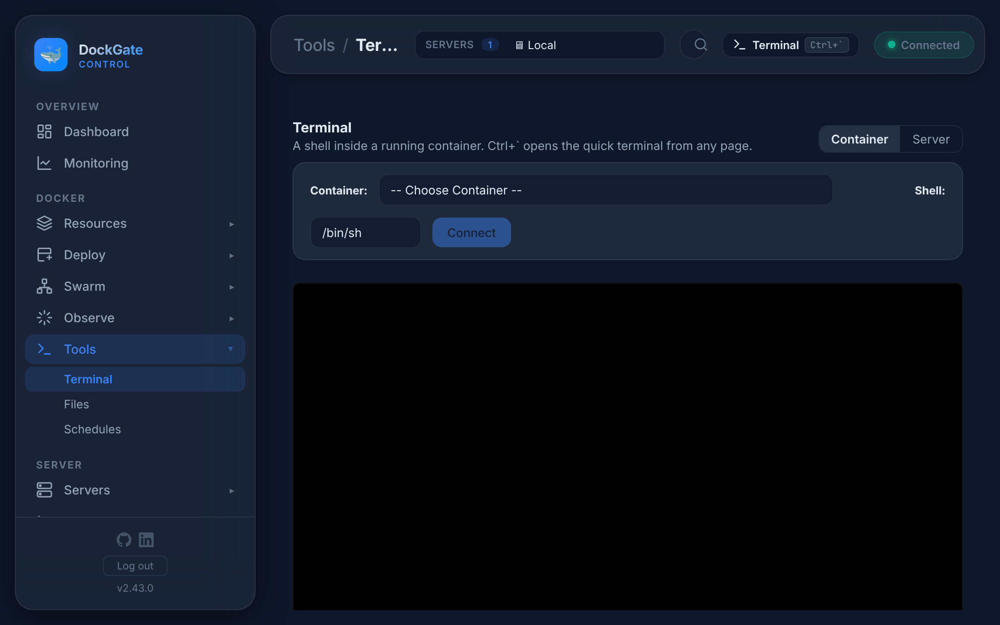
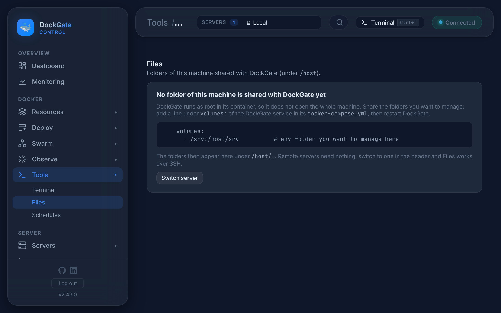
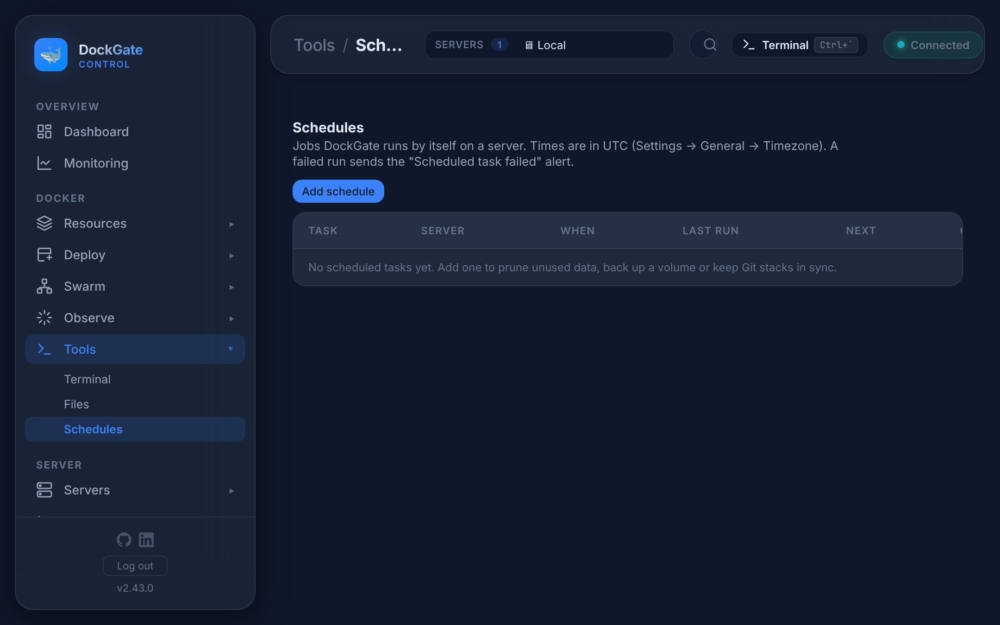

# Tools → Terminal, Files, Schedules

> **Where:** sidebar **Tools**
>
> **Works on:** the server picked in the top bar (**SERVERS ▾**).

---

## Terminal



| Tab | What you get |
|---|---|
| **Container** | A shell inside a running container. Pick the container and the shell (`/bin/sh`, `/bin/bash`…), then **Connect** |
| **Server** | A shell on the server. On a remote server it is a real SSH shell (`apt`, `systemctl`, `docker`…). On *Local* it is a shell inside the DockGate container, which has the `docker` CLI |

**Ctrl+`** opens the **quick terminal** from any page: a drawer at the bottom that keeps running while you move around. The **Terminal** button in the top bar does the same.

The default shell is set in **Settings → General → Default shell**. When a session ends, press **Reconnect**.

> Opening a container terminal is recorded in **Observe → Audit log** (`terminal_open`). What you type is not recorded.

---

## Files

**Remote server:** browse, edit, upload and download files on the server over SSH (SFTP).

**Local:** DockGate runs in a container, so it sees only the folders of this machine you share with it. Add them to the DockGate service in its `docker-compose.yml` and restart DockGate:

```yaml
    volumes:
      - /srv:/host/srv    # any folder you want to manage
```

They then appear under `/host/…`. Remote servers need nothing: pick one in the top bar.



| Action | What it does |
|---|---|
| Open a folder, **Up one level** | Move around; the path bar shows where you are |
| **New folder** / **New file** | Create in the current folder |
| **Upload** | Files or whole folders, with progress. Drop them on the page |
| **Edit** | Text files open in an editor; **Save** writes them back |
| **Rename** / **Delete** | One item, or tick several and **Delete selected** |
| **Download** | A file, or a folder as `.tar.gz` |
| **📦 Extract** | Unpacks `.zip`, `.tar`, `.tar.gz`, `.tar.bz2` and `.tar.xz` in place |
| **Two-pane transfer** | Your computer on one side, the server on the other: tick items and move them across |

Files inside containers and volumes are edited on their own pages: **Resources → Containers →** a container **→ Files**, and **Resources → Volumes → Browse**.

---

## Schedules

Jobs DockGate runs by itself on a server.



| Task | What it does |
|---|---|
| **Prune unused data** | Removes the things you tick: unused images, stopped containers, unused networks. Unused volumes are never pruned |
| **Back up a volume** | Saves the volume as a `.tar.gz` in a folder on the server and keeps the newest *N* copies (1–365, default 7) |
| **Sync Git stacks** | Pulls the chosen Git stacks (or every DockGate-managed Git stack on the server) and redeploys, only when there is a new commit |

**How often:** every hour (at a minute), every day or every week, at a time in `HH:MM`. Times are in UTC unless a timezone is set in **Settings → General → Timezone**.

The list shows each task's server, schedule, last run (with its result) and next run. Each row has an on/off switch, **Run now**, **Edit…** and **Delete…**. Deleting a task keeps the backups it made. A failed run sends the **Scheduled task failed** notification.

## Errors and fixes

| You see | Why | What to do |
|---|---|---|
| *No folder of this machine is shared with DockGate yet* | Files on *Local* with no folder shared | Add a volume under `/host` as shown above, or pick a remote server |
| `Session expired — sign in again` | You were signed out during a transfer | Sign in and start the transfer again |
| *— session ended (press Reconnect) —* | The shell exited, or the connection dropped | **Reconnect** |
| `Time must look like 03:30` | Wrong time format | `HH:MM`, 24-hour |
| `The backup folder must be an absolute path at least two levels deep, e.g. /var/backups/dockgate` | A folder like `/` or `/backups` | Use a deeper folder |
| `Keep between 1 and 365 copies` | Value out of range | e.g. `7` |
| `Tick at least one thing to prune` | Prune task with nothing ticked | Tick images, containers or networks |
| `Choose a volume` / `Choose a server` / `Choose a day of the week` | Empty field | Fill it in |
