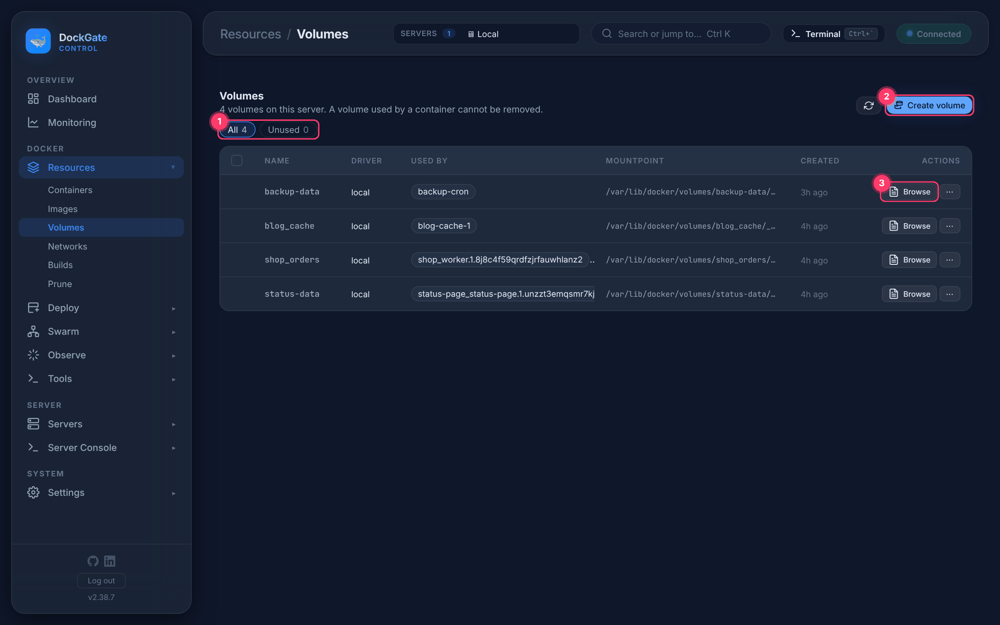
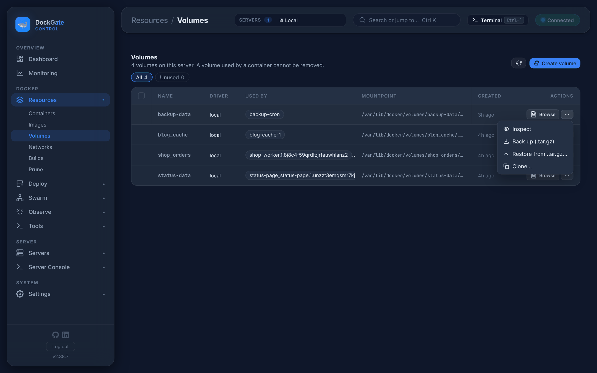

# Resources → Volumes

> **Where:** sidebar **Resources → Volumes**
>
> **Works on:** the server picked in the top bar (**SERVERS ▾**).

Named volumes hold your apps' data. Here you create, browse, edit, back up, restore and clone them.

1. **Filters:** All, Unused (no container uses it).
2. **Create volume** — name, driver (`local` by default), optional driver options (`type=nfs, o=addr=1.2.3.4, device=:/path`) and labels (`env=prod, app=web`).
3. **Browse** — the files inside the volume (see below).

**Used by** shows the containers that mount each volume. **A volume in use can not be removed**, and only unused volumes can be ticked for **Remove…**.

## Actions (⋯)

| Action | What it does |
|---|---|
| **Inspect** | Driver, mountpoint, labels, options |
| **Back up (.tar.gz)** | Downloads everything in the volume as `<name>.tar.gz` |
| **Restore from .tar.gz…** | Upload a `.tar.gz` (or `.tar`); it is **extracted over** the volume. Files with the same name are replaced; files that are not in the archive stay |
| **Clone…** | Copies all data into a **new** volume (default name `<name>-copy`). The name must not be taken |
| **Remove…** | Only for unused volumes. **Deletes the data for good.** You type the name to confirm |

## Browse and edit files

**Browse** opens the volume's folders. You can open folders, **download** a file, create a **new file or folder**, **rename**, **delete**, and **edit** text files up to 1 MB. DockGate does this with a small helper container that mounts the volume, so the volume does not need to be in use.

## Good to know

- **Back up while the app is stopped** for databases. A copy taken while a database writes can be inconsistent. Better: use the database's own dump.
- To back up volumes on a schedule, use **Tools → Schedules → Volume backup**.
- **Restore does not empty the volume first.** To get exactly the archive's content, clone or remove the old data first.
- Volumes of Swarm services stay on the server where the task runs.

## Errors and fixes

| You see | Why | What to do |
|---|---|---|
| `A volume named <name> already exists — choose another name` | Clone… to a name in use | Choose a new name |
| `Volume name: letters, digits, _ . or -, starting with a letter or digit` | Invalid name | e.g. `app-data-copy` |
| `Copying the data failed: … — the new volume was removed` | The copy stopped (disk full, unreadable files) | Free disk space and try again |
| `Restore failed (tar exited N) — use a .tar.gz or .tar file` | The file is not a tar archive | Use a file made by **Back up**, or `tar czf` |
| `The file is empty` | An empty file was picked | Pick the backup file again |
| `The folder <path> does not exist` | The folder was removed | Go back to the top folder |
| `volume is in use - [container id]` | Remove on a volume a container uses (even a stopped one) | Remove that container first |
